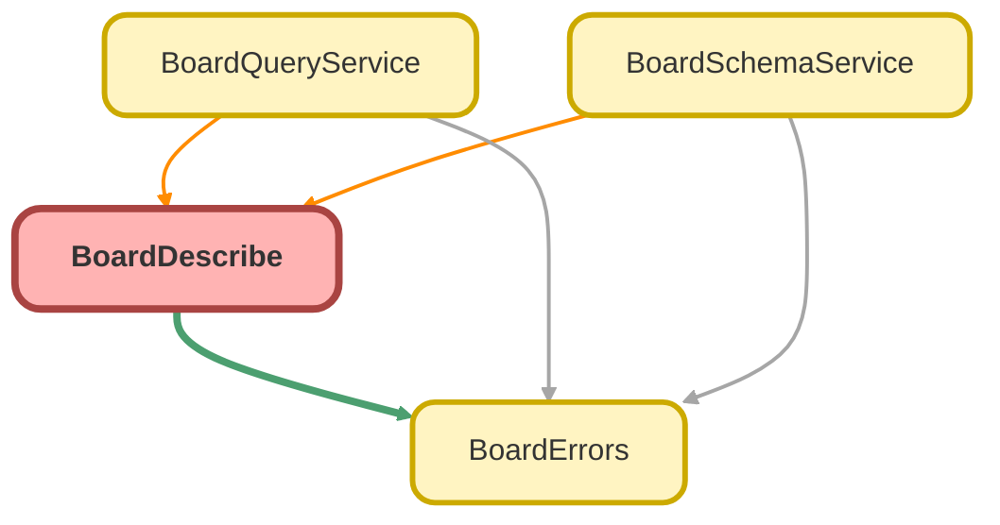

<!-- This file is auto-generated. if you do not want it to be overwritten, set TRUE in the line below -->
<!-- DO_NOT_OVERWRITE_DOC=FALSE -->

# BoardDescribe Class

Transaction-scoped describe cache and running-user access checks shared by the Board Apex services. 
 
Object access means `isAccessible() && isQueryable()` ; field access means FLS read ( `isAccessible()` ). Failures are 
 `BoardErrors`  `CONFIG_ERROR` (unknown names) or `ACCESS_ERROR` (no access).

## Class Diagram



<!-- Apex description -->

## Apex Code

```java
/**
 * Transaction-scoped describe cache and running-user access checks shared by the Board Apex services.
 *
 * Object access means `isAccessible() && isQueryable()`; field access means FLS read (`isAccessible()`). Failures are
 * `BoardErrors` `CONFIG_ERROR` (unknown names) or `ACCESS_ERROR` (no access).
 */
public with sharing class BoardDescribe {
    public static final Set<Schema.DisplayType> NUMERIC_TYPES = new Set<Schema.DisplayType>{
        Schema.DisplayType.INTEGER,
        Schema.DisplayType.LONG,
        Schema.DisplayType.DOUBLE,
        Schema.DisplayType.CURRENCY,
        Schema.DisplayType.PERCENT
    };

    // Keys are lower-cased API names.
    private static Map<String, Schema.SObjectType> globalDescribeCache;
    private static final Map<String, Schema.DescribeSObjectResult> OBJECT_DESCRIBE_CACHE = new Map<String, Schema.DescribeSObjectResult>();

    public static Map<String, Schema.SObjectType> getGlobalDescribe() {
        if (globalDescribeCache == null) {
            globalDescribeCache = Schema.getGlobalDescribe();
        }
        return globalDescribeCache;
    }

    public static Schema.DescribeSObjectResult describeObject(Schema.SObjectType objectType) {
        String cacheKey = String.valueOf(objectType).toLowerCase();
        Schema.DescribeSObjectResult objectDescribe = OBJECT_DESCRIBE_CACHE.get(cacheKey);
        if (objectDescribe == null) {
            objectDescribe = objectType.getDescribe(SObjectDescribeOptions.DEFERRED);
            OBJECT_DESCRIBE_CACHE.put(cacheKey, objectDescribe);
        }
        return objectDescribe;
    }

    public static Boolean isReadableObject(Schema.DescribeSObjectResult objectDescribe) {
        return objectDescribe.isAccessible() && objectDescribe.isQueryable();
    }

    /** Describe of a readable, queryable object; `fieldPath` of the error is the supplied name (null when blank). */
    public static Schema.DescribeSObjectResult requireReadableObject(String objectApiName) {
        Schema.SObjectType objectType = String.isBlank(objectApiName)
            ? null
            : getGlobalDescribe().get(objectApiName.trim());
        if (objectType == null) {
            throw BoardErrors.error(
                BoardErrors.CONFIG_ERROR,
                'Unknown object: ' + objectApiName,
                null,
                String.isBlank(objectApiName) ? null : objectApiName
            );
        }
        Schema.DescribeSObjectResult objectDescribe = describeObject(objectType);
        if (!isReadableObject(objectDescribe)) {
            throw BoardErrors.error(
                BoardErrors.ACCESS_ERROR,
                'You do not have access to the object ' + objectDescribe.getName(),
                null,
                objectDescribe.getName()
            );
        }
        return objectDescribe;
    }

    /** `fieldDescribe` when the running user can read it, else an `ACCESS_ERROR` naming `objectName.Field`. */
    public static Schema.DescribeFieldResult requireReadableField(
        String objectName,
        Schema.DescribeFieldResult fieldDescribe,
        String filterId,
        String fieldPath
    ) {
        if (!fieldDescribe.isAccessible()) {
            throw BoardErrors.error(
                BoardErrors.ACCESS_ERROR,
                'You do not have access to the field ' + objectName + '.' + fieldDescribe.getName(),
                filterId,
                fieldPath
            );
        }
        return fieldDescribe;
    }

    /** A valid 15/18-character record Id, or null. */
    public static Id toId(String rawId) {
        if (String.isBlank(rawId) || (rawId.length() != 15 && rawId.length() != 18)) {
            return null;
        }
        try {
            return Id.valueOf(rawId);
        } catch (Exception invalidId) {
            return null;
        }
    }

    /** Escapes `\`, `%`, and `_` so the term matches literally inside a `LIKE` pattern. */
    public static String escapeLike(String term) {
        return term.replace('\\', '\\\\').replace('%', '\\%').replace('_', '\\_');
    }
}
```

## Fields
### `NUMERIC_TYPES`

#### Signature
```apex
public static final NUMERIC_TYPES
```

#### Type
Set<Schema.DisplayType>

---

### `globalDescribeCache`

#### Signature
```apex
private static globalDescribeCache
```

#### Type
Map<String,Schema.SObjectType>

---

### `OBJECT_DESCRIBE_CACHE`

#### Signature
```apex
private static final OBJECT_DESCRIBE_CACHE
```

#### Type
Map<String,Schema.DescribeSObjectResult>

## Methods
### `getGlobalDescribe()`

#### Signature
```apex
public static Map<String,Schema.SObjectType> getGlobalDescribe()
```

#### Return Type
**Map<String,Schema.SObjectType>**

---

### `describeObject(objectType)`

#### Signature
```apex
public static Schema.DescribeSObjectResult describeObject(Schema.SObjectType objectType)
```

#### Parameters
| Name | Type | Description |
|------|------|-------------|
| objectType | Schema.SObjectType |  |

#### Return Type
**Schema.DescribeSObjectResult**

---

### `isReadableObject(objectDescribe)`

#### Signature
```apex
public static Boolean isReadableObject(Schema.DescribeSObjectResult objectDescribe)
```

#### Parameters
| Name | Type | Description |
|------|------|-------------|
| objectDescribe | Schema.DescribeSObjectResult |  |

#### Return Type
**Boolean**

---

### `requireReadableObject(objectApiName)`

Describe of a readable, queryable object; `fieldPath` of the error is the supplied name (null when blank).

#### Signature
```apex
public static Schema.DescribeSObjectResult requireReadableObject(String objectApiName)
```

#### Parameters
| Name | Type | Description |
|------|------|-------------|
| objectApiName | String |  |

#### Return Type
**Schema.DescribeSObjectResult**

---

### `requireReadableField(objectName, fieldDescribe, filterId, fieldPath)`

`fieldDescribe` when the running user can read it, else an `ACCESS_ERROR` naming `objectName.Field` .

#### Signature
```apex
public static Schema.DescribeFieldResult requireReadableField(String objectName, Schema.DescribeFieldResult fieldDescribe, String filterId, String fieldPath)
```

#### Parameters
| Name | Type | Description |
|------|------|-------------|
| objectName | String |  |
| fieldDescribe | Schema.DescribeFieldResult |  |
| filterId | String |  |
| fieldPath | String |  |

#### Return Type
**Schema.DescribeFieldResult**

---

### `toId(rawId)`

A valid 15/18-character record Id, or null.

#### Signature
```apex
public static Id toId(String rawId)
```

#### Parameters
| Name | Type | Description |
|------|------|-------------|
| rawId | String |  |

#### Return Type
**Id**

---

### `escapeLike(term)`

Escapes `\` , `%` , and `_` so the term matches literally inside a `LIKE` pattern.

#### Signature
```apex
public static String escapeLike(String term)
```

#### Parameters
| Name | Type | Description |
|------|------|-------------|
| term | String |  |

#### Return Type
**String**