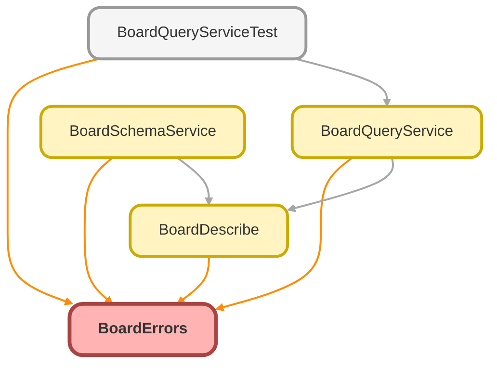

<!-- This file is auto-generated. if you do not want it to be overwritten, set TRUE in the line below -->
<!-- DO_NOT_OVERWRITE_DOC=FALSE -->

# BoardErrors Class

`BoardErrorPayload` contract shared by the Board Apex services. 
 
Services throw `BoardErrors.BoardException` (via `error(...)` ) and convert every failure at the `@AuraEnabled` 
boundary with `toAuraException` , whose message is the serialized payload 
 `{ category, message, filterId, fieldPath, retryable }` . Unknown exceptions get a generic retryable message; their 
details (which may contain compiled SOQL/SOSL) are logged, never returned.

## Class Diagram



<!-- Apex description -->

## Apex Code

```java
/**
 * `BoardErrorPayload` contract shared by the Board Apex services.
 *
 * Services throw `BoardErrors.BoardException` (via `error(...)`) and convert every failure at the `@AuraEnabled`
 * boundary with `toAuraException`, whose message is the serialized payload
 * `{ category, message, filterId, fieldPath, retryable }`. Unknown exceptions get a generic retryable message; their
 * details (which may contain compiled SOQL/SOSL) are logged, never returned.
 */
public with sharing class BoardErrors {
    public static final String CONFIG_ERROR = 'CONFIG_ERROR';
    public static final String ACCESS_ERROR = 'ACCESS_ERROR';
    public static final String LIMIT_EXCEEDED = 'LIMIT_EXCEEDED';
    public static final String QUERY_ERROR = 'QUERY_ERROR';

    @TestVisible
    private static final String GENERIC_MESSAGE = 'The request failed. Retry, or contact your admin.';
    private static final String NON_SELECTIVE_MESSAGE = 'This view spans too many records for a selective query. Narrow the Date Range or add filters to view results.';

    public static BoardException error(String category, String message, String filterId, String fieldPath) {
        return error(category, message, filterId, fieldPath, false);
    }

    public static BoardException error(
        String category,
        String message,
        String filterId,
        String fieldPath,
        Boolean retryable
    ) {
        BoardException boardError = new BoardException(message);
        boardError.category = category;
        boardError.filterId = filterId;
        boardError.fieldPath = fieldPath;
        boardError.retryable = retryable;
        return boardError;
    }

    /** Serializes any failure into a `BoardErrorPayload` `AuraHandledException`. */
    public static AuraHandledException toAuraException(Exception failure) {
        Map<String, Object> payload = new Map<String, Object>{
            'category' => QUERY_ERROR,
            'message' => GENERIC_MESSAGE,
            'filterId' => null,
            'fieldPath' => null,
            'retryable' => true
        };
        if (failure instanceof BoardException) {
            BoardException boardError = (BoardException) failure;
            payload.put('category', boardError.category);
            payload.put('message', boardError.getMessage());
            payload.put('filterId', boardError.filterId);
            payload.put('fieldPath', boardError.fieldPath);
            payload.put('retryable', boardError.retryable == true);
        } else if (failure instanceof QueryException && failure.getMessage().containsIgnoreCase('non-selective')) {
            payload.put('category', LIMIT_EXCEEDED);
            payload.put('message', NON_SELECTIVE_MESSAGE);
            payload.put('retryable', false);
        } else {
            System.debug(
                LoggingLevel.ERROR,
                'Board request failed: ' +
                    failure.getTypeName() +
                    ': ' +
                    failure.getMessage() +
                    '\n' +
                    failure.getStackTraceString()
            );
        }
        String serialized = JSON.serialize(payload);
        AuraHandledException auraError = new AuraHandledException(serialized);
        auraError.setMessage(serialized);
        return auraError;
    }

    /** A classified Board failure (`category`, optional `filterId`/`fieldPath`, `retryable`). */
    public class BoardException extends Exception {
        public String category;
        public String filterId;
        public String fieldPath;
        public Boolean retryable;
    }
}
```

## Fields
### `CONFIG_ERROR`

#### Signature
```apex
public static final CONFIG_ERROR
```

#### Type
String

---

### `ACCESS_ERROR`

#### Signature
```apex
public static final ACCESS_ERROR
```

#### Type
String

---

### `LIMIT_EXCEEDED`

#### Signature
```apex
public static final LIMIT_EXCEEDED
```

#### Type
String

---

### `QUERY_ERROR`

#### Signature
```apex
public static final QUERY_ERROR
```

#### Type
String

---

### `GENERIC_MESSAGE`

`TESTVISIBLE`

#### Signature
```apex
private static final GENERIC_MESSAGE
```

#### Type
String

---

### `NON_SELECTIVE_MESSAGE`

#### Signature
```apex
private static final NON_SELECTIVE_MESSAGE
```

#### Type
String

## Methods
### `error(category, message, filterId, fieldPath)`

#### Signature
```apex
public static BoardException error(String category, String message, String filterId, String fieldPath)
```

#### Parameters
| Name | Type | Description |
|------|------|-------------|
| category | String |  |
| message | String |  |
| filterId | String |  |
| fieldPath | String |  |

#### Return Type
**BoardException**

---

### `error(category, message, filterId, fieldPath, retryable)`

#### Signature
```apex
public static BoardException error(String category, String message, String filterId, String fieldPath, Boolean retryable)
```

#### Parameters
| Name | Type | Description |
|------|------|-------------|
| category | String |  |
| message | String |  |
| filterId | String |  |
| fieldPath | String |  |
| retryable | Boolean |  |

#### Return Type
**BoardException**

---

### `toAuraException(failure)`

Serializes any failure into a `BoardErrorPayload`  `AuraHandledException` .

#### Signature
```apex
public static AuraHandledException toAuraException(Exception failure)
```

#### Parameters
| Name | Type | Description |
|------|------|-------------|
| failure | Exception |  |

#### Return Type
**AuraHandledException**

## Classes
### BoardException Class

A classified Board failure ( `category` , optional `filterId` / `fieldPath` , `retryable` ).

#### Fields
##### `category`

###### Signature
```apex
public category
```

###### Type
String

---

##### `filterId`

###### Signature
```apex
public filterId
```

###### Type
String

---

##### `fieldPath`

###### Signature
```apex
public fieldPath
```

###### Type
String

---

##### `retryable`

###### Signature
```apex
public retryable
```

###### Type
Boolean