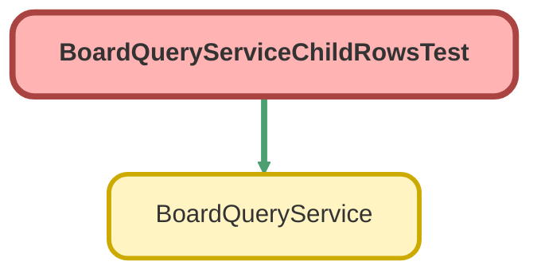

<!-- This file is auto-generated. if you do not want it to be overwritten, set TRUE in the line below -->
<!-- DO_NOT_OVERWRITE_DOC=FALSE -->

# BoardQueryServiceChildRowsTest Class

`ISTEST`

## Class Diagram



<!-- Apex description -->

## Apex Code

```java
@IsTest
private class BoardQueryServiceChildRowsTest {
    private static final String RESTRICTED_ALIAS = 'brdchld';
    private static final String RESTRICTED_LAST_NAME = 'Boardchild Restricted';

    /**
     * Data: Cases `Child A` (3 CaseComments, 2 FeedItems), `Child B` (none), `Child C` (12 CaseComments).
     * Account `Child Account` with 2 Opportunities.
     *
     * Restricted user: `Minimum Access - Salesforce` + Read on Account and Opportunity (FLS: Opportunity.AccountId).
     */
    @TestSetup
    static void setup() {
        System.runAs(new User(Id = UserInfo.getUserId())) {
            User restrictedUser = new User(
                ProfileId = [SELECT Id FROM Profile WHERE Name = 'Minimum Access - Salesforce' LIMIT 1]
                .Id,
                Alias = RESTRICTED_ALIAS,
                LastName = RESTRICTED_LAST_NAME,
                Email = RESTRICTED_ALIAS + '@example.com',
                Username = RESTRICTED_ALIAS +
                    String.valueOf(Crypto.getRandomInteger()).replace('-', '') +
                    '@board-child.test',
                TimeZoneSidKey = 'America/Los_Angeles',
                LocaleSidKey = 'en_US',
                EmailEncodingKey = 'UTF-8',
                LanguageLocaleKey = 'en_US'
            );
            insert restrictedUser;
            PermissionSet permissionSet = new PermissionSet(Name = 'BoardChildTestAccess', Label = 'Board Child Test');
            insert permissionSet;
            insert new List<ObjectPermissions>{
                new ObjectPermissions(ParentId = permissionSet.Id, SobjectType = 'Account', PermissionsRead = true),
                new ObjectPermissions(ParentId = permissionSet.Id, SobjectType = 'Opportunity', PermissionsRead = true)
            };
            insert new FieldPermissions(
                ParentId = permissionSet.Id,
                SobjectType = 'Opportunity',
                Field = 'Opportunity.AccountId',
                PermissionsRead = true
            );
            insert new PermissionSetAssignment(AssigneeId = restrictedUser.Id, PermissionSetId = permissionSet.Id);
        }

        Account account = new Account(Name = 'Child Account');
        insert account;
        insert new List<Opportunity>{
            new Opportunity(
                Name = 'Child Opp 1',
                AccountId = account.Id,
                StageName = 'Prospecting',
                CloseDate = Date.today(),
                Amount = 100
            ),
            new Opportunity(
                Name = 'Child Opp 2',
                AccountId = account.Id,
                StageName = 'Prospecting',
                CloseDate = Date.today(),
                Amount = 200
            )
        };

        Case caseA = new Case(Subject = 'Child A');
        Case caseB = new Case(Subject = 'Child B');
        Case caseC = new Case(Subject = 'Child C');
        insert new List<Case>{ caseA, caseB, caseC };

        List<CaseComment> comments = new List<CaseComment>();
        for (Integer i = 1; i <= 3; i++) {
            comments.add(new CaseComment(ParentId = caseA.Id, CommentBody = 'A comment ' + i));
        }
        for (Integer i = 1; i <= 12; i++) {
            comments.add(
                new CaseComment(ParentId = caseC.Id, CommentBody = 'C comment ' + String.valueOf(i).leftPad(2, '0'))
            );
        }
        insert comments;
        insert new List<FeedItem>{
            new FeedItem(ParentId = caseA.Id, Body = 'Feed one'),
            new FeedItem(ParentId = caseA.Id, Body = 'Feed two')
        };
    }

    // ---------------------------------------------------------------------------------------------------------
    // Page-scoped child counts
    // ---------------------------------------------------------------------------------------------------------

    @IsTest
    static void caseCommentCountsCoverEveryPageRowAndCapAtTheLimit() {
        Map<String, Object> child = caseCommentConfig();
        BoardQueryService.TableResult result = BoardQueryService.queryTable(JSON.serialize(caseRequest(child)));

        Map<String, BoardQueryService.TableRow> bySubject = rowsBySubject(result.rows);
        Assert.areEqual(3, bySubject.get('Child A').childCount);
        Assert.isFalse(bySubject.get('Child A').childCountCapped);
        Assert.areEqual(0, bySubject.get('Child B').childCount);
        Assert.isFalse(bySubject.get('Child B').childCountCapped);
        Assert.areEqual(10, bySubject.get('Child C').childCount, 'Count is capped at the child row limit');
        Assert.isTrue(bySubject.get('Child C').childCountCapped);

        // Subsequent cursor pages carry counts too.
        BoardQueryService.TablePage page = BoardQueryService.fetchTablePage(
            result.paginationCursor,
            0,
            10,
            JSON.serialize(child)
        );
        Assert.areEqual(3, rowsBySubject(page.rows).get('Child A').childCount);

        // Without a child relationship, rows carry no counts.
        BoardQueryService.TablePage plain = BoardQueryService.fetchTablePage(result.paginationCursor, 0, 10, null);
        Assert.isNull(plain.rows[0].childCount);
    }

    @IsTest
    static void feedItemCountsUseTheForeignKeyLoopInsteadOfGroupBy() {
        Map<String, Object> child = new Map<String, Object>{
            'relationshipName' => 'Feeds',
            'childObjectApiName' => 'FeedItem',
            'foreignKeyField' => 'ParentId',
            'columns' => new List<Object>{ new Map<String, Object>{ 'id' => 'body', 'fieldPath' => 'Body' } }
        };
        BoardQueryService.TableResult result = BoardQueryService.queryTable(JSON.serialize(caseRequest(child)));
        Map<String, BoardQueryService.TableRow> bySubject = rowsBySubject(result.rows);
        Assert.areEqual(2, bySubject.get('Child A').childCount);
        Assert.areEqual(0, bySubject.get('Child C').childCount);

        BoardQueryService.ChildRowsResult feed = BoardQueryService.queryChildRows(
            JSON.serialize(child),
            bySubject.get('Child A').id
        );
        Assert.areEqual(2, feed.rows.size());
    }

    @IsTest
    static void saturatedCountQueryMarksCountsAsPartial() {
        BoardQueryService.CHILD_COUNT_QUERY_LIMIT = 2;
        BoardQueryService.TableResult result = BoardQueryService.queryTable(
            JSON.serialize(caseRequest(caseCommentConfig()))
        );
        for (BoardQueryService.TableRow row : result.rows) {
            Assert.areEqual(row.childCount > 0, row.childCountCapped, String.valueOf(row.values));
        }
    }

    // ---------------------------------------------------------------------------------------------------------
    // Lazy child rows
    // ---------------------------------------------------------------------------------------------------------

    @IsTest
    static void queryChildRowsReturnsSortedLimitedChildColumns() {
        Case caseC = [SELECT Id FROM Case WHERE Subject = 'Child C'];
        Map<String, Object> child = caseCommentConfig();
        child.put('sortBy', 'CreatedDate');
        child.put('sortDirection', 'DESC');
        child.put('limit', 5);

        BoardQueryService.ChildRowsResult result = BoardQueryService.queryChildRows(JSON.serialize(child), caseC.Id);

        Assert.areEqual(caseC.Id, result.parentId);
        Assert.areEqual(5, result.rows.size());
        Assert.isTrue(result.hasMore);
        Assert.areEqual('CreatedDate', result.sortBy);
        Assert.areEqual('DESC', result.sortDirection);
        Assert.areEqual('CommentBody', result.columns[0].fieldPath);
        Assert.areEqual('TEXTAREA', result.columns[0].dataType);
        Assert.isTrue(String.valueOf(result.rows[0].values.get('CommentBody')).startsWith('C comment'));

        child.put('limit', 500); // clamped to 50
        BoardQueryService.ChildRowsResult all = BoardQueryService.queryChildRows(JSON.serialize(child), caseC.Id);
        Assert.areEqual(12, all.rows.size());
        Assert.isFalse(all.hasMore);
    }

    @IsTest
    static void childColumnsEnforceFieldLevelSecurity() {
        User restricted = [SELECT Id FROM User WHERE Alias = :RESTRICTED_ALIAS LIMIT 1];
        Account account = [SELECT Id FROM Account WHERE Name = 'Child Account'];
        Map<String, Object> readable = opportunityConfig('Name');
        Map<String, Object> unreadable = opportunityConfig('Amount');

        BoardQueryService.ChildRowsResult allowed;
        Map<String, Object> denied;
        System.runAs(restricted) {
            allowed = BoardQueryService.queryChildRows(JSON.serialize(readable), account.Id);
            denied = expectChildError(unreadable, account.Id, 'ACCESS_ERROR');
        }
        Assert.areEqual(2, allowed.rows.size());
        Assert.isFalse(allowed.rows[0].values.containsKey('Amount'));
        Assert.areEqual('Amount', denied.get('fieldPath'));
    }

    @IsTest
    static void invalidChildConfigsFailClosed() {
        Case caseA = [SELECT Id FROM Case WHERE Subject = 'Child A'];
        Account account = [SELECT Id FROM Account WHERE Name = 'Child Account'];

        Map<String, Object> noObject = caseCommentConfig();
        noObject.remove('childObjectApiName');
        expectChildError(noObject, caseA.Id, 'CONFIG_ERROR');

        Map<String, Object> badKey = caseCommentConfig();
        badKey.put('foreignKeyField', 'CommentBody');
        expectChildError(badKey, caseA.Id, 'CONFIG_ERROR');

        Map<String, Object> noColumns = caseCommentConfig();
        noColumns.put('columns', new List<Object>());
        expectChildError(noColumns, caseA.Id, 'CONFIG_ERROR');

        Map<String, Object> wrongParent = expectChildError(caseCommentConfig(), account.Id, 'CONFIG_ERROR');
        Assert.areEqual('childRelationship.foreignKeyField', wrongParent.get('fieldPath'));

        Map<String, Object> badId = expectChildError(caseCommentConfig(), 'not-an-id', 'CONFIG_ERROR');
        Assert.areEqual('parentId', badId.get('fieldPath'));
    }

    // ---------------------------------------------------------------------------------------------------------
    // Helpers
    // ---------------------------------------------------------------------------------------------------------

    private static Map<String, Object> caseCommentConfig() {
        return new Map<String, Object>{
            'relationshipName' => 'CaseComments',
            'childObjectApiName' => 'CaseComment',
            'foreignKeyField' => 'ParentId',
            'columns' => new List<Object>{ new Map<String, Object>{ 'id' => 'body', 'fieldPath' => 'CommentBody' } }
        };
    }

    private static Map<String, Object> opportunityConfig(String fieldPath) {
        return new Map<String, Object>{
            'relationshipName' => 'Opportunities',
            'childObjectApiName' => 'Opportunity',
            'foreignKeyField' => 'AccountId',
            'columns' => new List<Object>{ new Map<String, Object>{ 'id' => 'c', 'fieldPath' => fieldPath } }
        };
    }

    private static Map<String, Object> caseRequest(Map<String, Object> child) {
        return new Map<String, Object>{
            'objectApiName' => 'Case',
            'columns' => new List<Object>{ new Map<String, Object>{ 'id' => 's', 'fieldPath' => 'Subject' } },
            'sortBy' => 'Subject',
            'childRelationship' => child
        };
    }

    private static Map<String, BoardQueryService.TableRow> rowsBySubject(List<BoardQueryService.TableRow> rows) {
        Map<String, BoardQueryService.TableRow> bySubject = new Map<String, BoardQueryService.TableRow>();
        for (BoardQueryService.TableRow row : rows) {
            bySubject.put(String.valueOf(row.values.get('Subject')), row);
        }
        return bySubject;
    }

    private static Map<String, Object> expectChildError(Map<String, Object> child, String parentId, String category) {
        try {
            BoardQueryService.queryChildRows(JSON.serialize(child), parentId);
        } catch (AuraHandledException error) {
            Map<String, Object> payload = (Map<String, Object>) JSON.deserializeUntyped(error.getMessage());
            Assert.areEqual(category, payload.get('category'), String.valueOf(payload));
            return payload;
        }
        Assert.fail('Expected ' + category + ' for ' + JSON.serialize(child));
        return null;
    }
}
```

## Fields
### `RESTRICTED_ALIAS`

#### Signature
```apex
private static final RESTRICTED_ALIAS
```

#### Type
String

---

### `RESTRICTED_LAST_NAME`

#### Signature
```apex
private static final RESTRICTED_LAST_NAME
```

#### Type
String

## Methods
### `setup()`

`TESTSETUP`

Data: Cases `Child A` (3 CaseComments, 2 FeedItems), `Child B` (none), `Child C` (12 CaseComments). 
Account `Child Account` with 2 Opportunities. 
 
Restricted user: `Minimum Access - Salesforce` + Read on Account and Opportunity (FLS: Opportunity.AccountId).

#### Signature
```apex
private static void setup()
```

#### Return Type
**void**

---

### `caseCommentCountsCoverEveryPageRowAndCapAtTheLimit()`

`ISTEST`

#### Signature
```apex
private static void caseCommentCountsCoverEveryPageRowAndCapAtTheLimit()
```

#### Return Type
**void**

---

### `feedItemCountsUseTheForeignKeyLoopInsteadOfGroupBy()`

`ISTEST`

#### Signature
```apex
private static void feedItemCountsUseTheForeignKeyLoopInsteadOfGroupBy()
```

#### Return Type
**void**

---

### `saturatedCountQueryMarksCountsAsPartial()`

`ISTEST`

#### Signature
```apex
private static void saturatedCountQueryMarksCountsAsPartial()
```

#### Return Type
**void**

---

### `queryChildRowsReturnsSortedLimitedChildColumns()`

`ISTEST`

#### Signature
```apex
private static void queryChildRowsReturnsSortedLimitedChildColumns()
```

#### Return Type
**void**

---

### `childColumnsEnforceFieldLevelSecurity()`

`ISTEST`

#### Signature
```apex
private static void childColumnsEnforceFieldLevelSecurity()
```

#### Return Type
**void**

---

### `invalidChildConfigsFailClosed()`

`ISTEST`

#### Signature
```apex
private static void invalidChildConfigsFailClosed()
```

#### Return Type
**void**

---

### `caseCommentConfig()`

#### Signature
```apex
private static Map<String,Object> caseCommentConfig()
```

#### Return Type
**Map<String,Object>**

---

### `opportunityConfig(fieldPath)`

#### Signature
```apex
private static Map<String,Object> opportunityConfig(String fieldPath)
```

#### Parameters
| Name | Type | Description |
|------|------|-------------|
| fieldPath | String |  |

#### Return Type
**Map<String,Object>**

---

### `caseRequest(child)`

#### Signature
```apex
private static Map<String,Object> caseRequest(Map<String,Object> child)
```

#### Parameters
| Name | Type | Description |
|------|------|-------------|
| child | Map<String,Object> |  |

#### Return Type
**Map<String,Object>**

---

### `rowsBySubject(rows)`

#### Signature
```apex
private static Map<String,BoardQueryService.TableRow> rowsBySubject(List<BoardQueryService.TableRow> rows)
```

#### Parameters
| Name | Type | Description |
|------|------|-------------|
| rows | List<BoardQueryService.TableRow> |  |

#### Return Type
**Map<String,BoardQueryService.TableRow>**

---

### `expectChildError(child, parentId, category)`

#### Signature
```apex
private static Map<String,Object> expectChildError(Map<String,Object> child, String parentId, String category)
```

#### Parameters
| Name | Type | Description |
|------|------|-------------|
| child | Map<String,Object> |  |
| parentId | String |  |
| category | String |  |

#### Return Type
**Map<String,Object>**