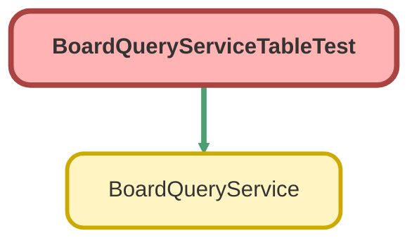

<!-- This file is auto-generated. if you do not want it to be overwritten, set TRUE in the line below -->
<!-- DO_NOT_OVERWRITE_DOC=FALSE -->

# BoardQueryServiceTableTest Class

`ISTEST`

## Class Diagram



<!-- Apex description -->

## Apex Code

```java
@IsTest
private class BoardQueryServiceTableTest {
    private static final String RESTRICTED_ALIAS = 'brdtbl';
    private static final String RESTRICTED_LAST_NAME = 'Boardtable Restricted';
    private static final Integer CASE_COUNT = 25;

    /**
     * Data: Account chain Level 0 <- Level 1 <- ... <- Level 4 (each ParentId = previous level).
     * 25 Cases on Level 4 with subjects `Board Table 01..25`; odd-numbered Cases are High priority.
     *
     * Restricted user: `Minimum Access - Salesforce` + Read on Account (FLS: Industry) and Case (FLS: AccountId).
     */
    @TestSetup
    static void setup() {
        User restrictedUser;
        System.runAs(new User(Id = UserInfo.getUserId())) {
            restrictedUser = new User(
                ProfileId = [SELECT Id FROM Profile WHERE Name = 'Minimum Access - Salesforce' LIMIT 1]
                .Id,
                Alias = RESTRICTED_ALIAS,
                LastName = RESTRICTED_LAST_NAME,
                Email = RESTRICTED_ALIAS + '@example.com',
                Username = RESTRICTED_ALIAS +
                    String.valueOf(Crypto.getRandomInteger()).replace('-', '') +
                    '@board-table.test',
                TimeZoneSidKey = 'America/Los_Angeles',
                LocaleSidKey = 'en_US',
                EmailEncodingKey = 'UTF-8',
                LanguageLocaleKey = 'en_US'
            );
            insert restrictedUser;
            PermissionSet permissionSet = new PermissionSet(Name = 'BoardTableTestAccess', Label = 'Board Table Test');
            insert permissionSet;
            insert new List<ObjectPermissions>{
                new ObjectPermissions(ParentId = permissionSet.Id, SobjectType = 'Account', PermissionsRead = true),
                new ObjectPermissions(ParentId = permissionSet.Id, SobjectType = 'Case', PermissionsRead = true)
            };
            insert new List<FieldPermissions>{
                new FieldPermissions(
                    ParentId = permissionSet.Id,
                    SobjectType = 'Account',
                    Field = 'Account.Industry',
                    PermissionsRead = true
                ),
                new FieldPermissions(
                    ParentId = permissionSet.Id,
                    SobjectType = 'Case',
                    Field = 'Case.AccountId',
                    PermissionsRead = true
                )
            };
            insert new PermissionSetAssignment(AssigneeId = restrictedUser.Id, PermissionSetId = permissionSet.Id);
        }

        Id parentId = null;
        for (Integer level = 0; level < 5; level++) {
            Account account = new Account(
                Name = 'Board Level ' + level,
                Industry = 'Energy',
                ParentId = parentId,
                OwnerId = restrictedUser.Id
            );
            insert account;
            parentId = account.Id;
        }

        List<Case> cases = new List<Case>();
        for (Integer i = 1; i <= CASE_COUNT; i++) {
            cases.add(
                new Case(
                    Subject = 'Board Table ' + String.valueOf(i).leftPad(2, '0'),
                    AccountId = parentId,
                    Priority = Math.mod(i, 2) == 1 ? 'High' : 'Low',
                    OwnerId = restrictedUser.Id
                )
            );
        }
        insert cases;
    }

    // ---------------------------------------------------------------------------------------------------------
    // Columns, dot-paths, and record links
    // ---------------------------------------------------------------------------------------------------------

    @IsTest
    static void columnsResolveDirectAndOneToFiveHopParentPathsWithRecordLinks() {
        Map<String, Object> request = tableRequest(
            new List<Map<String, Object>>{
                column('number', 'CaseNumber', null),
                column('subject', 'subject', 'never'),
                column('priority', 'Priority', 'always'),
                column('account', 'Account.Name', null),
                column('owner', 'Owner.Name', 'auto'),
                column('industry', 'Account.Industry', null),
                column('root', 'Account.Parent.Parent.Parent.Parent.Name', null)
            }
        );
        request.put('sortBy', 'Subject');
        BoardQueryService.TableResult result = BoardQueryService.queryTable(JSON.serialize(request));

        Map<String, BoardQueryService.TableColumn> columns = new Map<String, BoardQueryService.TableColumn>();
        for (BoardQueryService.TableColumn tableColumn : result.columns) {
            columns.put(tableColumn.id, tableColumn);
        }
        Assert.areEqual('Subject', columns.get('subject').fieldPath, 'Canonical field path');
        Assert.areEqual('Id', columns.get('number').linkPath, 'Name field links to the row');
        Assert.isNull(columns.get('subject').linkPath, 'linkToRecord never');
        Assert.areEqual('Id', columns.get('priority').linkPath, 'linkToRecord always');
        Assert.areEqual('AccountId', columns.get('account').linkPath, 'Parent name links to the parent');
        Assert.areEqual('OwnerId', columns.get('owner').linkPath, 'Polymorphic owner name links to the owner');
        Assert.isNull(columns.get('industry').linkPath, 'Non-name parent field has no auto link');
        Assert.areEqual('Account.Parent.Parent.Parent.ParentId', columns.get('root').linkPath);
        Assert.areEqual('PICKLIST', columns.get('priority').dataType);
        Assert.isTrue(columns.get('number').isSortable);

        Case expected = [
            SELECT Id, CaseNumber, AccountId, OwnerId, Account.Parent.Parent.Parent.ParentId
            FROM Case
            WHERE Subject = 'Board Table 01'
        ];
        BoardQueryService.TableRow first = result.rows[0];
        Assert.areEqual(expected.Id, first.id);
        Assert.areEqual(expected.CaseNumber, first.values.get('CaseNumber'));
        Assert.areEqual('Board Table 01', first.values.get('Subject'));
        Assert.areEqual('Board Level 4', first.values.get('Account.Name'), 'One hop');
        Assert.areEqual(RESTRICTED_LAST_NAME, first.values.get('Owner.Name'), 'Polymorphic hop');
        Assert.areEqual('Board Level 0', first.values.get('Account.Parent.Parent.Parent.Parent.Name'), 'Five hops');
        Assert.areEqual(expected.AccountId, first.values.get('AccountId'));
        Assert.areEqual(expected.OwnerId, first.values.get('OwnerId'));
        Assert.areEqual(
            expected.Account.Parent.Parent.Parent.ParentId,
            first.values.get('Account.Parent.Parent.Parent.ParentId')
        );
    }

    @IsTest
    static void invalidOrUnreadableColumnsFailClosed() {
        assertColumnError('Account.Parent.Parent.Parent.Parent.Parent.Name', 'CONFIG_ERROR');
        assertColumnError('Account.Nope__c', 'CONFIG_ERROR');
        assertColumnError('CaseComment(ParentId).CommentBody', 'CONFIG_ERROR');
        assertColumnError('', 'CONFIG_ERROR');
        expectError(tableRequest(new List<Map<String, Object>>()), 'CONFIG_ERROR');

        Map<String, Object> unsortable = tableRequest(new List<Map<String, Object>>{ column('s', 'Subject', null) });
        unsortable.put('sortBy', 'Description');
        Assert.areEqual('Description', expectError(unsortable, 'CONFIG_ERROR').get('fieldPath'));

        Map<String, Object> readable = tableRequest(
            new List<Map<String, Object>>{ column('industry', 'Account.Industry', null) }
        );
        Map<String, Object> unreadable = tableRequest(
            new List<Map<String, Object>>{
                column('industry', 'Account.Industry', null),
                column('phone', 'Account.Phone', null)
            }
        );
        User restricted = [SELECT Id FROM User WHERE Alias = :RESTRICTED_ALIAS LIMIT 1];
        BoardQueryService.TableResult allowed;
        Map<String, Object> denied;
        System.runAs(restricted) {
            allowed = BoardQueryService.queryTable(JSON.serialize(readable));
            denied = expectError(unreadable, 'ACCESS_ERROR');
        }
        Assert.areEqual(CASE_COUNT, allowed.totalCount, 'Readable parent path works for the restricted user');
        Assert.areEqual('Energy', allowed.rows[0].values.get('Account.Industry'));
        Assert.areEqual('Account.Phone', denied.get('fieldPath'), String.valueOf(denied));
    }

    // ---------------------------------------------------------------------------------------------------------
    // Sorting
    // ---------------------------------------------------------------------------------------------------------

    @IsTest
    static void sortingIsServerSideWithIdTieBreaker() {
        Map<String, Object> request = tableRequest(new List<Map<String, Object>>{ column('s', 'Subject', null) });
        request.put('sortBy', 'Subject');
        request.put('sortDirection', 'DESC');
        BoardQueryService.TableResult descending = BoardQueryService.queryTable(JSON.serialize(request));
        Assert.areEqual('Board Table 25', descending.rows[0].values.get('Subject'));
        Assert.areEqual('Subject', descending.sortBy);
        Assert.areEqual('DESC', descending.sortDirection);

        request.put('sortDirection', 'ASC');
        BoardQueryService.TableResult ascending = BoardQueryService.queryTable(JSON.serialize(request));
        Assert.areEqual('Board Table 01', ascending.rows[0].values.get('Subject'));

        // Priority ties across many rows: the deterministic `Id ASC` tie-breaker fixes the order within each group.
        request.put('sortBy', 'Priority');
        request.put('pageSize', 100);
        BoardQueryService.TableResult byPriority = BoardQueryService.queryTable(JSON.serialize(request));
        List<Case> expected = [SELECT Id FROM Case ORDER BY Priority ASC NULLS LAST, Id ASC];
        Assert.areEqual(CASE_COUNT, byPriority.rows.size());
        for (Integer i = 0; i < expected.size(); i++) {
            Assert.areEqual(expected[i].Id, byPriority.rows[i].id, 'Row ' + i);
        }

        request.remove('sortBy');
        BoardQueryService.TableResult unsorted = BoardQueryService.queryTable(JSON.serialize(request));
        Assert.isNull(unsorted.sortBy, 'Default order is Id ASC');
        Assert.areEqual([SELECT Id FROM Case ORDER BY Id ASC LIMIT 1].Id, unsorted.rows[0].id);
    }

    // ---------------------------------------------------------------------------------------------------------
    // Pagination cursor
    // ---------------------------------------------------------------------------------------------------------

    @IsTest
    static void paginationCursorTraversesPagesAndClampsTheFinalPage() {
        Map<String, Object> request = tableRequest(new List<Map<String, Object>>{ column('s', 'Subject', null) });
        request.put('sortBy', 'Subject');
        request.put('pageSize', 5); // clamped up to the 10-row minimum
        BoardQueryService.TableResult first = BoardQueryService.queryTable(JSON.serialize(request));
        Assert.areEqual(CASE_COUNT, first.totalCount);
        Assert.areEqual(10, first.rows.size());
        Assert.areEqual(0, first.start);
        Assert.areEqual(10, first.nextIndex);
        Assert.isTrue(first.hasMore);
        Assert.isNotNull(first.paginationCursor);

        BoardQueryService.TablePage second = BoardQueryService.fetchTablePage(first.paginationCursor, 10, 10, null);
        Assert.areEqual('Board Table 11', second.rows[0].values.get('Subject'));
        Assert.areEqual(20, second.nextIndex);
        Assert.isTrue(second.hasMore);

        // 25 - 20 = 5 rows remain: fetchSize is clamped and getNextIndex() wrap-to-zero is guarded.
        BoardQueryService.TablePage last = BoardQueryService.fetchTablePage(first.paginationCursor, 20, 10, null);
        Assert.areEqual(5, last.rows.size());
        Assert.areEqual('Board Table 25', last.rows[4].values.get('Subject'));
        Assert.areEqual(CASE_COUNT, last.nextIndex);
        Assert.isFalse(last.hasMore);
        Assert.areEqual(0, last.deletedRows);

        BoardQueryService.TablePage past = BoardQueryService.fetchTablePage(
            first.paginationCursor,
            CASE_COUNT,
            10,
            null
        );
        Assert.isTrue(past.rows.isEmpty(), 'Fetching at the end returns no rows instead of throwing');
        Assert.isFalse(past.hasMore);

        BoardQueryService.TablePage defaults = BoardQueryService.fetchTablePage(
            first.paginationCursor,
            null,
            null,
            null
        );
        Assert.areEqual(CASE_COUNT, defaults.rows.size(), 'Default page size 25 from start 0');
    }

    @IsTest
    static void cursorSpansAtMostTheTableRowLimitAndHonoursFilters() {
        BoardQueryService.TABLE_MAX_ROWS = 12;
        Map<String, Object> request = tableRequest(new List<Map<String, Object>>{ column('s', 'Subject', null) });
        BoardQueryService.TableResult capped = BoardQueryService.queryTable(JSON.serialize(request));
        Assert.areEqual(12, capped.totalCount);

        BoardQueryService.TABLE_MAX_ROWS = 100000;
        request.put(
            'baseFilters',
            new List<Object>{
                new Map<String, Object>{
                    'id' => 'high',
                    'fieldPath' => 'Priority',
                    'operator' => 'EQ',
                    'value' => 'High'
                }
            }
        );
        request.put(
            'filters',
            new List<Object>{
                new Map<String, Object>{
                    'filterId' => 'subject',
                    'type' => 'PICKLIST',
                    'fieldPath' => 'Subject',
                    'explicit' => true,
                    'operator' => 'IN',
                    'values' => new List<Object>{ 'Board Table 01', 'Board Table 02', 'Board Table 03' }
                }
            }
        );
        BoardQueryService.TableResult filtered = BoardQueryService.queryTable(JSON.serialize(request));
        Assert.areEqual(2, filtered.totalCount, 'High priority among 01..03');
        Assert.areEqual(new List<String>{ 'subject' }, filtered.appliedFilterIds);
        Assert.isFalse(filtered.hasMore);
    }

    @IsTest
    static void expiredCursorIsRetryableAndQueryTableReopensAtStart() {
        assertCursorExpired(null, 0);
        assertCursorExpired('not a cursor', 0);
        assertCursorExpired('{"unknown":true}', 20);

        Map<String, Object> request = tableRequest(new List<Map<String, Object>>{ column('s', 'Subject', null) });
        request.put('sortBy', 'Subject');
        request.put('pageSize', 10);
        request.put('start', 20);
        BoardQueryService.TableResult reopened = BoardQueryService.queryTable(JSON.serialize(request));
        Assert.areEqual(20, reopened.start);
        Assert.areEqual(5, reopened.rows.size());
        Assert.areEqual('Board Table 21', reopened.rows[0].values.get('Subject'));
        Assert.isFalse(reopened.hasMore);
    }

    // ---------------------------------------------------------------------------------------------------------
    // Helpers
    // ---------------------------------------------------------------------------------------------------------

    private static Map<String, Object> tableRequest(List<Map<String, Object>> columns) {
        return new Map<String, Object>{
            'objectApiName' => 'Case',
            'columns' => columns,
            'filters' => new List<Object>(),
            'baseFilters' => new List<Object>(),
            'refreshToken' => 0
        };
    }

    private static Map<String, Object> column(String id, String fieldPath, String linkToRecord) {
        return new Map<String, Object>{ 'id' => id, 'fieldPath' => fieldPath, 'linkToRecord' => linkToRecord };
    }

    private static void assertColumnError(String fieldPath, String category) {
        expectError(tableRequest(new List<Map<String, Object>>{ column('c', fieldPath, null) }), category);
    }

    private static Map<String, Object> expectError(Map<String, Object> request, String category) {
        try {
            BoardQueryService.queryTable(JSON.serialize(request));
        } catch (AuraHandledException error) {
            Map<String, Object> payload = (Map<String, Object>) JSON.deserializeUntyped(error.getMessage());
            Assert.areEqual(category, payload.get('category'), String.valueOf(payload));
            return payload;
        }
        Assert.fail('Expected ' + category + ' for ' + JSON.serialize(request));
        return null;
    }

    private static void assertCursorExpired(String cursor, Integer start) {
        try {
            BoardQueryService.fetchTablePage(cursor, start, 10, null);
        } catch (AuraHandledException error) {
            Map<String, Object> payload = (Map<String, Object>) JSON.deserializeUntyped(error.getMessage());
            Assert.areEqual('QUERY_ERROR', payload.get('category'), String.valueOf(payload));
            Assert.areEqual('paginationCursor', payload.get('fieldPath'));
            Assert.areEqual(true, payload.get('retryable'));
            return;
        }
        Assert.fail('Expected an expired cursor error for ' + cursor);
    }
}
```

## Fields
### `RESTRICTED_ALIAS`

#### Signature
```apex
private static final RESTRICTED_ALIAS
```

#### Type
String

---

### `RESTRICTED_LAST_NAME`

#### Signature
```apex
private static final RESTRICTED_LAST_NAME
```

#### Type
String

---

### `CASE_COUNT`

#### Signature
```apex
private static final CASE_COUNT
```

#### Type
Integer

## Methods
### `setup()`

`TESTSETUP`

Data: Account chain Level 0 &lt;- Level 1 &lt;- ... &lt;- Level 4 (each ParentId &#x3D; previous level). 
25 Cases on Level 4 with subjects `Board Table 01..25` ; odd-numbered Cases are High priority. 
 
Restricted user: `Minimum Access - Salesforce` + Read on Account (FLS: Industry) and Case (FLS: AccountId).

#### Signature
```apex
private static void setup()
```

#### Return Type
**void**

---

### `columnsResolveDirectAndOneToFiveHopParentPathsWithRecordLinks()`

`ISTEST`

#### Signature
```apex
private static void columnsResolveDirectAndOneToFiveHopParentPathsWithRecordLinks()
```

#### Return Type
**void**

---

### `invalidOrUnreadableColumnsFailClosed()`

`ISTEST`

#### Signature
```apex
private static void invalidOrUnreadableColumnsFailClosed()
```

#### Return Type
**void**

---

### `sortingIsServerSideWithIdTieBreaker()`

`ISTEST`

#### Signature
```apex
private static void sortingIsServerSideWithIdTieBreaker()
```

#### Return Type
**void**

---

### `paginationCursorTraversesPagesAndClampsTheFinalPage()`

`ISTEST`

#### Signature
```apex
private static void paginationCursorTraversesPagesAndClampsTheFinalPage()
```

#### Return Type
**void**

---

### `cursorSpansAtMostTheTableRowLimitAndHonoursFilters()`

`ISTEST`

#### Signature
```apex
private static void cursorSpansAtMostTheTableRowLimitAndHonoursFilters()
```

#### Return Type
**void**

---

### `expiredCursorIsRetryableAndQueryTableReopensAtStart()`

`ISTEST`

#### Signature
```apex
private static void expiredCursorIsRetryableAndQueryTableReopensAtStart()
```

#### Return Type
**void**

---

### `tableRequest(columns)`

#### Signature
```apex
private static Map<String,Object> tableRequest(List<Map<String,Object>> columns)
```

#### Parameters
| Name | Type | Description |
|------|------|-------------|
| columns | List<Map<String,Object>> |  |

#### Return Type
**Map<String,Object>**

---

### `column(id, fieldPath, linkToRecord)`

#### Signature
```apex
private static Map<String,Object> column(String id, String fieldPath, String linkToRecord)
```

#### Parameters
| Name | Type | Description |
|------|------|-------------|
| id | String |  |
| fieldPath | String |  |
| linkToRecord | String |  |

#### Return Type
**Map<String,Object>**

---

### `assertColumnError(fieldPath, category)`

#### Signature
```apex
private static void assertColumnError(String fieldPath, String category)
```

#### Parameters
| Name | Type | Description |
|------|------|-------------|
| fieldPath | String |  |
| category | String |  |

#### Return Type
**void**

---

### `expectError(request, category)`

#### Signature
```apex
private static Map<String,Object> expectError(Map<String,Object> request, String category)
```

#### Parameters
| Name | Type | Description |
|------|------|-------------|
| request | Map<String,Object> |  |
| category | String |  |

#### Return Type
**Map<String,Object>**

---

### `assertCursorExpired(cursor, start)`

#### Signature
```apex
private static void assertCursorExpired(String cursor, Integer start)
```

#### Parameters
| Name | Type | Description |
|------|------|-------------|
| cursor | String |  |
| start | Integer |  |

#### Return Type
**void**