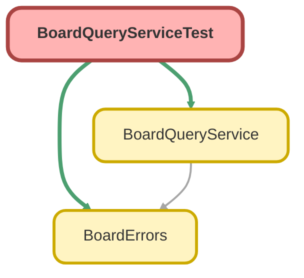

<!-- This file is auto-generated. if you do not want it to be overwritten, set TRUE in the line below -->
<!-- DO_NOT_OVERWRITE_DOC=FALSE -->

# BoardQueryServiceTest Class

`ISTEST`

## Class Diagram



<!-- Apex description -->

## Apex Code

```java
@IsTest
private class BoardQueryServiceTest {
    private static final String RESTRICTED_ALIAS = 'brdqry';
    private static final String RESTRICTED_LAST_NAME = 'Boardquery Restricted';

    /**
     * Data: Alpha (Banking) <- Alpha Child (Energy, ParentId = Alpha), Beta (Energy).
     * Opportunities: Alpha 100 & 200, Beta 300 & null (closed two years ago), Alpha Child 400.
     * Cases: two on Alpha (High, Low), one on Beta (Low). Alpha's High case has a CaseComment; Beta's case a FeedItem.
     *
     * Restricted user: `Minimum Access - Salesforce` + Read on Account (FLS: Industry), Case (FLS: AccountId), and
     * Asset (FLS: AccountId, but not the other Account references AssetProvidedById / AssetServicedById).
     */
    @TestSetup
    static void setup() {
        User restrictedUser;
        System.runAs(new User(Id = UserInfo.getUserId())) {
            restrictedUser = new User(
                ProfileId = [SELECT Id FROM Profile WHERE Name = 'Minimum Access - Salesforce' LIMIT 1]
                .Id,
                Alias = RESTRICTED_ALIAS,
                LastName = RESTRICTED_LAST_NAME,
                Email = RESTRICTED_ALIAS + '@example.com',
                Username = RESTRICTED_ALIAS +
                    String.valueOf(Crypto.getRandomInteger()).replace('-', '') +
                    '@board-query.test',
                TimeZoneSidKey = 'America/Los_Angeles',
                LocaleSidKey = 'en_US',
                EmailEncodingKey = 'UTF-8',
                LanguageLocaleKey = 'en_US'
            );
            insert restrictedUser;
            PermissionSet permissionSet = new PermissionSet(Name = 'BoardQueryTestAccess', Label = 'Board Query Test');
            insert permissionSet;
            insert new List<ObjectPermissions>{
                new ObjectPermissions(ParentId = permissionSet.Id, SobjectType = 'Account', PermissionsRead = true),
                new ObjectPermissions(ParentId = permissionSet.Id, SobjectType = 'Case', PermissionsRead = true),
                new ObjectPermissions(ParentId = permissionSet.Id, SobjectType = 'Asset', PermissionsRead = true)
            };
            insert new List<FieldPermissions>{
                new FieldPermissions(
                    ParentId = permissionSet.Id,
                    SobjectType = 'Account',
                    Field = 'Account.Industry',
                    PermissionsRead = true
                ),
                new FieldPermissions(
                    ParentId = permissionSet.Id,
                    SobjectType = 'Case',
                    Field = 'Case.AccountId',
                    PermissionsRead = true
                ),
                new FieldPermissions(
                    ParentId = permissionSet.Id,
                    SobjectType = 'Asset',
                    Field = 'Asset.AccountId',
                    PermissionsRead = true
                )
            };
            insert new PermissionSetAssignment(AssigneeId = restrictedUser.Id, PermissionSetId = permissionSet.Id);
        }

        Account alpha = new Account(Name = 'Board Alpha', Industry = 'Banking', OwnerId = restrictedUser.Id);
        Account beta = new Account(Name = 'Board Beta', Industry = 'Energy', OwnerId = restrictedUser.Id);
        insert new List<Account>{ alpha, beta };
        Account alphaChild = new Account(
            Name = 'Board Alpha Child',
            Industry = 'Energy',
            ParentId = alpha.Id,
            OwnerId = restrictedUser.Id
        );
        insert alphaChild;

        String stage = Opportunity.StageName.getDescribe().getPicklistValues()[0].getValue();
        insert new List<Opportunity>{
            opportunity('Board Opp 1', alpha.Id, 100, Date.today(), stage),
            opportunity('Board Opp 2', alpha.Id, 200, Date.today(), stage),
            opportunity('Board Opp 3', beta.Id, 300, Date.today(), stage),
            opportunity('Board Opp 4', alphaChild.Id, 400, Date.today(), stage),
            opportunity('Board Opp 5', beta.Id, null, Date.today().addYears(-2), stage)
        };

        Case highCase = new Case(Subject = 'Board High', AccountId = alpha.Id, Priority = 'High');
        Case lowCase = new Case(Subject = 'Board Low', AccountId = alpha.Id, Priority = 'Low');
        Case betaCase = new Case(Subject = 'Board Beta', AccountId = beta.Id, Priority = 'Low');
        for (Case supportCase : new List<Case>{ highCase, lowCase, betaCase }) {
            supportCase.OwnerId = restrictedUser.Id;
        }
        insert new List<Case>{ highCase, lowCase, betaCase };
        insert new CaseComment(ParentId = highCase.Id, CommentBody = 'Board comment');
        insert new FeedItem(ParentId = betaCase.Id, Body = 'Board feed post');
    }

    // ---------------------------------------------------------------------------------------------------------
    // Filter bindings
    // ---------------------------------------------------------------------------------------------------------

    @IsTest
    static void explicitBindingsSupportDirectFieldsAndParentDotPaths() {
        Map<String, Object> byAccount = metricRequest('Opportunity', 'COUNT', null);
        addFilter(byAccount, lookup('account', 'AccountId', true, accountId('Board Alpha')));
        BoardQueryService.MetricResult direct = run(byAccount);
        Assert.areEqual(2, direct.value, 'Direct AccountId binding');
        Assert.areEqual(new List<String>{ 'account' }, direct.appliedFilterIds);
        Assert.areEqual('SINGLE', direct.mode);
        Assert.isTrue(direct.isComplete);

        Map<String, Object> byIndustry = metricRequest('Opportunity', 'COUNT', null);
        addFilter(byIndustry, picklist('industry', 'Account.Industry', true, new List<String>{ 'Energy' }));
        Assert.areEqual(3, run(byIndustry).value, 'One-hop parent path: Beta x2 + Alpha Child');

        Map<String, Object> byParent = metricRequest('Opportunity', 'COUNT', null);
        addFilter(byParent, lookup('parent', 'Account.ParentId', true, accountId('Board Alpha')));
        Assert.areEqual(1, run(byParent).value, 'Parent hop to Account.ParentId');

        Map<String, Object> byGrandParent = metricRequest('Opportunity', 'COUNT', null);
        addFilter(
            byGrandParent,
            picklist('grandIndustry', 'Account.Parent.Industry', true, new List<String>{ 'Banking' })
        );
        Assert.areEqual(1, run(byGrandParent).value, 'Two-hop parent path');
    }

    @IsTest
    static void explicitChildSemiJoinsFilterParentsByChildRecords() {
        Map<String, Object> commented = metricRequest('Case', 'COUNT', null);
        Map<String, Object> commenter = filter('commenter', 'USER', 'CaseComment(ParentId).CreatedById', true, 'IN');
        commenter.put('token', 'ME');
        addFilter(commented, commenter);
        Assert.areEqual(1, run(commented).value, 'Only the High case has a CaseComment');

        Map<String, Object> posted = metricRequest('Case', 'COUNT', null);
        addFilter(posted, picklist('feedType', 'FeedItem(ParentId).Type', true, new List<String>{ 'TextPost' }));
        Assert.areEqual(1, run(posted).value, 'Polymorphic FeedItem.ParentId semi-join');

        Map<String, Object> accountsWithBigDeals = metricRequest('Account', 'COUNT', null);
        Map<String, Object> bigDeal = filter('bigDeal', 'DATE_RANGE', 'Opportunity(AccountId).CloseDate', true, 'GTE');
        bigDeal.put('from', String.valueOf(Date.today().addDays(-1)));
        addFilter(accountsWithBigDeals, bigDeal);
        Assert.areEqual(3, run(accountsWithBigDeals).value, 'Every account has a current opportunity');
    }

    @IsTest
    static void conventionBindingsResolveRecordContextOrSkipSilently() {
        Id alphaId = accountId('Board Alpha');

        Map<String, Object> cases = metricRequest('Case', 'COUNT', null);
        addFilter(cases, recordContext(alphaId));
        BoardQueryService.MetricResult caseResult = run(cases);
        Assert.areEqual(2, caseResult.value, 'Single Case.AccountId reference binds by convention');
        Assert.areEqual(new List<String>{ '$recordContext' }, caseResult.appliedFilterIds);

        Map<String, Object> accounts = metricRequest('Account', 'COUNT', null);
        addFilter(accounts, recordContext(alphaId));
        Assert.areEqual(1, run(accounts).value, 'Same object binds to Id');

        Map<String, Object> tasks = metricRequest('Task', 'COUNT', null);
        addFilter(tasks, recordContext(alphaId));
        BoardQueryService.MetricResult ambiguous = run(tasks);
        Assert.areEqual(new List<String>{ '$recordContext' }, ambiguous.ignoredFilterIds, 'AccountId + WhatId');
        Assert.isTrue(ambiguous.appliedFilterIds.isEmpty());

        Map<String, Object> opportunities = metricRequest('Opportunity', 'COUNT', null);
        addFilter(opportunities, recordContext([SELECT Id FROM Case LIMIT 1].Id));
        Map<String, Object> mine = filter('owner', 'USER', null, false, 'IN');
        mine.put('token', 'ME');
        addFilter(opportunities, mine);
        Map<String, Object> ignored = picklist('stage', 'IGNORE', true, new List<String>{ 'Anything' });
        addFilter(opportunities, ignored);
        BoardQueryService.MetricResult partial = run(opportunities);
        Assert.areEqual(5, partial.value, 'Opportunity has no Case reference; owner binds to OwnerId');
        Assert.areEqual(new List<String>{ 'owner' }, partial.appliedFilterIds);
        Assert.areEqual(new List<String>{ '$recordContext', 'stage' }, partial.ignoredFilterIds);
    }

    @IsTest
    static void restrictedUserFailsClosedOnExplicitInaccessibleFieldsButSkipsConventionFields() {
        Map<String, Object> explicitPriority = metricRequest('Case', 'COUNT', null);
        addFilter(explicitPriority, picklist('priority', 'Priority', true, new List<String>{ 'High' }));
        Map<String, Object> conventionPriority = metricRequest('Case', 'COUNT', null);
        addFilter(conventionPriority, picklist('priority', 'Priority', false, new List<String>{ 'High' }));
        Map<String, Object> industry = metricRequest('Case', 'COUNT', null);
        addFilter(industry, picklist('industry', 'Account.Industry', true, new List<String>{ 'Banking' }));
        Map<String, Object> revenue = metricRequest('Account', 'SUM', 'AnnualRevenue');

        Map<String, Object> explicitError;
        BoardQueryService.MetricResult skipped;
        Integer industryCount;
        Map<String, Object> objectError;
        Map<String, Object> valueFieldError;
        System.runAs(restrictedUser()) {
            explicitError = expectError(explicitPriority, 'ACCESS_ERROR');
            skipped = run(conventionPriority);
            industryCount = (Integer) run(industry).value;
            objectError = expectError(metricRequest('Opportunity', 'COUNT', null), 'ACCESS_ERROR');
            valueFieldError = expectError(revenue, 'ACCESS_ERROR');
        }

        Assert.areEqual('priority', explicitError.get('filterId'));
        Assert.areEqual('Priority', explicitError.get('fieldPath'));
        Assert.areEqual(false, explicitError.get('retryable'));
        Assert.areEqual(3, skipped.value, 'Unviewable convention field is skipped, not applied');
        Assert.areEqual(new List<String>{ 'priority' }, skipped.ignoredFilterIds);
        Assert.areEqual(2, industryCount, 'Readable parent path applies for the restricted user');
        Assert.areEqual('Opportunity', objectError.get('fieldPath'));
        Assert.areEqual('AnnualRevenue', valueFieldError.get('fieldPath'));
    }

    @IsTest
    static void stepTwoAmbiguityIgnoresFieldLevelSecurity() {
        // Asset has three Account references; the restricted user can read only AccountId.
        Id alphaId = accountId('Board Alpha');
        Map<String, Object> serverConvention = metricRequest('Asset', 'COUNT', null);
        addFilter(serverConvention, recordContext(alphaId));
        Map<String, Object> widgetConvention = metricRequest('Asset', 'COUNT', null);
        addFilter(widgetConvention, lookup('account', 'AccountId', false, alphaId));
        Map<String, Object> stepOne = metricRequest('Asset', 'COUNT', null);
        Map<String, Object> hinted = lookup('account', 'AccountId', false, alphaId);
        hinted.put('fieldApiName', 'AccountId');
        addFilter(stepOne, hinted);

        BoardQueryService.MetricResult serverResult;
        BoardQueryService.MetricResult widgetResult;
        BoardQueryService.MetricResult stepOneResult;
        System.runAs(restrictedUser()) {
            serverResult = run(serverConvention);
            widgetResult = run(widgetConvention);
            stepOneResult = run(stepOne);
        }

        Assert.areEqual(new List<String>{ '$recordContext' }, serverResult.ignoredFilterIds, 'Never binds AccountId');
        Assert.areEqual(
            new List<String>{ 'account' },
            widgetResult.ignoredFilterIds,
            'A Step 2 path resolved from readable fields only is re-checked'
        );
        Assert.areEqual(new List<String>{ 'account' }, stepOneResult.appliedFilterIds, 'Step 1 hint match applies');
    }

    @IsTest
    static void brokenExplicitBindingsAndBaseFiltersFailClosedWithConfigError() {
        assertBindingError(picklist('account', 'Account.Nope__c', true, new List<String>{ 'x' }), 'account');
        assertBindingError(lookup('child', 'Nope__c(ParentId).Id', true, accountId('Board Alpha')), 'child');
        assertBindingError(
            picklist('wrongFk', 'Contact(AccountId).LastName', true, new List<String>{ 'x' }),
            'wrongFk'
        );
        assertBindingError(
            picklist('deep', 'Account.Parent.Parent.Parent.Parent.Parent.Name', true, new List<String>{ 'x' }),
            'deep'
        );
        assertBindingError(picklist('relation', 'Nope.Name', true, new List<String>{ 'x' }), 'relation');
        assertBindingError(picklist('longText', 'Description', true, new List<String>{ 'x' }), 'longText');
        assertBindingError(lookup('badId', 'AccountId', true, 'not-an-id'), 'badId');
        assertBindingError(picklist('empty', ' ', true, new List<String>{ 'x' }), 'empty');

        Map<String, Object> wrongType = filter('closeDate', 'DATE_RANGE', 'StageName', true, 'LITERAL');
        wrongType.put('literal', 'TODAY');
        assertBindingError(wrongType, 'closeDate');
        Map<String, Object> badLiteral = filter('closeDate', 'DATE_RANGE', 'CloseDate', true, 'LITERAL');
        badLiteral.put('literal', 'TODAY OR Name != null');
        assertBindingError(badLiteral, 'closeDate');
        Map<String, Object> badDate = filter('closeDate', 'DATE_RANGE', 'CloseDate', true, 'BETWEEN');
        badDate.put('from', '2026-13-45');
        assertBindingError(badDate, 'closeDate');
        Map<String, Object> sosl = filter('search', 'TEXT', 'Name', true, 'SOSL');
        sosl.put('text', 'Board');
        assertBindingError(sosl, 'search');

        Map<String, Object> tooManyJoins = metricRequest('Case', 'COUNT', null);
        for (String filterId : new List<String>{ 'one', 'two', 'three' }) {
            Map<String, Object> semiJoin = filter(filterId, 'USER', 'CaseComment(ParentId).CreatedById', true, 'IN');
            semiJoin.put('token', 'ME');
            addFilter(tooManyJoins, semiJoin);
        }
        Assert.areEqual('three', expectError(tooManyJoins, 'CONFIG_ERROR').get('filterId'));

        Map<String, Object> conventionWrongType = metricRequest('Opportunity', 'COUNT', null);
        Map<String, Object> conventionDate = filter('closeDate', 'DATE_RANGE', 'StageName', false, 'LITERAL');
        conventionDate.put('literal', 'TODAY');
        addFilter(conventionWrongType, conventionDate);
        Assert.areEqual(5, run(conventionWrongType).value, 'Incompatible convention binding is skipped');

        assertBaseFilterError(baseFilter('bf1', 'Bogus__c', 'EQ', 'x'), 'bf1');
        assertBaseFilterError(baseFilter('bf2', 'Amount', 'GT', 'abc'), 'bf2');
        assertBaseFilterError(baseFilter('bf3', 'CloseDate', 'LITERAL', 'NOT_A_LITERAL'), 'bf3');
        assertBaseFilterError(baseFilter('bf4', 'Amount', 'LITERAL', 'TODAY'), 'bf4');
        assertBaseFilterError(baseFilter('bf5', 'Amount', 'LIKE', '1'), 'bf5');
        assertBaseFilterError(baseFilter('bf6', 'Amount', 'BETWEEN', '1'), 'bf6');
        assertBaseFilterError(baseFilter('bf7', 'Amount', 'GT', null), 'bf7');
        assertBaseFilterError(baseFilter('bf8', 'StageName', 'IN', new List<Object>()), 'bf8');
        assertBaseFilterError(baseFilter('bf9', '', 'EQ', 'x'), 'bf9');
    }

    @IsTest
    static void malformedRequestsAndValueFieldsFailClosedWithConfigError() {
        expectRawError('{ not json', 'CONFIG_ERROR');
        expectRawError('[1, 2]', 'CONFIG_ERROR');
        expectError(metricRequest('Nope__c', 'COUNT', null), 'CONFIG_ERROR');
        expectError(metricRequest('Opportunity', 'MEDIAN', 'Amount'), 'CONFIG_ERROR');
        expectError(metricRequest('Opportunity', 'SUM', null), 'CONFIG_ERROR');
        expectError(metricRequest('Opportunity', 'SUM', 'Name'), 'CONFIG_ERROR');
        expectError(metricRequest('Opportunity', 'SUM', 'Account.AnnualRevenue'), 'CONFIG_ERROR');
        expectError(metricRequest('Opportunity', 'AVG', 'Nope__c'), 'CONFIG_ERROR');
    }

    // ---------------------------------------------------------------------------------------------------------
    // Operators
    // ---------------------------------------------------------------------------------------------------------

    @IsTest
    static void dateRangesPassLiteralsAndExpandIsoDatesToDayBoundaries() {
        String today = String.valueOf(Date.today());
        Assert.areEqual(4, countWith(dateFilter('CloseDate', 'LITERAL', 'last_n_days:30', null, null)));
        Assert.areEqual(
            4,
            countWith(dateFilter('CloseDate', 'BETWEEN', null, String.valueOf(Date.today().addDays(-1)), today))
        );
        Assert.areEqual(5, countWith(dateFilter('CreatedDate', 'BETWEEN', null, today, today)), 'Whole user day');
        Assert.areEqual(
            0,
            countWith(dateFilter('CreatedDate', 'GTE', null, String.valueOf(Date.today().addDays(1)), null))
        );
        Assert.areEqual(
            0,
            countWith(dateFilter('CreatedDate', 'LTE', null, null, String.valueOf(Date.today().addDays(-1))))
        );
        Assert.areEqual(5, countWith(dateFilter('CreatedDate', 'LTE', null, null, today)), 'End of day inclusive');
    }

    @IsTest
    static void picklistAndTextFiltersAdaptToFieldTypes() {
        Assert.areEqual(5, countWith(picklist('private', 'IsPrivate', true, new List<String>{ 'false' })));
        Map<String, Object> contains = filter('search', 'TEXT', 'Name', true, 'CONTAINS');
        contains.put('text', 'Opp');
        Assert.areEqual(5, countWith(contains));
        Map<String, Object> startsWith = filter('search', 'TEXT', 'Name', true, 'STARTS_WITH');
        startsWith.put('text', 'Opp');
        Assert.areEqual(0, countWith(startsWith));
        Map<String, Object> wildcard = filter('search', 'TEXT', 'Name', true, 'CONTAINS');
        wildcard.put('text', '%%');
        Assert.areEqual(0, countWith(wildcard), 'LIKE wildcards are escaped');

        Map<String, Object> tooShort = metricRequest('Opportunity', 'COUNT', null);
        Map<String, Object> oneCharacter = filter('search', 'TEXT', 'Name', true, 'CONTAINS');
        oneCharacter.put('text', 'x');
        addFilter(tooShort, oneCharacter);
        BoardQueryService.MetricResult shortResult = run(tooShort);
        Assert.areEqual(5, shortResult.value, 'One character never filters (minCharacters floor of 2)');
        Assert.areEqual(new List<String>{ 'search' }, shortResult.ignoredFilterIds);
        Map<String, Object> belowMinimum = filter('search', 'TEXT', 'Name', true, 'CONTAINS');
        belowMinimum.put('text', 'Opp 9');
        belowMinimum.put('minCharacters', 6);
        Assert.areEqual(5, countWith(belowMinimum), 'The filter minCharacters raises the floor');

        List<Schema.PicklistEntry> channels = QuickText.Channel.getDescribe().getPicklistValues();
        insert new List<QuickText>{
            new QuickText(Name = 'Board QT 1', Message = 'One', Channel = channels[0].getValue()),
            new QuickText(
                Name = 'Board QT 2',
                Message = 'Two',
                Channel = channels[0].getValue() + ';' + channels[1].getValue()
            ),
            new QuickText(Name = 'Board QT 3', Message = 'Three', Channel = channels[1].getValue())
        };
        Map<String, Object> multi = metricRequest('QuickText', 'COUNT', null);
        addFilter(multi, picklist('channel', 'Channel', true, new List<String>{ channels[0].getValue() }));
        Assert.areEqual(2, run(multi).value, 'IN adapts to INCLUDES on MultiPicklist');
        Map<String, Object> excludes = metricRequest('QuickText', 'COUNT', null);
        addBaseFilter(excludes, baseFilter('bf', 'Channel', 'NOT_IN', new List<Object>{ channels[0].getValue() }));
        Assert.areEqual(1, run(excludes).value, 'NOT_IN adapts to EXCLUDES on MultiPicklist');
    }

    @IsTest
    static void baseFiltersCombineWithBoardFiltersUsingAnd() {
        String stage = Opportunity.StageName.getDescribe().getPicklistValues()[0].getValue();
        String today = String.valueOf(Date.today());
        Assert.areEqual(3, countWithBase(baseFilter('min', 'Amount', 'GTE', 200)));
        Assert.areEqual(1, countWithBase(baseFilter('max', 'Amount', 'LT', '200')));
        Assert.areEqual(1, countWithBase(baseFilter('blank', 'Amount', 'IS_NULL', true)));
        Assert.areEqual(4, countWithBase(baseFilter('present', 'Amount', 'IS_NULL', false)));
        Assert.areEqual(4, countWithBase(baseFilter('notNull', 'Amount', 'NEQ', null)));
        Assert.areEqual(1, countWithBase(baseFilter('eq', 'Amount', 'EQ', 300)));
        Assert.areEqual(5, countWithBase(baseFilter('stage', 'StageName', 'IN', new List<Object>{ stage })));
        Assert.areEqual(0, countWithBase(baseFilter('notStage', 'StageName', 'NOT_IN', stage)));
        Assert.areEqual(5, countWithBase(baseFilter('like', 'Name', 'LIKE', 'Opp')));
        Assert.areEqual(5, countWithBase(baseFilter('likeRaw', 'Name', 'LIKE', 'Board%')));
        Assert.areEqual(4, countWithBase(baseFilter('quarter', 'CloseDate', 'LITERAL', 'THIS_FISCAL_YEAR')));
        Assert.areEqual(4, countWithBase(baseFilter('closeDate', 'CloseDate', 'EQ', today)));
        Assert.areEqual(5, countWithBase(baseFilter('createdDay', 'CreatedDate', 'EQ', today)));
        Assert.areEqual(0, countWithBase(baseFilter('notCreatedDay', 'CreatedDate', 'NEQ', today)));
        Assert.areEqual(0, countWithBase(baseFilter('createdAfter', 'CreatedDate', 'GT', today)));
        Assert.areEqual(5, countWithBase(baseFilter('createdFrom', 'CreatedDate', 'GTE', today)));
        Assert.areEqual(0, countWithBase(baseFilter('createdBefore', 'CreatedDate', 'LT', today)));
        Assert.areEqual(5, countWithBase(baseFilter('createdUntil', 'CreatedDate', 'LTE', today)));
        Assert.areEqual(
            5,
            countWithBase(
                baseFilter(
                    'createdBy',
                    'CreatedDate',
                    'LT',
                    Datetime.now().addDays(1).formatGmt('yyyy-MM-dd\'T\'HH:mm:ss\'Z\'')
                )
            )
        );
        Assert.areEqual(5, countWithBase(baseFilter('private', 'IsPrivate', 'NOT_IN', new List<Object>{ true })));
        Assert.areEqual(1, countWithBase(baseFilter('parent', 'Account.ParentId', 'EQ', accountId('Board Alpha'))));

        Map<String, Object> combined = metricRequest('Opportunity', 'COUNT', null);
        addFilter(combined, lookup('account', 'AccountId', true, accountId('Board Beta')));
        addBaseFilter(combined, baseFilter('min', 'Amount', 'GTE', 200));
        Assert.areEqual(1, run(combined).value, 'Beta 300 only');
    }

    // ---------------------------------------------------------------------------------------------------------
    // Aggregation tiers
    // ---------------------------------------------------------------------------------------------------------

    @IsTest
    static void tierOneComputesEveryAggregateInASingleCall() {
        Assert.areEqual(5, run(metricRequest('Opportunity', 'COUNT', null)).value);
        Assert.areEqual(1000, (Decimal) run(metricRequest('Opportunity', 'SUM', 'Amount')).value);
        Assert.areEqual(250, (Decimal) run(metricRequest('Opportunity', 'AVG', 'Amount')).value, 'Nulls ignored');
        Assert.areEqual(3, run(metricRequest('Opportunity', 'COUNT_DISTINCT', 'AccountId')).value);

        BoardQueryService.MetricResult min = run(metricRequest('Opportunity', 'MIN', 'Amount'));
        Assert.areEqual(100, (Decimal) min.value);
        Assert.areEqual('CURRENCY', min.valueType);
        Assert.isNull(min.totalRows, 'MIN/MAX use ORDER BY ... LIMIT 1 without counting');
        Assert.areEqual(400, (Decimal) run(metricRequest('Opportunity', 'MAX', 'Amount')).value);

        BoardQueryService.MetricResult earliest = run(metricRequest('Opportunity', 'MIN', 'CloseDate'));
        Assert.areEqual(Date.today().addYears(-2), earliest.value);
        Assert.areEqual('DATE', earliest.valueType);

        BoardQueryService.MetricResult sum = run(metricRequest('Opportunity', 'SUM', 'Amount'));
        Assert.areEqual(5, sum.totalRows);
        Assert.areEqual('SINGLE', sum.mode);
    }

    @IsTest
    static void zeroMatchingRowsReturnNullForValueAggregates() {
        for (String aggregateFunction : new List<String>{ 'SUM', 'AVG', 'MIN', 'MAX', 'COUNT_DISTINCT', 'COUNT' }) {
            Map<String, Object> request = metricRequest('Opportunity', aggregateFunction, 'Amount');
            addFilter(request, picklist('industry', 'Account.Industry', true, new List<String>{ 'Nope' }));
            BoardQueryService.MetricResult result = run(request);
            if (aggregateFunction == 'COUNT' || aggregateFunction == 'COUNT_DISTINCT') {
                Assert.areEqual(0, result.value, aggregateFunction);
            } else {
                Assert.isNull(result.value, aggregateFunction + ' over zero rows');
            }
        }
    }

    @IsTest
    static void tierTwoChunksSumAndAvgThroughDatabaseCursor() {
        BoardQueryService.CURSOR_AGGREGATE_THRESHOLD = 2;
        BoardQueryService.CURSOR_CHUNK_SIZE = 2;

        Map<String, Object> request = metricRequest('Opportunity', 'AVG', 'Amount');
        BoardQueryService.MetricResult first = run(request);
        Assert.areEqual('CURSOR', first.mode);
        Assert.isFalse(first.isComplete);
        Assert.isNull(first.value);
        Assert.areEqual(5, first.totalRows);
        Assert.areEqual(5, first.chunk.totalRows);
        Assert.areEqual(2, first.chunk.nextOffset);
        Assert.isNotNull(first.chunk.cursor);

        Decimal sum = 0;
        Integer count = 0;
        Decimal min;
        Decimal max;
        Integer calls = 1;
        BoardQueryService.AggregateChunk chunk = first.chunk;
        while (true) {
            BoardQueryService.AggregateBucket bucket = chunk.buckets[0];
            Assert.isTrue(bucket.groupValues.isEmpty());
            sum += bucket.sum;
            count += bucket.count;
            min = min == null || (bucket.min != null && bucket.min < min) ? bucket.min : min;
            max = max == null || (bucket.max != null && bucket.max > max) ? bucket.max : max;
            if (chunk.isComplete) {
                break;
            }
            Map<String, Object> next = request.clone();
            next.put('cursor', chunk.cursor);
            next.put('offset', chunk.nextOffset);
            chunk = BoardQueryService.fetchAggregateChunk(JSON.serialize(next));
            calls++;
        }
        Assert.areEqual(3, calls, '5 rows in chunks of 2');
        Assert.areEqual(1000, sum);
        Assert.areEqual(4, count, 'Null amounts are not counted');
        Assert.areEqual(100, min);
        Assert.areEqual(400, max);
    }

    @IsTest
    static void tierThreeFailsWithLimitExceeded() {
        BoardQueryService.CURSOR_AGGREGATE_THRESHOLD = 2;
        BoardQueryService.CURSOR_MAX_ROWS = 4;

        Map<String, Object> sumError = expectError(metricRequest('Opportunity', 'SUM', 'Amount'), 'LIMIT_EXCEEDED');
        Assert.isTrue(((String) sumError.get('message')).contains('5 records'), (String) sumError.get('message'));
        Assert.areEqual(false, sumError.get('retryable'));

        BoardQueryService.CURSOR_MAX_ROWS = 200000;
        expectError(metricRequest('Opportunity', 'COUNT_DISTINCT', 'AccountId'), 'LIMIT_EXCEEDED');
        Assert.areEqual(5, run(metricRequest('Opportunity', 'COUNT', null)).value, 'COUNT is never limited');
    }

    @IsTest
    static void expiredOrInvalidCursorIsRetryableQueryError() {
        Map<String, Object> request = metricRequest('Opportunity', 'SUM', 'Amount');
        // A syntactically valid but unknown queryId raises an uncatchable platform error; use a corrupt handle.
        request.put('cursor', 'not-a-cursor-handle');
        request.put('offset', 0);
        try {
            BoardQueryService.fetchAggregateChunk(JSON.serialize(request));
            Assert.fail('Expected a cursor error');
        } catch (AuraHandledException error) {
            Map<String, Object> payload = (Map<String, Object>) JSON.deserializeUntyped(error.getMessage());
            Assert.areEqual('QUERY_ERROR', payload.get('category'));
            Assert.areEqual(true, payload.get('retryable'));
        }
    }

    // ---------------------------------------------------------------------------------------------------------
    // Bar Chart
    // ---------------------------------------------------------------------------------------------------------

    @IsTest
    static void barReferenceGroupsDisplayRelatedRecordNames() {
        BoardQueryService.BarResult byAccount = runBar(barRequest('Opportunity', 'COUNT', null, 'AccountId'));
        Assert.areEqual('SINGLE', byAccount.mode);
        Assert.areEqual('Account.Name', byAccount.groupBy.labelFieldPath);
        Assert.areEqual('REFERENCE', byAccount.groupBy.dataType);
        Assert.isNull(byAccount.stackBy);
        Map<String, BoardQueryService.BarBucket> accounts = bucketsByLabel(byAccount);
        Assert.areEqual(new Set<String>{ 'Board Alpha', 'Board Beta', 'Board Alpha Child' }, accounts.keySet());
        Assert.areEqual(2, accounts.get('Board Alpha').value);
        Assert.areEqual(String.valueOf(accountId('Board Alpha')), accounts.get('Board Alpha').groupValue);
        Assert.areEqual(2, byAccount.buckets[0].value, 'Largest buckets first');

        BoardQueryService.BarResult byOwner = runBar(barRequest('Case', 'COUNT', null, 'OwnerId'));
        Assert.areEqual('Owner.Name', byOwner.groupBy.labelFieldPath, 'Polymorphic owner resolves the User name');
        Assert.areEqual(1, byOwner.buckets.size());
        Assert.areEqual(RESTRICTED_LAST_NAME, byOwner.buckets[0].groupLabel);
        Assert.areEqual(3, byOwner.buckets[0].value);

        BoardQueryService.BarResult byIndustry = runBar(barRequest('Opportunity', 'SUM', 'Amount', 'Account.Industry'));
        Map<String, BoardQueryService.BarBucket> industries = bucketsByLabel(byIndustry);
        Assert.areEqual(300, (Decimal) industries.get('Banking').value);
        Assert.areEqual(700, (Decimal) industries.get('Energy').value, 'Parent dot-path: Beta 300 + Alpha Child 400');
        Assert.areEqual(5, byIndustry.totalRows);
        Assert.areEqual('CURRENCY', byIndustry.valueType);
    }

    @IsTest
    static void barNullBucketsAreKeptByDefaultAndExcludedOnRequest() {
        Map<String, Object> request = barRequest('Opportunity', 'COUNT', null, 'Account.ParentId');
        BoardQueryService.BarResult withBlank = runBar(request);
        Assert.areEqual(2, withBlank.buckets.size());
        Assert.isNull(withBlank.buckets[0].groupValue, 'Null parent bucket (4 rows) sorts first');
        Assert.isNull(withBlank.buckets[0].groupLabel);
        Assert.areEqual(4, withBlank.buckets[0].value);
        Assert.areEqual('Board Alpha', withBlank.buckets[1].groupLabel, 'Account.Parent.Name label');

        request.put('includeNullBucket', false);
        BoardQueryService.BarResult withoutBlank = runBar(request);
        Assert.areEqual(1, withoutBlank.buckets.size());
        Assert.areEqual('Board Alpha', withoutBlank.buckets[0].groupLabel);
    }

    @IsTest
    static void barDateGroupsBucketByGranularityWithSortableKeys() {
        Date today = Date.today();
        Date older = today.addYears(-2);
        String year = String.valueOf(today.year());
        String month = year + '-' + String.valueOf(today.month()).leftPad(2, '0');
        String quarter = year + '-Q' + ((today.month() - 1) / 3 + 1);

        Map<String, BoardQueryService.BarBucket> years = bucketsByKey(
            runBar(dateBarRequest('CloseDate', 'CALENDAR_YEAR'))
        );
        Assert.areEqual(4, years.get(year).value);
        Assert.areEqual(1, years.get(String.valueOf(older.year())).value);
        Assert.areEqual(year, years.get(year).groupLabel);

        Map<String, BoardQueryService.BarBucket> months = bucketsByKey(
            runBar(dateBarRequest('CloseDate', 'CALENDAR_MONTH'))
        );
        Assert.areEqual(4, months.get(month).value);
        Assert.areEqual(
            Datetime.newInstance(today.year(), today.month(), 1).format('MMM yyyy'),
            months.get(month).groupLabel
        );

        BoardQueryService.BarResult quarters = runBar(dateBarRequest('CloseDate', 'CALENDAR_QUARTER'));
        Assert.areEqual('CALENDAR_QUARTER', quarters.groupBy.dateGranularity);
        Assert.areEqual(4, bucketsByKey(quarters).get(quarter).value);

        BoardQueryService.BarResult days = runBar(dateBarRequest('CloseDate', null));
        Assert.areEqual('DAY', days.groupBy.dateGranularity, 'Date fields default to DAY buckets');
        Assert.areEqual(today.format(), bucketsByKey(days).get(String.valueOf(today)).groupLabel);

        BoardQueryService.BarResult created = runBar(dateBarRequest('CreatedDate', 'CALENDAR_MONTH'));
        Assert.areEqual(5, bucketsByKey(created).get(month).value, 'DateTime buckets in the user time zone');
        Assert.areEqual(5, bucketsByKey(runBar(dateBarRequest('CreatedDate', 'DAY'))).get(String.valueOf(today)).value);

        BoardQueryService.BarResult fiscalYears = runBar(dateBarRequest('CloseDate', 'FISCAL_YEAR'));
        Assert.areEqual(2, fiscalYears.buckets.size());
        for (BoardQueryService.BarBucket bucket : fiscalYears.buckets) {
            Assert.isTrue(Pattern.matches('FY\\d{4}', bucket.groupValue), bucket.groupValue);
            Assert.areEqual(bucket.groupValue, bucket.groupLabel);
        }
        for (BoardQueryService.BarBucket bucket : runBar(dateBarRequest('CloseDate', 'FISCAL_QUARTER')).buckets) {
            Assert.isTrue(Pattern.matches('FY\\d{4}-Q[1-4]', bucket.groupValue), bucket.groupValue);
            Assert.isTrue(Pattern.matches('Q[1-4] FY\\d{4}', bucket.groupLabel), bucket.groupLabel);
        }

        expectBarError(dateBarRequest('StageName', 'CALENDAR_MONTH'), 'CONFIG_ERROR');
        expectBarError(dateBarRequest('CloseDate', 'WEEK'), 'CONFIG_ERROR');
    }

    @IsTest
    static void barPicklistGroupsReturnDescribeOrderAndStackedSeries() {
        List<String> activePriorities = new List<String>();
        Map<String, String> priorityLabels = new Map<String, String>();
        for (Schema.PicklistEntry entry : Case.Priority.getDescribe().getPicklistValues()) {
            if (entry.isActive()) {
                activePriorities.add(entry.getValue());
                priorityLabels.put(entry.getValue(), entry.getLabel());
            }
        }
        BoardQueryService.BarResult byPriority = runBar(barRequest('Case', 'COUNT', null, 'Priority'));
        Assert.areEqual(activePriorities, byPriority.groupBy.picklistOrder);
        Map<String, BoardQueryService.BarBucket> priorities = bucketsByKey(byPriority);
        Assert.areEqual(2, priorities.get('Low').value);
        Assert.areEqual(priorityLabels.get('High'), priorities.get('High').groupLabel, 'Translated picklist label');

        Map<String, Object> stacked = barRequest('Case', 'COUNT', null, 'AccountId');
        stacked.put('stackByField', 'Priority');
        BoardQueryService.BarResult series = runBar(stacked);
        Assert.areEqual('Priority', series.stackBy.fieldPath);
        Assert.areEqual(activePriorities, series.stackBy.picklistOrder);
        Map<String, Integer> counts = new Map<String, Integer>();
        for (BoardQueryService.BarBucket bucket : series.buckets) {
            counts.put(bucket.groupLabel + '|' + bucket.stackValue, (Integer) bucket.value);
        }
        Assert.areEqual(
            new Map<String, Integer>{ 'Board Alpha|High' => 1, 'Board Alpha|Low' => 1, 'Board Beta|Low' => 1 },
            counts
        );
    }

    @IsTest
    static void barValueAggregatesRunPerGroup() {
        Map<String, BoardQueryService.BarBucket> averages = bucketsByLabel(
            runBar(barRequest('Opportunity', 'AVG', 'Amount', 'AccountId'))
        );
        Assert.areEqual(150, (Decimal) averages.get('Board Alpha').value);
        Assert.areEqual(300, (Decimal) averages.get('Board Beta').value, 'Null amounts ignored');
        Map<String, BoardQueryService.BarBucket> minimums = bucketsByLabel(
            runBar(barRequest('Opportunity', 'MIN', 'Amount', 'AccountId'))
        );
        Assert.areEqual(100, (Decimal) minimums.get('Board Alpha').value);
        Map<String, BoardQueryService.BarBucket> distinct = bucketsByLabel(
            runBar(barRequest('Opportunity', 'COUNT_DISTINCT', 'AccountId', 'Account.Industry'))
        );
        Assert.areEqual(2, distinct.get('Energy').value);
    }

    @IsTest
    static void barGroupCapFallsBackToCursorChunksWithEveryGroup() {
        BoardQueryService.BAR_GROUP_LIMIT = 2;

        BoardQueryService.BarResult sums = runBar(barRequest('Opportunity', 'SUM', 'Amount', 'AccountId'));
        Assert.areEqual('CURSOR', sums.mode);
        Assert.isFalse(sums.hasMoreGroups);
        Assert.isTrue(sums.buckets.isEmpty());
        Map<String, Decimal> sumByAccount = mergeChunks(barRequest('Opportunity', 'SUM', 'Amount', 'AccountId'), sums);
        Assert.areEqual(3, sumByAccount.size(), 'Every group, not just the largest 2');
        Assert.areEqual(300, sumByAccount.get('Board Alpha'));
        Assert.areEqual(300, sumByAccount.get('Board Beta'));
        Assert.areEqual(400, sumByAccount.get('Board Alpha Child'));

        BoardQueryService.CURSOR_CHUNK_SIZE = 2;
        Map<String, Object> countRequest = barRequest('Opportunity', 'COUNT', null, 'AccountId');
        BoardQueryService.BarResult counts = runBar(countRequest);
        Assert.areEqual('CURSOR', counts.mode, 'Grouped COUNT falls back too');
        Assert.areEqual(5, counts.totalRows);
        Assert.isFalse(counts.isComplete);
        Map<String, Decimal> countByAccount = mergeChunks(countRequest, counts);
        Assert.areEqual(3, countByAccount.size());
        Assert.areEqual(2, countByAccount.get('Board Alpha'), 'COUNT buckets add 1 per row across chunks');
        Assert.areEqual(2, countByAccount.get('Board Beta'));
        Assert.areEqual(1, countByAccount.get('Board Alpha Child'));
    }

    @IsTest
    static void barGroupCapReportsPartialResultsWhenTheCursorTierCannotRun() {
        BoardQueryService.BAR_GROUP_LIMIT = 2;
        BoardQueryService.BarResult distinct = runBar(barRequest('Opportunity', 'COUNT_DISTINCT', 'Name', 'AccountId'));
        Assert.areEqual('SINGLE', distinct.mode, 'COUNT_DISTINCT cannot merge cursor chunks');
        Assert.isTrue(distinct.hasMoreGroups);
        Assert.areEqual(2, distinct.buckets.size());

        BoardQueryService.CURSOR_MAX_ROWS = 4;
        BoardQueryService.BarResult capped = runBar(barRequest('Opportunity', 'SUM', 'Amount', 'AccountId'));
        Assert.areEqual('SINGLE', capped.mode, '5 rows exceed the cursor tier');
        Assert.isTrue(capped.hasMoreGroups);
        Assert.areEqual(2, capped.buckets.size());
        Assert.areEqual('Board Alpha Child', capped.buckets[0].groupLabel, 'Largest sums kept: 400');
    }

    @IsTest
    static void unexpectedFailuresReturnAGenericRetryableMessage() {
        Map<String, Object> request = metricRequest('Opportunity', 'SUM', 'Amount');
        request.put('cursor', 'not-a-cursor-handle');
        request.put('offset', 'not-a-number');
        try {
            BoardQueryService.fetchAggregateChunk(JSON.serialize(request));
            Assert.fail('Expected an error');
        } catch (AuraHandledException error) {
            Map<String, Object> payload = (Map<String, Object>) JSON.deserializeUntyped(error.getMessage());
            Assert.areEqual('QUERY_ERROR', payload.get('category'));
            Assert.areEqual(BoardErrors.GENERIC_MESSAGE, payload.get('message'), 'Platform details are not returned');
            Assert.areEqual(true, payload.get('retryable'));
        }
    }

    @IsTest
    static void barTierTwoMergesGroupedCursorChunksMatchingSingleCallBuckets() {
        Map<String, Object> request = dateBarRequest('CloseDate', 'FISCAL_QUARTER');
        request.put('aggregateFunction', 'SUM');
        request.put('valueFieldApiName', 'Amount');
        request.put('stackByField', 'AccountId');
        Map<String, Object> single = new Map<String, Object>();
        for (BoardQueryService.BarBucket bucket : runBar(request).buckets) {
            single.put(bucket.groupValue + '|' + bucket.stackLabel, (Decimal) bucket.value);
        }

        BoardQueryService.CURSOR_AGGREGATE_THRESHOLD = 2;
        BoardQueryService.CURSOR_CHUNK_SIZE = 2;
        BoardQueryService.BarResult first = runBar(request);
        Assert.areEqual('CURSOR', first.mode);
        Assert.isFalse(first.isComplete);
        Assert.areEqual(5, first.totalRows);

        Map<String, Object> merged = new Map<String, Object>();
        Integer calls = 1;
        BoardQueryService.AggregateChunk chunk = first.chunk;
        while (true) {
            for (BoardQueryService.AggregateBucket bucket : chunk.buckets) {
                Assert.areEqual(2, bucket.groupValues.size(), 'Group and stack values');
                String key = String.valueOf(bucket.groupValues[0]) + '|' + bucket.groupLabels[1];
                Decimal sum = (Decimal) merged.get(key);
                merged.put(key, (sum == null ? bucket.sum : sum + bucket.sum));
            }
            if (chunk.isComplete) {
                break;
            }
            Map<String, Object> next = request.clone();
            next.put('cursor', chunk.cursor);
            next.put('offset', chunk.nextOffset);
            chunk = BoardQueryService.fetchAggregateChunk(JSON.serialize(next));
            calls++;
        }
        Assert.areEqual(3, calls);
        // The single-call path drops all-null SUM groups' values to null; the cursor reports 0 for them.
        for (String key : single.keySet()) {
            Decimal expected = (Decimal) single.get(key);
            if (expected == null) {
                expected = 0;
            }
            Assert.areEqual(expected, (Decimal) merged.get(key), key);
        }
        Assert.areEqual(single.keySet(), merged.keySet(), 'Cursor buckets match SOQL fiscal date functions');

        Map<String, Object> created = dateBarRequest('CreatedDate', 'CALENDAR_MONTH');
        created.put('aggregateFunction', 'MAX');
        created.put('valueFieldApiName', 'Amount');
        BoardQueryService.CURSOR_CHUNK_SIZE = 10;
        BoardQueryService.BarResult dateTimes = runBar(created);
        Assert.isTrue(dateTimes.chunk.isComplete);
        Date today = Date.today();
        Assert.areEqual(
            String.valueOf(today.year()) + '-' + String.valueOf(today.month()).leftPad(2, '0'),
            dateTimes.chunk.buckets[0].groupValues[0]
        );
        Assert.areEqual(400, dateTimes.chunk.buckets[0].max);

        for (String granularity : new List<String>{ 'DAY', 'CALENDAR_QUARTER', 'CALENDAR_YEAR', 'FISCAL_YEAR' }) {
            Map<String, Object> bucketed = dateBarRequest('CloseDate', granularity);
            bucketed.put('aggregateFunction', 'AVG');
            bucketed.put('valueFieldApiName', 'Amount');
            Set<Object> cursorKeys = new Set<Object>();
            for (BoardQueryService.AggregateBucket bucket : runBar(bucketed).chunk.buckets) {
                cursorKeys.add(bucket.groupValues[0]);
            }
            BoardQueryService.CURSOR_AGGREGATE_THRESHOLD = 49900;
            Set<Object> singleKeys = new Set<Object>();
            for (BoardQueryService.BarBucket bucket : runBar(bucketed).buckets) {
                singleKeys.add(bucket.groupValue);
            }
            BoardQueryService.CURSOR_AGGREGATE_THRESHOLD = 2;
            Assert.areEqual(singleKeys, cursorKeys, granularity);
        }
    }

    @IsTest
    static void barFailsClosedOnLimitsInvalidDimensionsAndInaccessibleFields() {
        expectBarError(barRequest('Opportunity', 'COUNT', null, null), 'CONFIG_ERROR');
        expectBarError(barRequest('Opportunity', 'COUNT', null, 'Description'), 'CONFIG_ERROR');
        expectBarError(
            barRequest('Opportunity', 'COUNT', null, 'OpportunityLineItem(OpportunityId).Quantity'),
            'CONFIG_ERROR'
        );
        expectBarError(barRequest('Opportunity', 'SUM', 'Name', 'StageName'), 'CONFIG_ERROR');
        expectBarError(barRequest('Opportunity', 'MEDIAN', 'Amount', 'StageName'), 'CONFIG_ERROR');
        Map<String, Object> badStack = barRequest('Opportunity', 'COUNT', null, 'StageName');
        badStack.put('stackByField', 'Nope__c');
        Assert.areEqual('Nope__c', expectBarError(badStack, 'CONFIG_ERROR').get('fieldPath'));

        BoardQueryService.CURSOR_AGGREGATE_THRESHOLD = 2;
        expectBarError(barRequest('Opportunity', 'COUNT_DISTINCT', 'AccountId', 'StageName'), 'LIMIT_EXCEEDED');
        BoardQueryService.CURSOR_MAX_ROWS = 4;
        expectBarError(barRequest('Opportunity', 'SUM', 'Amount', 'StageName'), 'LIMIT_EXCEEDED');
        Assert.areEqual(
            'SINGLE',
            runBar(barRequest('Opportunity', 'COUNT', null, 'StageName')).mode,
            'Grouped COUNT is never limited'
        );

        Map<String, Object> accessError;
        System.runAs(restrictedUser()) {
            accessError = expectBarError(barRequest('Case', 'COUNT', null, 'Priority'), 'ACCESS_ERROR');
        }
        Assert.areEqual('Priority', accessError.get('fieldPath'));
    }

    // ---------------------------------------------------------------------------------------------------------
    // Helpers
    // ---------------------------------------------------------------------------------------------------------

    private static Map<String, Object> barRequest(
        String objectApiName,
        String aggregateFunction,
        String valueField,
        String groupByField
    ) {
        Map<String, Object> request = metricRequest(objectApiName, aggregateFunction, valueField);
        request.put('groupByField', groupByField);
        return request;
    }

    private static Map<String, Object> dateBarRequest(String groupByField, String dateGranularity) {
        Map<String, Object> request = barRequest('Opportunity', 'COUNT', null, groupByField);
        request.put('dateGranularity', dateGranularity);
        return request;
    }

    private static BoardQueryService.BarResult runBar(Map<String, Object> request) {
        return BoardQueryService.queryBar(JSON.serialize(request));
    }

    /** Sums every cursor chunk's bucket `sum` by group label, following `nextOffset` until complete. */
    private static Map<String, Decimal> mergeChunks(Map<String, Object> request, BoardQueryService.BarResult first) {
        Map<String, Decimal> merged = new Map<String, Decimal>();
        BoardQueryService.AggregateChunk chunk = first.chunk;
        Boolean complete = false;
        while (!complete) {
            for (BoardQueryService.AggregateBucket bucket : chunk.buckets) {
                String key = bucket.groupLabels[0];
                Decimal current = merged.containsKey(key) ? merged.get(key) : 0.0;
                merged.put(key, current + bucket.sum);
            }
            complete = chunk.isComplete;
            if (!complete) {
                Map<String, Object> next = request.clone();
                next.put('cursor', chunk.cursor);
                next.put('offset', chunk.nextOffset);
                chunk = BoardQueryService.fetchAggregateChunk(JSON.serialize(next));
            }
        }
        return merged;
    }

    private static Map<String, BoardQueryService.BarBucket> bucketsByLabel(BoardQueryService.BarResult result) {
        Map<String, BoardQueryService.BarBucket> buckets = new Map<String, BoardQueryService.BarBucket>();
        for (BoardQueryService.BarBucket bucket : result.buckets) {
            buckets.put(bucket.groupLabel, bucket);
        }
        return buckets;
    }

    private static Map<String, BoardQueryService.BarBucket> bucketsByKey(BoardQueryService.BarResult result) {
        Map<String, BoardQueryService.BarBucket> buckets = new Map<String, BoardQueryService.BarBucket>();
        for (BoardQueryService.BarBucket bucket : result.buckets) {
            buckets.put(bucket.groupValue, bucket);
        }
        return buckets;
    }

    private static Map<String, Object> expectBarError(Map<String, Object> request, String category) {
        try {
            runBar(request);
        } catch (AuraHandledException error) {
            Map<String, Object> payload = (Map<String, Object>) JSON.deserializeUntyped(error.getMessage());
            Assert.areEqual(category, payload.get('category'), String.valueOf(payload));
            return payload;
        }
        Assert.fail('Expected ' + category + ' for ' + JSON.serialize(request));
        return null;
    }

    private static Opportunity opportunity(String name, Id accountId, Decimal amount, Date closeDate, String stage) {
        return new Opportunity(
            Name = name,
            AccountId = accountId,
            Amount = amount,
            CloseDate = closeDate,
            StageName = stage
        );
    }

    private static User restrictedUser() {
        return [SELECT Id FROM User WHERE Alias = :RESTRICTED_ALIAS AND LastName = :RESTRICTED_LAST_NAME LIMIT 1];
    }

    private static Id accountId(String name) {
        return [SELECT Id FROM Account WHERE Name = :name LIMIT 1].Id;
    }

    private static Map<String, Object> metricRequest(
        String objectApiName,
        String aggregateFunction,
        String valueField
    ) {
        return new Map<String, Object>{
            'objectApiName' => objectApiName,
            'aggregateFunction' => aggregateFunction,
            'valueFieldApiName' => valueField,
            'filters' => new List<Object>(),
            'baseFilters' => new List<Object>(),
            'refreshToken' => 0
        };
    }

    private static Map<String, Object> filter(
        String filterId,
        String type,
        String fieldPath,
        Boolean explicit,
        String operator
    ) {
        return new Map<String, Object>{
            'filterId' => filterId,
            'type' => type,
            'fieldPath' => fieldPath,
            'explicit' => explicit,
            'operator' => operator,
            'values' => new List<Object>()
        };
    }

    private static Map<String, Object> picklist(
        String filterId,
        String fieldPath,
        Boolean explicit,
        List<String> values
    ) {
        Map<String, Object> entry = filter(filterId, 'PICKLIST', fieldPath, explicit, 'IN');
        entry.put('values', values);
        return entry;
    }

    private static Map<String, Object> lookup(String filterId, String fieldPath, Boolean explicit, String recordId) {
        Map<String, Object> entry = filter(filterId, 'LOOKUP', fieldPath, explicit, 'IN');
        entry.put('values', new List<Object>{ recordId });
        entry.put('targetObjectApiName', 'Account');
        return entry;
    }

    private static Map<String, Object> recordContext(Id recordId) {
        Map<String, Object> entry = filter('$recordContext', 'RECORD_CONTEXT', null, false, 'IN');
        entry.put('values', new List<Object>{ recordId });
        return entry;
    }

    private static Map<String, Object> dateFilter(
        String fieldPath,
        String operator,
        String literal,
        String fromValue,
        String toValue
    ) {
        Map<String, Object> entry = filter('dates', 'DATE_RANGE', fieldPath, true, operator);
        entry.put('literal', literal);
        entry.put('from', fromValue);
        entry.put('to', toValue);
        return entry;
    }

    private static Map<String, Object> baseFilter(String id, String fieldPath, String operator, Object value) {
        return new Map<String, Object>{
            'id' => id,
            'fieldPath' => fieldPath,
            'operator' => operator,
            'value' => value
        };
    }

    private static void addFilter(Map<String, Object> request, Map<String, Object> entry) {
        ((List<Object>) request.get('filters')).add(entry);
    }

    private static void addBaseFilter(Map<String, Object> request, Map<String, Object> condition) {
        ((List<Object>) request.get('baseFilters')).add(condition);
    }

    private static Integer countWith(Map<String, Object> entry) {
        Map<String, Object> request = metricRequest('Opportunity', 'COUNT', null);
        addFilter(request, entry);
        return (Integer) run(request).value;
    }

    private static Integer countWithBase(Map<String, Object> condition) {
        Map<String, Object> request = metricRequest('Opportunity', 'COUNT', null);
        addBaseFilter(request, condition);
        return (Integer) run(request).value;
    }

    private static BoardQueryService.MetricResult run(Map<String, Object> request) {
        return BoardQueryService.queryMetric(JSON.serialize(request));
    }

    private static Map<String, Object> expectError(Map<String, Object> request, String category) {
        return expectRawError(JSON.serialize(request), category);
    }

    private static Map<String, Object> expectRawError(String requestJson, String category) {
        try {
            BoardQueryService.queryMetric(requestJson);
        } catch (AuraHandledException error) {
            Map<String, Object> payload = (Map<String, Object>) JSON.deserializeUntyped(error.getMessage());
            Assert.areEqual(category, payload.get('category'), String.valueOf(payload));
            return payload;
        }
        Assert.fail('Expected ' + category + ' for ' + requestJson);
        return null;
    }

    private static void assertBindingError(Map<String, Object> entry, String filterId) {
        Map<String, Object> request = metricRequest('Opportunity', 'COUNT', null);
        addFilter(request, entry);
        Map<String, Object> payload = expectError(request, 'CONFIG_ERROR');
        Assert.areEqual(filterId, payload.get('filterId'), String.valueOf(payload));
    }

    private static void assertBaseFilterError(Map<String, Object> condition, String id) {
        Map<String, Object> request = metricRequest('Opportunity', 'COUNT', null);
        addBaseFilter(request, condition);
        Map<String, Object> payload = expectError(request, 'CONFIG_ERROR');
        Assert.areEqual(id, payload.get('filterId'), String.valueOf(payload));
    }
}
```

## Fields
### `RESTRICTED_ALIAS`

#### Signature
```apex
private static final RESTRICTED_ALIAS
```

#### Type
String

---

### `RESTRICTED_LAST_NAME`

#### Signature
```apex
private static final RESTRICTED_LAST_NAME
```

#### Type
String

## Methods
### `setup()`

`TESTSETUP`

Data: Alpha (Banking) &lt;- Alpha Child (Energy, ParentId &#x3D; Alpha), Beta (Energy). 
Opportunities: Alpha 100 &amp; 200, Beta 300 &amp; null (closed two years ago), Alpha Child 400. 
Cases: two on Alpha (High, Low), one on Beta (Low). Alpha&#x27;s High case has a CaseComment; Beta&#x27;s case a FeedItem. 
 
Restricted user: `Minimum Access - Salesforce` + Read on Account (FLS: Industry), Case (FLS: AccountId), and 
Asset (FLS: AccountId, but not the other Account references AssetProvidedById / AssetServicedById).

#### Signature
```apex
private static void setup()
```

#### Return Type
**void**

---

### `explicitBindingsSupportDirectFieldsAndParentDotPaths()`

`ISTEST`

#### Signature
```apex
private static void explicitBindingsSupportDirectFieldsAndParentDotPaths()
```

#### Return Type
**void**

---

### `explicitChildSemiJoinsFilterParentsByChildRecords()`

`ISTEST`

#### Signature
```apex
private static void explicitChildSemiJoinsFilterParentsByChildRecords()
```

#### Return Type
**void**

---

### `conventionBindingsResolveRecordContextOrSkipSilently()`

`ISTEST`

#### Signature
```apex
private static void conventionBindingsResolveRecordContextOrSkipSilently()
```

#### Return Type
**void**

---

### `restrictedUserFailsClosedOnExplicitInaccessibleFieldsButSkipsConventionFields()`

`ISTEST`

#### Signature
```apex
private static void restrictedUserFailsClosedOnExplicitInaccessibleFieldsButSkipsConventionFields()
```

#### Return Type
**void**

---

### `stepTwoAmbiguityIgnoresFieldLevelSecurity()`

`ISTEST`

#### Signature
```apex
private static void stepTwoAmbiguityIgnoresFieldLevelSecurity()
```

#### Return Type
**void**

---

### `brokenExplicitBindingsAndBaseFiltersFailClosedWithConfigError()`

`ISTEST`

#### Signature
```apex
private static void brokenExplicitBindingsAndBaseFiltersFailClosedWithConfigError()
```

#### Return Type
**void**

---

### `malformedRequestsAndValueFieldsFailClosedWithConfigError()`

`ISTEST`

#### Signature
```apex
private static void malformedRequestsAndValueFieldsFailClosedWithConfigError()
```

#### Return Type
**void**

---

### `dateRangesPassLiteralsAndExpandIsoDatesToDayBoundaries()`

`ISTEST`

#### Signature
```apex
private static void dateRangesPassLiteralsAndExpandIsoDatesToDayBoundaries()
```

#### Return Type
**void**

---

### `picklistAndTextFiltersAdaptToFieldTypes()`

`ISTEST`

#### Signature
```apex
private static void picklistAndTextFiltersAdaptToFieldTypes()
```

#### Return Type
**void**

---

### `baseFiltersCombineWithBoardFiltersUsingAnd()`

`ISTEST`

#### Signature
```apex
private static void baseFiltersCombineWithBoardFiltersUsingAnd()
```

#### Return Type
**void**

---

### `tierOneComputesEveryAggregateInASingleCall()`

`ISTEST`

#### Signature
```apex
private static void tierOneComputesEveryAggregateInASingleCall()
```

#### Return Type
**void**

---

### `zeroMatchingRowsReturnNullForValueAggregates()`

`ISTEST`

#### Signature
```apex
private static void zeroMatchingRowsReturnNullForValueAggregates()
```

#### Return Type
**void**

---

### `tierTwoChunksSumAndAvgThroughDatabaseCursor()`

`ISTEST`

#### Signature
```apex
private static void tierTwoChunksSumAndAvgThroughDatabaseCursor()
```

#### Return Type
**void**

---

### `tierThreeFailsWithLimitExceeded()`

`ISTEST`

#### Signature
```apex
private static void tierThreeFailsWithLimitExceeded()
```

#### Return Type
**void**

---

### `expiredOrInvalidCursorIsRetryableQueryError()`

`ISTEST`

#### Signature
```apex
private static void expiredOrInvalidCursorIsRetryableQueryError()
```

#### Return Type
**void**

---

### `barReferenceGroupsDisplayRelatedRecordNames()`

`ISTEST`

#### Signature
```apex
private static void barReferenceGroupsDisplayRelatedRecordNames()
```

#### Return Type
**void**

---

### `barNullBucketsAreKeptByDefaultAndExcludedOnRequest()`

`ISTEST`

#### Signature
```apex
private static void barNullBucketsAreKeptByDefaultAndExcludedOnRequest()
```

#### Return Type
**void**

---

### `barDateGroupsBucketByGranularityWithSortableKeys()`

`ISTEST`

#### Signature
```apex
private static void barDateGroupsBucketByGranularityWithSortableKeys()
```

#### Return Type
**void**

---

### `barPicklistGroupsReturnDescribeOrderAndStackedSeries()`

`ISTEST`

#### Signature
```apex
private static void barPicklistGroupsReturnDescribeOrderAndStackedSeries()
```

#### Return Type
**void**

---

### `barValueAggregatesRunPerGroup()`

`ISTEST`

#### Signature
```apex
private static void barValueAggregatesRunPerGroup()
```

#### Return Type
**void**

---

### `barGroupCapFallsBackToCursorChunksWithEveryGroup()`

`ISTEST`

#### Signature
```apex
private static void barGroupCapFallsBackToCursorChunksWithEveryGroup()
```

#### Return Type
**void**

---

### `barGroupCapReportsPartialResultsWhenTheCursorTierCannotRun()`

`ISTEST`

#### Signature
```apex
private static void barGroupCapReportsPartialResultsWhenTheCursorTierCannotRun()
```

#### Return Type
**void**

---

### `unexpectedFailuresReturnAGenericRetryableMessage()`

`ISTEST`

#### Signature
```apex
private static void unexpectedFailuresReturnAGenericRetryableMessage()
```

#### Return Type
**void**

---

### `barTierTwoMergesGroupedCursorChunksMatchingSingleCallBuckets()`

`ISTEST`

#### Signature
```apex
private static void barTierTwoMergesGroupedCursorChunksMatchingSingleCallBuckets()
```

#### Return Type
**void**

---

### `barFailsClosedOnLimitsInvalidDimensionsAndInaccessibleFields()`

`ISTEST`

#### Signature
```apex
private static void barFailsClosedOnLimitsInvalidDimensionsAndInaccessibleFields()
```

#### Return Type
**void**

---

### `barRequest(objectApiName, aggregateFunction, valueField, groupByField)`

#### Signature
```apex
private static Map<String,Object> barRequest(String objectApiName, String aggregateFunction, String valueField, String groupByField)
```

#### Parameters
| Name | Type | Description |
|------|------|-------------|
| objectApiName | String |  |
| aggregateFunction | String |  |
| valueField | String |  |
| groupByField | String |  |

#### Return Type
**Map<String,Object>**

---

### `dateBarRequest(groupByField, dateGranularity)`

#### Signature
```apex
private static Map<String,Object> dateBarRequest(String groupByField, String dateGranularity)
```

#### Parameters
| Name | Type | Description |
|------|------|-------------|
| groupByField | String |  |
| dateGranularity | String |  |

#### Return Type
**Map<String,Object>**

---

### `runBar(request)`

#### Signature
```apex
private static BoardQueryService.BarResult runBar(Map<String,Object> request)
```

#### Parameters
| Name | Type | Description |
|------|------|-------------|
| request | Map<String,Object> |  |

#### Return Type
**BoardQueryService.BarResult**

---

### `mergeChunks(request, first)`

Sums every cursor chunk&#x27;s bucket `sum` by group label, following `nextOffset` until complete.

#### Signature
```apex
private static Map<String,Decimal> mergeChunks(Map<String,Object> request, BoardQueryService.BarResult first)
```

#### Parameters
| Name | Type | Description |
|------|------|-------------|
| request | Map<String,Object> |  |
| first | BoardQueryService.BarResult |  |

#### Return Type
**Map<String,Decimal>**

---

### `bucketsByLabel(result)`

#### Signature
```apex
private static Map<String,BoardQueryService.BarBucket> bucketsByLabel(BoardQueryService.BarResult result)
```

#### Parameters
| Name | Type | Description |
|------|------|-------------|
| result | BoardQueryService.BarResult |  |

#### Return Type
**Map<String,BoardQueryService.BarBucket>**

---

### `bucketsByKey(result)`

#### Signature
```apex
private static Map<String,BoardQueryService.BarBucket> bucketsByKey(BoardQueryService.BarResult result)
```

#### Parameters
| Name | Type | Description |
|------|------|-------------|
| result | BoardQueryService.BarResult |  |

#### Return Type
**Map<String,BoardQueryService.BarBucket>**

---

### `expectBarError(request, category)`

#### Signature
```apex
private static Map<String,Object> expectBarError(Map<String,Object> request, String category)
```

#### Parameters
| Name | Type | Description |
|------|------|-------------|
| request | Map<String,Object> |  |
| category | String |  |

#### Return Type
**Map<String,Object>**

---

### `opportunity(name, accountId, amount, closeDate, stage)`

#### Signature
```apex
private static Opportunity opportunity(String name, Id accountId, Decimal amount, Date closeDate, String stage)
```

#### Parameters
| Name | Type | Description |
|------|------|-------------|
| name | String |  |
| accountId | Id |  |
| amount | Decimal |  |
| closeDate | Date |  |
| stage | String |  |

#### Return Type
**[Opportunity](../objects/Opportunity.md)**

---

### `restrictedUser()`

#### Signature
```apex
private static User restrictedUser()
```

#### Return Type
**User**

---

### `accountId(name)`

#### Signature
```apex
private static Id accountId(String name)
```

#### Parameters
| Name | Type | Description |
|------|------|-------------|
| name | String |  |

#### Return Type
**Id**

---

### `metricRequest(objectApiName, aggregateFunction, valueField)`

#### Signature
```apex
private static Map<String,Object> metricRequest(String objectApiName, String aggregateFunction, String valueField)
```

#### Parameters
| Name | Type | Description |
|------|------|-------------|
| objectApiName | String |  |
| aggregateFunction | String |  |
| valueField | String |  |

#### Return Type
**Map<String,Object>**

---

### `filter(filterId, type, fieldPath, explicit, operator)`

#### Signature
```apex
private static Map<String,Object> filter(String filterId, String type, String fieldPath, Boolean explicit, String operator)
```

#### Parameters
| Name | Type | Description |
|------|------|-------------|
| filterId | String |  |
| type | String |  |
| fieldPath | String |  |
| explicit | Boolean |  |
| operator | String |  |

#### Return Type
**Map<String,Object>**

---

### `picklist(filterId, fieldPath, explicit, values)`

#### Signature
```apex
private static Map<String,Object> picklist(String filterId, String fieldPath, Boolean explicit, List<String> values)
```

#### Parameters
| Name | Type | Description |
|------|------|-------------|
| filterId | String |  |
| fieldPath | String |  |
| explicit | Boolean |  |
| values | List<String> |  |

#### Return Type
**Map<String,Object>**

---

### `lookup(filterId, fieldPath, explicit, recordId)`

#### Signature
```apex
private static Map<String,Object> lookup(String filterId, String fieldPath, Boolean explicit, String recordId)
```

#### Parameters
| Name | Type | Description |
|------|------|-------------|
| filterId | String |  |
| fieldPath | String |  |
| explicit | Boolean |  |
| recordId | String |  |

#### Return Type
**Map<String,Object>**

---

### `recordContext(recordId)`

#### Signature
```apex
private static Map<String,Object> recordContext(Id recordId)
```

#### Parameters
| Name | Type | Description |
|------|------|-------------|
| recordId | Id |  |

#### Return Type
**Map<String,Object>**

---

### `dateFilter(fieldPath, operator, literal, fromValue, toValue)`

#### Signature
```apex
private static Map<String,Object> dateFilter(String fieldPath, String operator, String literal, String fromValue, String toValue)
```

#### Parameters
| Name | Type | Description |
|------|------|-------------|
| fieldPath | String |  |
| operator | String |  |
| literal | String |  |
| fromValue | String |  |
| toValue | String |  |

#### Return Type
**Map<String,Object>**

---

### `baseFilter(id, fieldPath, operator, value)`

#### Signature
```apex
private static Map<String,Object> baseFilter(String id, String fieldPath, String operator, Object value)
```

#### Parameters
| Name | Type | Description |
|------|------|-------------|
| id | String |  |
| fieldPath | String |  |
| operator | String |  |
| value | Object |  |

#### Return Type
**Map<String,Object>**

---

### `addFilter(request, entry)`

#### Signature
```apex
private static void addFilter(Map<String,Object> request, Map<String,Object> entry)
```

#### Parameters
| Name | Type | Description |
|------|------|-------------|
| request | Map<String,Object> |  |
| entry | Map<String,Object> |  |

#### Return Type
**void**

---

### `addBaseFilter(request, condition)`

#### Signature
```apex
private static void addBaseFilter(Map<String,Object> request, Map<String,Object> condition)
```

#### Parameters
| Name | Type | Description |
|------|------|-------------|
| request | Map<String,Object> |  |
| condition | Map<String,Object> |  |

#### Return Type
**void**

---

### `countWith(entry)`

#### Signature
```apex
private static Integer countWith(Map<String,Object> entry)
```

#### Parameters
| Name | Type | Description |
|------|------|-------------|
| entry | Map<String,Object> |  |

#### Return Type
**Integer**

---

### `countWithBase(condition)`

#### Signature
```apex
private static Integer countWithBase(Map<String,Object> condition)
```

#### Parameters
| Name | Type | Description |
|------|------|-------------|
| condition | Map<String,Object> |  |

#### Return Type
**Integer**

---

### `run(request)`

#### Signature
```apex
private static BoardQueryService.MetricResult run(Map<String,Object> request)
```

#### Parameters
| Name | Type | Description |
|------|------|-------------|
| request | Map<String,Object> |  |

#### Return Type
**BoardQueryService.MetricResult**

---

### `expectError(request, category)`

#### Signature
```apex
private static Map<String,Object> expectError(Map<String,Object> request, String category)
```

#### Parameters
| Name | Type | Description |
|------|------|-------------|
| request | Map<String,Object> |  |
| category | String |  |

#### Return Type
**Map<String,Object>**

---

### `expectRawError(requestJson, category)`

#### Signature
```apex
private static Map<String,Object> expectRawError(String requestJson, String category)
```

#### Parameters
| Name | Type | Description |
|------|------|-------------|
| requestJson | String |  |
| category | String |  |

#### Return Type
**Map<String,Object>**

---

### `assertBindingError(entry, filterId)`

#### Signature
```apex
private static void assertBindingError(Map<String,Object> entry, String filterId)
```

#### Parameters
| Name | Type | Description |
|------|------|-------------|
| entry | Map<String,Object> |  |
| filterId | String |  |

#### Return Type
**void**

---

### `assertBaseFilterError(condition, id)`

#### Signature
```apex
private static void assertBaseFilterError(Map<String,Object> condition, String id)
```

#### Parameters
| Name | Type | Description |
|------|------|-------------|
| condition | Map<String,Object> |  |
| id | String |  |

#### Return Type
**void**