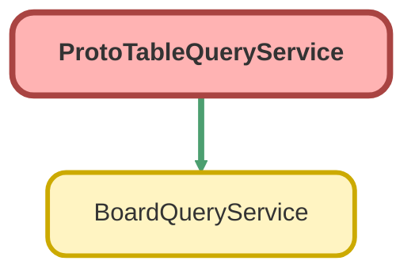

<!-- This file is auto-generated. if you do not want it to be overwritten, set TRUE in the line below -->
<!-- DO_NOT_OVERWRITE_DOC=FALSE -->

# ProtoTableQueryService Class

PROTOTYPE ONLY - Ticket 12: Table widget prototype 
Validates User Mode BoardQueryService pattern for Table widget: 
1. 1-5 hop parent dot-paths (Account.Name, Contact.Name, Owner.Name) + smart record links 
2. Expandable child relationships (CaseComment / FeedItem) - Lazy + Search Batch vs Embedded Subquery 
3. Free-text search (Hybrid SOSL + SOQL LIKE vs SOSL-only vs SOQL LIKE-only) with child match auto-expansion 
4. Server-side sorting + Infinite scroll (OFFSET with Id ASC tie-breaker up to 2,000 cap vs Keyset cursor)

## Class Diagram



<!-- Apex description -->

## Apex Code

```java
/**
 * PROTOTYPE ONLY - Ticket 12: Table widget prototype
 * Validates User Mode BoardQueryService pattern for Table widget:
 *  1. 1-5 hop parent dot-paths (Account.Name, Contact.Name, Owner.Name) + smart record links
 *  2. Expandable child relationships (CaseComment / FeedItem) - Lazy + Search Batch vs Embedded Subquery
 *  3. Free-text search (Hybrid SOSL + SOQL LIKE vs SOSL-only vs SOQL LIKE-only) with child match auto-expansion
 *  4. Server-side sorting + Infinite scroll (OFFSET with Id ASC tie-breaker up to 2,000 cap vs Keyset cursor)
 */
public with sharing class ProtoTableQueryService {

    public class TableQueryRequest {
        @AuraEnabled public List<String> statuses { get; set; }
        @AuraEnabled public List<String> priorities { get; set; }
        @AuraEnabled public String accountId { get; set; }
        @AuraEnabled public String searchText { get; set; }
        @AuraEnabled public String searchStrategy { get; set; } // HYBRID | SOSL_ONLY | LIKE_ONLY
        @AuraEnabled public String childMode { get; set; } // CASE_COMMENT | FEED_ITEM
        @AuraEnabled public String childFetchStrategy { get; set; } // LAZY_AND_SEARCH_BATCH | EMBEDDED_SUBQUERY
        @AuraEnabled public String paginationStrategy { get; set; } // OFFSET | KEYSET
        @AuraEnabled public String sortBy { get; set; } // CaseNumber | Subject | Status | Priority | Account.Name | CreatedDate
        @AuraEnabled public String sortDirection { get; set; } // ASC | DESC
        @AuraEnabled public Integer pageSize { get; set; }
        @AuraEnabled public Integer offsetVal { get; set; }
        @AuraEnabled public String cursorSortValue { get; set; }
        @AuraEnabled public String cursorLastId { get; set; }
    }

    public class ChildRowDto {
        @AuraEnabled public String id { get; set; }
        @AuraEnabled public String parentId { get; set; }
        @AuraEnabled public String body { get; set; }
        @AuraEnabled public String authorName { get; set; }
        @AuraEnabled public String authorId { get; set; }
        @AuraEnabled public Datetime createdDate { get; set; }
        @AuraEnabled public Boolean isPublished { get; set; }
        @AuraEnabled public String childType { get; set; }
        @AuraEnabled public Boolean isSearchMatch { get; set; }
    }

    public class CaseRowDto {
        @AuraEnabled public String id { get; set; }
        @AuraEnabled public String caseNumber { get; set; }
        @AuraEnabled public String subject { get; set; }
        @AuraEnabled public String status { get; set; }
        @AuraEnabled public String priority { get; set; }
        @AuraEnabled public String origin { get; set; }
        @AuraEnabled public Datetime createdDate { get; set; }
        @AuraEnabled public String accountId { get; set; }
        @AuraEnabled public String accountName { get; set; }
        @AuraEnabled public String accountIndustry { get; set; }
        @AuraEnabled public String contactId { get; set; }
        @AuraEnabled public String contactName { get; set; }
        @AuraEnabled public String ownerId { get; set; }
        @AuraEnabled public String ownerName { get; set; }
        @AuraEnabled public Boolean matchedOnParent { get; set; }
        @AuraEnabled public Boolean matchedOnChild { get; set; }
        @AuraEnabled public Boolean autoExpanded { get; set; }
        @AuraEnabled public Integer childCount { get; set; }
        @AuraEnabled public Integer matchedChildCount { get; set; }
        @AuraEnabled public List<ChildRowDto> children { get; set; }
    }

    public class TelemetryDto {
        @AuraEnabled public Long elapsedMs { get; set; }
        @AuraEnabled public Integer soqlQueriesUsed { get; set; }
        @AuraEnabled public Integer soslQueriesUsed { get; set; }
        @AuraEnabled public Integer queryRowsUsed { get; set; }
        @AuraEnabled public Integer heapBytesUsed { get; set; }
        @AuraEnabled public String executedSoql { get; set; }
        @AuraEnabled public String executedSearchDiagnostic { get; set; }
        @AuraEnabled public String childFetchStrategy { get; set; }
        @AuraEnabled public String paginationStrategy { get; set; }
    }

    public class TablePageResponse {
        @AuraEnabled public List<CaseRowDto> rows { get; set; }
        @AuraEnabled public Integer totalCount { get; set; }
        @AuraEnabled public String totalCountDisplay { get; set; }
        @AuraEnabled public Boolean hasMore { get; set; }
        @AuraEnabled public Integer nextOffset { get; set; }
        @AuraEnabled public String nextCursorSortValue { get; set; }
        @AuraEnabled public String nextCursorLastId { get; set; }
        @AuraEnabled public TelemetryDto telemetry { get; set; }
    }

    private static final Set<String> ALLOWED_SORT_FIELDS = new Set<String>{
        'CaseNumber', 'Subject', 'Status', 'Priority', 'Account.Name', 'Contact.Name', 'Owner.Name', 'CreatedDate'
    };

    @AuraEnabled
    public static TablePageResponse queryTablePage(String requestJson) {
        Long startTime = System.currentTimeMillis();
        TableQueryRequest req = (TableQueryRequest) JSON.deserialize(requestJson, TableQueryRequest.class);

        String sortBy = (req.sortBy != null && ALLOWED_SORT_FIELDS.contains(req.sortBy)) ? req.sortBy : 'CaseNumber';
        String sortDir = (req.sortDirection != null && req.sortDirection.equalsIgnoreCase('ASC')) ? 'ASC' : 'DESC';
        Integer pageSize = (req.pageSize != null && req.pageSize >= 5 && req.pageSize <= 100) ? req.pageSize : 25;
        Integer offsetVal = (req.offsetVal != null && req.offsetVal >= 0) ? req.offsetVal : 0;
        String childMode = String.isNotBlank(req.childMode) ? req.childMode : 'CASE_COMMENT';
        String childFetchStrategy = String.isNotBlank(req.childFetchStrategy) ? req.childFetchStrategy : 'LAZY_AND_SEARCH_BATCH';
        String paginationStrategy = String.isNotBlank(req.paginationStrategy) ? req.paginationStrategy : 'OFFSET';
        String searchStrategy = String.isNotBlank(req.searchStrategy) ? req.searchStrategy : 'HYBRID';
        String searchText = req.searchText != null ? req.searchText.trim() : '';

        Map<String, Object> binds = new Map<String, Object>();
        List<String> whereClauses = new List<String>();

        if (req.statuses != null && !req.statuses.isEmpty()) {
            binds.put('statuses', req.statuses);
            whereClauses.add('Status IN :statuses');
        }
        if (req.priorities != null && !req.priorities.isEmpty()) {
            binds.put('priorities', req.priorities);
            whereClauses.add('Priority IN :priorities');
        }
        if (String.isNotBlank(req.accountId)) {
            binds.put('accountId', req.accountId);
            whereClauses.add('AccountId = :accountId');
        }

        Set<Id> parentMatchIds = new Set<Id>();
        Set<Id> childMatchParentIds = new Set<Id>();
        Map<Id, List<ChildRowDto>> matchedChildrenByParent = new Map<Id, List<ChildRowDto>>();
        List<String> searchDiagnostics = new List<String>();

        if (String.isNotBlank(searchText) && searchText.length() >= 2) {
            String escapedSosl = escapeSoslTerm(searchText);
            String likePattern = '%' + searchText + '%';

            // 1. SOSL leg (when HYBRID or SOSL_ONLY)
            if (searchStrategy == 'HYBRID' || searchStrategy == 'SOSL_ONLY') {
                String sosl = 'FIND \'' + escapedSosl + '*\' IN ALL FIELDS RETURNING ' +
                    'Case(Id WHERE Id != null LIMIT 500), ' +
                    (childMode == 'FEED_ITEM'
                        ? 'FeedItem(Id, ParentId, Body, CreatedDate, CreatedBy.Name, CreatedById WHERE Parent.Type = \'Case\' ORDER BY CreatedDate DESC LIMIT 500)'
                        : 'CaseComment(Id, ParentId, CommentBody, IsPublished, CreatedDate, CreatedBy.Name, CreatedById ORDER BY CreatedDate DESC LIMIT 500)');
                List<List<SObject>> soslResults = Search.query(sosl, AccessLevel.USER_MODE);
                for (SObject cObj : soslResults[0]) {
                    parentMatchIds.add((Id) cObj.get('Id'));
                }
                for (SObject childObj : soslResults[1]) {
                    Id pId = (Id) childObj.get('ParentId');
                    if (pId != null && String.valueOf(pId).startsWith('500')) {
                        childMatchParentIds.add(pId);
                        addChildDto(matchedChildrenByParent, pId, toChildDto(childObj, childMode, true));
                    }
                }
                searchDiagnostics.add('SOSL matched ' + parentMatchIds.size() + ' parents, ' + childMatchParentIds.size() + ' child-parents');
            }

            // 2. SOQL LIKE leg (when HYBRID or LIKE_ONLY)
            if (searchStrategy == 'HYBRID' || searchStrategy == 'LIKE_ONLY') {
                List<Case> likeParents = [
                    SELECT Id
                    FROM Case
                    WHERE Subject LIKE :likePattern
                       OR CaseNumber LIKE :likePattern
                       OR Account.Name LIKE :likePattern
                       OR Contact.Name LIKE :likePattern
                    WITH USER_MODE
                    LIMIT 1000
                ];
                Integer beforeParentCount = parentMatchIds.size();
                for (Case c : likeParents) {
                    parentMatchIds.add(c.Id);
                }

                if (childMode == 'CASE_COMMENT') {
                    // CaseComment.CommentBody is filterable via SOQL LIKE (synchronous, zero index lag!)
                    List<CaseComment> likeComments = [
                        SELECT Id, ParentId, CommentBody, IsPublished, CreatedDate, CreatedBy.Name, CreatedById
                        FROM CaseComment
                        WHERE CommentBody LIKE :likePattern
                        WITH USER_MODE
                        ORDER BY CreatedDate DESC
                        LIMIT 500
                    ];
                    for (CaseComment cc : likeComments) {
                        if (cc.ParentId != null) {
                            childMatchParentIds.add(cc.ParentId);
                            addChildDto(matchedChildrenByParent, cc.ParentId, toChildDto(cc, 'CASE_COMMENT', true));
                        }
                    }
                    searchDiagnostics.add('SOQL LIKE matched ' + (parentMatchIds.size() - beforeParentCount) + ' additional parents & ' + likeComments.size() + ' CaseComments');
                } else {
                    // FeedItem.Body is NOT filterable in SOQL WHERE (Schema.SObjectType.FeedItem.fields.Body.isFilterable() == false)
                    // In LIKE_ONLY mode (or when SOSL index hasn't caught up yet), scan recent Case FeedItems in Apex memory
                    List<FeedItem> recentFeeds = [
                        SELECT Id, ParentId, Body, CreatedDate, CreatedBy.Name, CreatedById
                        FROM FeedItem
                        WHERE Parent.Type = 'Case'
                        WITH USER_MODE
                        ORDER BY CreatedDate DESC
                        LIMIT 500
                    ];
                    Integer feedMatches = 0;
                    String lowerTerm = searchText.toLowerCase();
                    for (FeedItem fi : recentFeeds) {
                        if (fi.Body != null && fi.Body.toLowerCase().contains(lowerTerm)) {
                            childMatchParentIds.add(fi.ParentId);
                            addChildDto(matchedChildrenByParent, fi.ParentId, toChildDto(fi, 'FEED_ITEM', true));
                            feedMatches++;
                        }
                    }
                    searchDiagnostics.add('FeedItem Body (isFilterable=false) fallback matched ' + feedMatches + ' FeedItems');
                }
            }

            Set<Id> combinedSearchIds = new Set<Id>();
            combinedSearchIds.addAll(parentMatchIds);
            combinedSearchIds.addAll(childMatchParentIds);
            binds.put('searchMatchIds', combinedSearchIds);
            whereClauses.add('Id IN :searchMatchIds');
        }

        String baseWhere = whereClauses.isEmpty() ? '' : (' WHERE ' + String.join(whereClauses, ' AND '));

        // Total count query (capped at 2001 per ticket 11 spec)
        String countSoql = 'SELECT COUNT() FROM Case' + baseWhere + ' LIMIT 2001';
        Integer totalCount = Database.countQueryWithBinds(countSoql, binds, AccessLevel.USER_MODE);
        String totalCountDisplay = totalCount > 2000 ? '2,000+' : String.valueOf(totalCount);

        // Keyset cursor clause if paginationStrategy == KEYSET and cursor is present
        List<String> pageWhereClauses = new List<String>(whereClauses);
        if (paginationStrategy == 'KEYSET' && String.isNotBlank(req.cursorLastId) && String.isNotBlank(req.cursorSortValue)) {
            binds.put('cursorLastId', req.cursorLastId);
            String op = sortDir == 'ASC' ? '>' : '<';
            if (sortBy == 'CreatedDate') {
                Datetime cursorDt = (Datetime) JSON.deserialize('"' + req.cursorSortValue + '"', Datetime.class);
                binds.put('cursorSortDt', cursorDt);
                pageWhereClauses.add('((CreatedDate ' + op + ' :cursorSortDt) OR (CreatedDate = :cursorSortDt AND Id > :cursorLastId))');
            } else {
                binds.put('cursorSortVal', req.cursorSortValue);
                pageWhereClauses.add('((' + sortBy + ' ' + op + ' :cursorSortVal) OR (' + sortBy + ' = :cursorSortVal AND Id > :cursorLastId))');
            }
        }

        String pageWhere = pageWhereClauses.isEmpty() ? '' : (' WHERE ' + String.join(pageWhereClauses, ' AND '));

        // Select fields including 1-5 hop dot paths and optional embedded child subquery
        String childSubquery = '';
        if (childFetchStrategy == 'EMBEDDED_SUBQUERY') {
            if (childMode == 'FEED_ITEM') {
                childSubquery = ', (SELECT Id, ParentId, Body, CreatedDate, CreatedBy.Name, CreatedById FROM Feeds ORDER BY CreatedDate DESC LIMIT 10)';
            } else {
                childSubquery = ', (SELECT Id, ParentId, CommentBody, IsPublished, CreatedDate, CreatedBy.Name, CreatedById FROM CaseComments ORDER BY CreatedDate DESC LIMIT 10)';
            }
        }

        Integer queryLimit = pageSize + 1;
        binds.put('queryLimit', queryLimit);

        String mainSoql = 'SELECT Id, CaseNumber, Subject, Status, Priority, Origin, CreatedDate, ' +
            'AccountId, Account.Name, Account.Industry, ContactId, Contact.Name, OwnerId, Owner.Name' +
            childSubquery +
            ' FROM Case' +
            pageWhere +
            ' ORDER BY ' + sortBy + ' ' + sortDir + ' NULLS LAST, Id ASC' +
            ' LIMIT :queryLimit';

        if (paginationStrategy == 'OFFSET') {
            binds.put('offsetVal', offsetVal);
            mainSoql += ' OFFSET :offsetVal';
        }

        List<Case> rawCases = (List<Case>) Database.queryWithBinds(mainSoql, binds, AccessLevel.USER_MODE);
        SObjectAccessDecision decision = Security.stripInaccessible(AccessType.READABLE, rawCases);
        List<Case> accessibleCases = (List<Case>) decision.getRecords();

        Boolean hasMore = accessibleCases.size() > pageSize;
        List<Case> pageCases = new List<Case>();
        for (Integer i = 0; i < Math.min(accessibleCases.size(), pageSize); i++) {
            pageCases.add(accessibleCases[i]);
        }

        // Count child rows per parent on this page so collapsed chevrons show exact badge counts
        Set<Id> pageCaseIds = new Set<Id>();
        for (Case c : pageCases) {
            pageCaseIds.add(c.Id);
        }

        Map<Id, Integer> childCountsByParent = new Map<Id, Integer>();
        if (!pageCaseIds.isEmpty()) {
            if (childMode == 'FEED_ITEM') {
                for (FeedItem fi : [
                    SELECT Id, ParentId
                    FROM FeedItem
                    WHERE ParentId IN :pageCaseIds
                    WITH USER_MODE
                    LIMIT 2000
                ]) {
                    Integer cur = childCountsByParent.containsKey(fi.ParentId) ? childCountsByParent.get(fi.ParentId) : 0;
                    childCountsByParent.put(fi.ParentId, cur + 1);
                }
            } else {
                for (CaseComment cc : [
                    SELECT Id, ParentId
                    FROM CaseComment
                    WHERE ParentId IN :pageCaseIds
                    WITH USER_MODE
                    LIMIT 2000
                ]) {
                    Integer cur = childCountsByParent.containsKey(cc.ParentId) ? childCountsByParent.get(cc.ParentId) : 0;
                    childCountsByParent.put(cc.ParentId, cur + 1);
                }
            }
        }

        // Batch-fetch full child lists (up to 10) for parents on this page that matched via child search in LAZY_AND_SEARCH_BATCH mode
        Set<Id> autoExpandParentIds = new Set<Id>();
        for (Id pId : pageCaseIds) {
            if (childMatchParentIds.contains(pId)) {
                autoExpandParentIds.add(pId);
            }
        }

        Map<Id, List<ChildRowDto>> batchChildrenForAutoExpand = new Map<Id, List<ChildRowDto>>();
        if (childFetchStrategy == 'LAZY_AND_SEARCH_BATCH' && !autoExpandParentIds.isEmpty()) {
            String lowerSearch = searchText.toLowerCase();
            if (childMode == 'FEED_ITEM') {
                for (FeedItem fi : [
                    SELECT Id, ParentId, Body, CreatedDate, CreatedBy.Name, CreatedById
                    FROM FeedItem
                    WHERE ParentId IN :autoExpandParentIds
                    WITH USER_MODE
                    ORDER BY CreatedDate DESC
                    LIMIT 200
                ]) {
                    Boolean isMatch = String.isNotBlank(lowerSearch) && fi.Body != null && fi.Body.toLowerCase().contains(lowerSearch);
                    addChildDtoWithLimit(batchChildrenForAutoExpand, fi.ParentId, toChildDto(fi, 'FEED_ITEM', isMatch), 10);
                }
            } else {
                for (CaseComment cc : [
                    SELECT Id, ParentId, CommentBody, IsPublished, CreatedDate, CreatedBy.Name, CreatedById
                    FROM CaseComment
                    WHERE ParentId IN :autoExpandParentIds
                    WITH USER_MODE
                    ORDER BY CreatedDate DESC
                    LIMIT 200
                ]) {
                    Boolean isMatch = String.isNotBlank(lowerSearch) && cc.CommentBody != null && cc.CommentBody.toLowerCase().contains(lowerSearch);
                    addChildDtoWithLimit(batchChildrenForAutoExpand, cc.ParentId, toChildDto(cc, 'CASE_COMMENT', isMatch), 10);
                }
            }
        }

        List<CaseRowDto> dtos = new List<CaseRowDto>();
        String lowerSearchTerm = searchText.toLowerCase();
        for (Case c : pageCases) {
            CaseRowDto dto = new CaseRowDto();
            dto.id = c.Id;
            dto.caseNumber = c.CaseNumber;
            dto.subject = c.Subject;
            dto.status = c.Status;
            dto.priority = c.Priority;
            dto.origin = c.Origin;
            dto.createdDate = c.CreatedDate;
            dto.accountId = c.AccountId;
            dto.accountName = c.Account != null ? c.Account.Name : null;
            dto.accountIndustry = c.Account != null ? c.Account.Industry : null;
            dto.contactId = c.ContactId;
            dto.contactName = c.Contact != null ? c.Contact.Name : null;
            dto.ownerId = c.OwnerId;
            dto.ownerName = c.Owner != null ? c.Owner.Name : null;
            dto.matchedOnParent = parentMatchIds.contains(c.Id);
            dto.matchedOnChild = childMatchParentIds.contains(c.Id);
            dto.autoExpanded = dto.matchedOnChild;
            dto.childCount = childCountsByParent.containsKey(c.Id) ? childCountsByParent.get(c.Id) : 0;
            dto.matchedChildCount = matchedChildrenByParent.containsKey(c.Id) ? matchedChildrenByParent.get(c.Id).size() : 0;
            dto.children = new List<ChildRowDto>();

            if (childFetchStrategy == 'EMBEDDED_SUBQUERY') {
                List<SObject> subRecords = childMode == 'FEED_ITEM' ? (List<SObject>) c.Feeds : (List<SObject>) c.CaseComments;
                if (subRecords != null) {
                    for (SObject childObj : subRecords) {
                        String bodyText = childMode == 'FEED_ITEM' ? (String) childObj.get('Body') : (String) childObj.get('CommentBody');
                        Boolean isMatch = String.isNotBlank(lowerSearchTerm) && bodyText != null && bodyText.toLowerCase().contains(lowerSearchTerm);
                        dto.children.add(toChildDto(childObj, childMode, isMatch));
                    }
                }
            } else if (dto.autoExpanded && batchChildrenForAutoExpand.containsKey(c.Id)) {
                dto.children = batchChildrenForAutoExpand.get(c.Id);
            }
            dtos.add(dto);
        }

        TablePageResponse resp = new TablePageResponse();
        resp.rows = dtos;
        resp.totalCount = totalCount;
        resp.totalCountDisplay = totalCountDisplay;
        resp.hasMore = hasMore;
        resp.nextOffset = offsetVal + dtos.size();

        if (!pageCases.isEmpty()) {
            Case lastCase = pageCases[pageCases.size() - 1];
            resp.nextCursorLastId = lastCase.Id;
            resp.nextCursorSortValue = extractSortCursorValue(lastCase, sortBy);
        }

        TelemetryDto tel = new TelemetryDto();
        tel.elapsedMs = System.currentTimeMillis() - startTime;
        tel.soqlQueriesUsed = Limits.getQueries();
        tel.soslQueriesUsed = Limits.getSoslQueries();
        tel.queryRowsUsed = Limits.getQueryRows();
        tel.heapBytesUsed = Limits.getHeapSize();
        tel.executedSoql = mainSoql;
        tel.executedSearchDiagnostic = searchDiagnostics.isEmpty() ? 'None (no active text search)' : String.join(searchDiagnostics, ' | ');
        tel.childFetchStrategy = childFetchStrategy;
        tel.paginationStrategy = paginationStrategy;
        resp.telemetry = tel;

        return resp;
    }

    @AuraEnabled
    public static List<ChildRowDto> fetchChildRows(Id parentId, String childMode, String searchText) {
        String mode = String.isNotBlank(childMode) ? childMode : 'CASE_COMMENT';
        String lowerSearch = searchText != null ? searchText.trim().toLowerCase() : '';
        List<ChildRowDto> results = new List<ChildRowDto>();

        if (mode == 'FEED_ITEM') {
            for (FeedItem fi : [
                SELECT Id, ParentId, Body, CreatedDate, CreatedBy.Name, CreatedById
                FROM FeedItem
                WHERE ParentId = :parentId
                WITH USER_MODE
                ORDER BY CreatedDate DESC
                LIMIT 20
            ]) {
                Boolean isMatch = String.isNotBlank(lowerSearch) && fi.Body != null && fi.Body.toLowerCase().contains(lowerSearch);
                results.add(toChildDto(fi, 'FEED_ITEM', isMatch));
            }
        } else {
            for (CaseComment cc : [
                SELECT Id, ParentId, CommentBody, IsPublished, CreatedDate, CreatedBy.Name, CreatedById
                FROM CaseComment
                WHERE ParentId = :parentId
                WITH USER_MODE
                ORDER BY CreatedDate DESC
                LIMIT 20
            ]) {
                Boolean isMatch = String.isNotBlank(lowerSearch) && cc.CommentBody != null && cc.CommentBody.toLowerCase().contains(lowerSearch);
                results.add(toChildDto(cc, 'CASE_COMMENT', isMatch));
            }
        }
        return results;
    }

    @AuraEnabled
    public static Map<String, Object> seedPrototypeData(Integer desiredTotalCases) {
        Integer target = (desiredTotalCases != null && desiredTotalCases > 0) ? Math.min(desiredTotalCases, 2200) : 250;

        List<Account> accounts = [SELECT Id, Name FROM Account WITH USER_MODE LIMIT 20];
        if (accounts.isEmpty()) {
            Account a = new Account(Name = 'Helios Grid Infrastructure Corp', Industry = 'Energy');
            insert a;
            accounts.add(a);
        }
        List<Contact> contacts = [SELECT Id, Name, AccountId FROM Contact WITH USER_MODE LIMIT 20];

        Integer existingCount = [SELECT COUNT() FROM Case WITH USER_MODE];
        Integer toCreate = Math.max(0, target - existingCount);

        List<String> statuses = new List<String>{ 'New', 'Working', 'Escalated', 'Closed' };
        List<String> priorities = new List<String>{ 'High', 'Medium', 'Low' };
        List<String> origins = new List<String>{ 'Phone', 'Web', 'Email' };
        List<String> subjects = new List<String>{
            'Substation transformer load spike on Sector 4',
            'Grid inverter harmonic distortion alert',
            'Solar array tracker calibration drift',
            'High-voltage switchgear inspection scheduled',
            'Battery storage thermal management check',
            'Regional feeder line telemetry delay',
            'Commercial meter gateway packet loss',
            'Wind farm nacelle vibration warning'
        };

        List<Case> newCases = new List<Case>();
        for (Integer i = 0; i < Math.min(toCreate, 450); i++) {
            Integer idx = existingCount + i + 1;
            Account acc = accounts[Math.mod(idx, accounts.size())];
            Contact con = !contacts.isEmpty() ? contacts[Math.mod(idx, contacts.size())] : null;
            newCases.add(new Case(
                Subject = '[PROTO-' + String.valueOf(idx).leftPad(4, '0') + '] ' + subjects[Math.mod(idx, subjects.size())],
                Status = statuses[Math.mod(idx, statuses.size())],
                Priority = priorities[Math.mod(idx, priorities.size())],
                Origin = origins[Math.mod(idx, origins.size())],
                AccountId = acc.Id,
                ContactId = con != null ? con.Id : null
            ));
        }
        if (!newCases.isEmpty()) {
            insert newCases;
        }

        // Ensure the top 15 Cases have rich CaseComments and FeedItems with distinctive child-only search keywords
        List<Case> topCases = [
            SELECT Id, CaseNumber, Subject
            FROM Case
            WITH USER_MODE
            ORDER BY CaseNumber ASC
            LIMIT 15
        ];
        Set<Id> topCaseIds = new Set<Id>();
        for (Case c : topCases) {
            topCaseIds.add(c.Id);
        }

        Integer existingComments = [SELECT COUNT() FROM CaseComment WHERE ParentId IN :topCaseIds WITH USER_MODE];
        Integer createdComments = 0;
        Integer createdFeeds = 0;

        if (existingComments < 10 && !topCases.isEmpty()) {
            List<String> diagnosticNotes = new List<String>{
                'DIAGNOSTIC: Turbine Bearing Overheat detected on rotor shaft #2 (89C peak). Recommend immediate lubrication flush.',
                'DIAGNOSTIC: Firmware v4.2 Rollback completed on controller node; telemetry packet loss dropped to 0.0%.',
                'FIELD LOG: SCADA Telemetry Drop traced to corroded fiber splice inside junction box JB-14.',
                'ENGINEERING: Voltage Regulator Fault confirmed on secondary winding; replacement unit shipped via priority courier.',
                'SAFETY AUDIT: Arc Flash Sensor Replacement verified and calibrated to IEEE 1584 threshold.'
            };

            List<CaseComment> commentsToInsert = new List<CaseComment>();
            List<FeedItem> feedsToInsert = new List<FeedItem>();

            for (Integer i = 0; i < Math.min(topCases.size(), 10); i++) {
                Case c = topCases[i];
                String note1 = diagnosticNotes[Math.mod(i, diagnosticNotes.size())];
                String note2 = 'FOLLOW-UP on Case #' + c.CaseNumber + ': Dispatch crew confirmed site access with customer operations lead.';

                commentsToInsert.add(new CaseComment(
                    ParentId = c.Id,
                    CommentBody = note1,
                    IsPublished = true
                ));
                commentsToInsert.add(new CaseComment(
                    ParentId = c.Id,
                    CommentBody = note2,
                    IsPublished = (Math.mod(i, 2) == 0)
                ));

                feedsToInsert.add(new FeedItem(
                    ParentId = c.Id,
                    Body = '[Chatter Post] ' + note1
                ));
            }
            insert commentsToInsert;
            insert feedsToInsert;
            createdComments = commentsToInsert.size();
            createdFeeds = feedsToInsert.size();
        }

        Map<String, Object> summary = new Map<String, Object>();
        summary.put('totalCases', [SELECT COUNT() FROM Case WITH USER_MODE]);
        summary.put('createdCasesInBatch', newCases.size());
        summary.put('totalCaseComments', [SELECT COUNT() FROM CaseComment WITH USER_MODE]);
        summary.put('createdCommentsInBatch', createdComments);
        summary.put('createdFeedsInBatch', createdFeeds);
        return summary;
    }

    private static String extractSortCursorValue(Case c, String sortBy) {
        if (sortBy == 'CaseNumber') return c.CaseNumber;
        if (sortBy == 'Subject') return c.Subject;
        if (sortBy == 'Status') return c.Status;
        if (sortBy == 'Priority') return c.Priority;
        if (sortBy == 'Account.Name') return c.Account != null ? c.Account.Name : '';
        if (sortBy == 'Contact.Name') return c.Contact != null ? c.Contact.Name : '';
        if (sortBy == 'Owner.Name') return c.Owner != null ? c.Owner.Name : '';
        if (sortBy == 'CreatedDate') return c.CreatedDate != null ? JSON.serialize(c.CreatedDate).replace('"', '') : '';
        return c.CaseNumber;
    }

    private static ChildRowDto toChildDto(SObject obj, String childMode, Boolean isMatch) {
        ChildRowDto dto = new ChildRowDto();
        dto.id = (String) obj.get('Id');
        dto.parentId = (String) obj.get('ParentId');
        dto.createdDate = (Datetime) obj.get('CreatedDate');
        dto.authorId = (String) obj.get('CreatedById');
        SObject createdBy = obj.getSObject('CreatedBy');
        dto.authorName = createdBy != null ? (String) createdBy.get('Name') : 'System';
        dto.childType = childMode;
        dto.isSearchMatch = isMatch;
        if (childMode == 'FEED_ITEM') {
            dto.body = (String) obj.get('Body');
            dto.isPublished = true;
        } else {
            dto.body = (String) obj.get('CommentBody');
            dto.isPublished = (Boolean) obj.get('IsPublished');
        }
        return dto;
    }

    private static void addChildDto(Map<Id, List<ChildRowDto>> mapByParent, Id parentId, ChildRowDto dto) {
        if (!mapByParent.containsKey(parentId)) {
            mapByParent.put(parentId, new List<ChildRowDto>());
        }
        for (ChildRowDto existing : mapByParent.get(parentId)) {
            if (existing.id == dto.id) {
                return;
            }
        }
        mapByParent.get(parentId).add(dto);
    }

    private static void addChildDtoWithLimit(Map<Id, List<ChildRowDto>> mapByParent, Id parentId, ChildRowDto dto, Integer maxPerParent) {
        if (!mapByParent.containsKey(parentId)) {
            mapByParent.put(parentId, new List<ChildRowDto>());
        }
        List<ChildRowDto> listForParent = mapByParent.get(parentId);
        if (listForParent.size() < maxPerParent) {
            listForParent.add(dto);
        }
    }

    private static String escapeSoslTerm(String input) {
        // Escape SOSL reserved characters: ? & | ! { } [ ] ( ) ^ ~ * : \ " ' + -
        String out = input.replace('\\', '\\\\');
        for (String ch : new List<String>{ '?', '&', '|', '!', '{', '}', '[', ']', '(', ')', '^', '~', '*', ':', '"', '\'', '+', '-' }) {
            out = out.replace(ch, '\\' + ch);
        }
        return out;
    }
}
```

## Fields
### `ALLOWED_SORT_FIELDS`

#### Signature
```apex
private static final ALLOWED_SORT_FIELDS
```

#### Type
Set<String>

## Methods
### `queryTablePage(requestJson)`

`AURAENABLED`

#### Signature
```apex
public static TablePageResponse queryTablePage(String requestJson)
```

#### Parameters
| Name | Type | Description |
|------|------|-------------|
| requestJson | String |  |

#### Return Type
**TablePageResponse**

---

### `fetchChildRows(parentId, childMode, searchText)`

`AURAENABLED`

#### Signature
```apex
public static List<ChildRowDto> fetchChildRows(Id parentId, String childMode, String searchText)
```

#### Parameters
| Name | Type | Description |
|------|------|-------------|
| parentId | Id |  |
| childMode | String |  |
| searchText | String |  |

#### Return Type
**List<ChildRowDto>**

---

### `seedPrototypeData(desiredTotalCases)`

`AURAENABLED`

#### Signature
```apex
public static Map<String,Object> seedPrototypeData(Integer desiredTotalCases)
```

#### Parameters
| Name | Type | Description |
|------|------|-------------|
| desiredTotalCases | Integer |  |

#### Return Type
**Map<String,Object>**

---

### `extractSortCursorValue(c, sortBy)`

#### Signature
```apex
private static String extractSortCursorValue(Case c, String sortBy)
```

#### Parameters
| Name | Type | Description |
|------|------|-------------|
| c | [Case](../objects/Case.md) |  |
| sortBy | String |  |

#### Return Type
**String**

---

### `toChildDto(obj, childMode, isMatch)`

#### Signature
```apex
private static ChildRowDto toChildDto(SObject obj, String childMode, Boolean isMatch)
```

#### Parameters
| Name | Type | Description |
|------|------|-------------|
| obj | SObject |  |
| childMode | String |  |
| isMatch | Boolean |  |

#### Return Type
**ChildRowDto**

---

### `addChildDto(mapByParent, parentId, dto)`

#### Signature
```apex
private static void addChildDto(Map<Id,List<ChildRowDto>> mapByParent, Id parentId, ChildRowDto dto)
```

#### Parameters
| Name | Type | Description |
|------|------|-------------|
| mapByParent | Map<Id,List<ChildRowDto>> |  |
| parentId | Id |  |
| dto | ChildRowDto |  |

#### Return Type
**void**

---

### `addChildDtoWithLimit(mapByParent, parentId, dto, maxPerParent)`

#### Signature
```apex
private static void addChildDtoWithLimit(Map<Id,List<ChildRowDto>> mapByParent, Id parentId, ChildRowDto dto, Integer maxPerParent)
```

#### Parameters
| Name | Type | Description |
|------|------|-------------|
| mapByParent | Map<Id,List<ChildRowDto>> |  |
| parentId | Id |  |
| dto | ChildRowDto |  |
| maxPerParent | Integer |  |

#### Return Type
**void**

---

### `escapeSoslTerm(input)`

#### Signature
```apex
private static String escapeSoslTerm(String input)
```

#### Parameters
| Name | Type | Description |
|------|------|-------------|
| input | String |  |

#### Return Type
**String**

## Classes
### TableQueryRequest Class

#### Properties
##### `statuses`

`AURAENABLED`

###### Signature
```apex
public statuses
```

###### Type
List<String>

---

##### `priorities`

`AURAENABLED`

###### Signature
```apex
public priorities
```

###### Type
List<String>

---

##### `accountId`

`AURAENABLED`

###### Signature
```apex
public accountId
```

###### Type
String

---

##### `searchText`

`AURAENABLED`

###### Signature
```apex
public searchText
```

###### Type
String

---

##### `searchStrategy`

`AURAENABLED`

###### Signature
```apex
public searchStrategy
```

###### Type
String

---

##### `childMode`

`AURAENABLED`

###### Signature
```apex
public childMode
```

###### Type
String

---

##### `childFetchStrategy`

`AURAENABLED`

###### Signature
```apex
public childFetchStrategy
```

###### Type
String

---

##### `paginationStrategy`

`AURAENABLED`

###### Signature
```apex
public paginationStrategy
```

###### Type
String

---

##### `sortBy`

`AURAENABLED`

###### Signature
```apex
public sortBy
```

###### Type
String

---

##### `sortDirection`

`AURAENABLED`

###### Signature
```apex
public sortDirection
```

###### Type
String

---

##### `pageSize`

`AURAENABLED`

###### Signature
```apex
public pageSize
```

###### Type
Integer

---

##### `offsetVal`

`AURAENABLED`

###### Signature
```apex
public offsetVal
```

###### Type
Integer

---

##### `cursorSortValue`

`AURAENABLED`

###### Signature
```apex
public cursorSortValue
```

###### Type
String

---

##### `cursorLastId`

`AURAENABLED`

###### Signature
```apex
public cursorLastId
```

###### Type
String

### ChildRowDto Class

#### Properties
##### `id`

`AURAENABLED`

###### Signature
```apex
public id
```

###### Type
String

---

##### `parentId`

`AURAENABLED`

###### Signature
```apex
public parentId
```

###### Type
String

---

##### `body`

`AURAENABLED`

###### Signature
```apex
public body
```

###### Type
String

---

##### `authorName`

`AURAENABLED`

###### Signature
```apex
public authorName
```

###### Type
String

---

##### `authorId`

`AURAENABLED`

###### Signature
```apex
public authorId
```

###### Type
String

---

##### `createdDate`

`AURAENABLED`

###### Signature
```apex
public createdDate
```

###### Type
Datetime

---

##### `isPublished`

`AURAENABLED`

###### Signature
```apex
public isPublished
```

###### Type
Boolean

---

##### `childType`

`AURAENABLED`

###### Signature
```apex
public childType
```

###### Type
String

---

##### `isSearchMatch`

`AURAENABLED`

###### Signature
```apex
public isSearchMatch
```

###### Type
Boolean

### CaseRowDto Class

#### Properties
##### `id`

`AURAENABLED`

###### Signature
```apex
public id
```

###### Type
String

---

##### `caseNumber`

`AURAENABLED`

###### Signature
```apex
public caseNumber
```

###### Type
String

---

##### `subject`

`AURAENABLED`

###### Signature
```apex
public subject
```

###### Type
String

---

##### `status`

`AURAENABLED`

###### Signature
```apex
public status
```

###### Type
String

---

##### `priority`

`AURAENABLED`

###### Signature
```apex
public priority
```

###### Type
String

---

##### `origin`

`AURAENABLED`

###### Signature
```apex
public origin
```

###### Type
String

---

##### `createdDate`

`AURAENABLED`

###### Signature
```apex
public createdDate
```

###### Type
Datetime

---

##### `accountId`

`AURAENABLED`

###### Signature
```apex
public accountId
```

###### Type
String

---

##### `accountName`

`AURAENABLED`

###### Signature
```apex
public accountName
```

###### Type
String

---

##### `accountIndustry`

`AURAENABLED`

###### Signature
```apex
public accountIndustry
```

###### Type
String

---

##### `contactId`

`AURAENABLED`

###### Signature
```apex
public contactId
```

###### Type
String

---

##### `contactName`

`AURAENABLED`

###### Signature
```apex
public contactName
```

###### Type
String

---

##### `ownerId`

`AURAENABLED`

###### Signature
```apex
public ownerId
```

###### Type
String

---

##### `ownerName`

`AURAENABLED`

###### Signature
```apex
public ownerName
```

###### Type
String

---

##### `matchedOnParent`

`AURAENABLED`

###### Signature
```apex
public matchedOnParent
```

###### Type
Boolean

---

##### `matchedOnChild`

`AURAENABLED`

###### Signature
```apex
public matchedOnChild
```

###### Type
Boolean

---

##### `autoExpanded`

`AURAENABLED`

###### Signature
```apex
public autoExpanded
```

###### Type
Boolean

---

##### `childCount`

`AURAENABLED`

###### Signature
```apex
public childCount
```

###### Type
Integer

---

##### `matchedChildCount`

`AURAENABLED`

###### Signature
```apex
public matchedChildCount
```

###### Type
Integer

---

##### `children`

`AURAENABLED`

###### Signature
```apex
public children
```

###### Type
List<ChildRowDto>

### TelemetryDto Class

#### Properties
##### `elapsedMs`

`AURAENABLED`

###### Signature
```apex
public elapsedMs
```

###### Type
Long

---

##### `soqlQueriesUsed`

`AURAENABLED`

###### Signature
```apex
public soqlQueriesUsed
```

###### Type
Integer

---

##### `soslQueriesUsed`

`AURAENABLED`

###### Signature
```apex
public soslQueriesUsed
```

###### Type
Integer

---

##### `queryRowsUsed`

`AURAENABLED`

###### Signature
```apex
public queryRowsUsed
```

###### Type
Integer

---

##### `heapBytesUsed`

`AURAENABLED`

###### Signature
```apex
public heapBytesUsed
```

###### Type
Integer

---

##### `executedSoql`

`AURAENABLED`

###### Signature
```apex
public executedSoql
```

###### Type
String

---

##### `executedSearchDiagnostic`

`AURAENABLED`

###### Signature
```apex
public executedSearchDiagnostic
```

###### Type
String

---

##### `childFetchStrategy`

`AURAENABLED`

###### Signature
```apex
public childFetchStrategy
```

###### Type
String

---

##### `paginationStrategy`

`AURAENABLED`

###### Signature
```apex
public paginationStrategy
```

###### Type
String

### TablePageResponse Class

#### Properties
##### `rows`

`AURAENABLED`

###### Signature
```apex
public rows
```

###### Type
List<CaseRowDto>

---

##### `totalCount`

`AURAENABLED`

###### Signature
```apex
public totalCount
```

###### Type
Integer

---

##### `totalCountDisplay`

`AURAENABLED`

###### Signature
```apex
public totalCountDisplay
```

###### Type
String

---

##### `hasMore`

`AURAENABLED`

###### Signature
```apex
public hasMore
```

###### Type
Boolean

---

##### `nextOffset`

`AURAENABLED`

###### Signature
```apex
public nextOffset
```

###### Type
Integer

---

##### `nextCursorSortValue`

`AURAENABLED`

###### Signature
```apex
public nextCursorSortValue
```

###### Type
String

---

##### `nextCursorLastId`

`AURAENABLED`

###### Signature
```apex
public nextCursorLastId
```

###### Type
String

---

##### `telemetry`

`AURAENABLED`

###### Signature
```apex
public telemetry
```

###### Type
TelemetryDto