# Proto Board Host Flow (PROTOTYPE)

## Flow Diagram [(_View History_)](Proto_Board_Host_Flow-history.md)

```mermaid
%% If you read this, your Markdown visualizer does not handle MermaidJS syntax.
%% - If you are in VS Code, install extension `Markdown Preview Mermaid Support` at https://marketplace.visualstudio.com/items?itemName=bierner.markdown-mermaid
%% - If you are using sfdx-hardis, try to define env variable `MERMAID_MODES=cli,docker` ,then run again the command to regenerate markdown with SVG images.
%% - If you are within a Zensical site, define the mermaid custom fence in `mkdocs.yml` as described in https://zensical.org/docs/
%% - As a last resort, you can copy-paste this MermaidJS code into https://mermaid.live/ to see the flow diagram

flowchart TB
START(["START<br/><b>Screen Flow</b>"]):::startClass
click START "#general-information" "4213056828"

Board_Screen(["💻 <em></em><br/>Board Screen"]):::screens
click Board_Screen "#board_screen" "899501918"

Board_Screen --> END_Board_Screen
START -->  Board_Screen
END_Board_Screen(( END )):::endClass


classDef actionCalls fill:#D4E4FC,color:black,text-decoration:none,max-height:100px
classDef assignments fill:#FBEED7,color:black,text-decoration:none,max-height:100px
classDef collectionProcessors fill:#F0E3FA,color:black,text-decoration:none,max-height:100px
classDef customErrors fill:#FFE9E9,color:black,text-decoration:none,max-height:100px
classDef decisions fill:#FDEAF6,color:black,text-decoration:none,max-height:100px
classDef loops fill:#FDEAF6,color:black,text-decoration:none,max-height:100px
classDef recordCreates fill:#FFF8C9,color:black,text-decoration:none,max-height:100px
classDef recordDeletes fill:#FFF8C9,color:black,text-decoration:none,max-height:100px
classDef recordLookups fill:#EDEAFF,color:black,text-decoration:none,max-height:100px
classDef recordRollbacks fill:#FFF8C9,color:black,text-decoration:none,max-height:100px
classDef recordUpdates fill:#FFF8C9,color:black,text-decoration:none,max-height:100px
classDef screens fill:#DFF6FF,color:black,text-decoration:none,max-height:100px
classDef subflows fill:#D4E4FC,color:black,text-decoration:none,max-height:100px
classDef startClass fill:#D9F2E6,color:black,text-decoration:none,max-height:100px
classDef endClass fill:#F9BABA,color:black,text-decoration:none,max-height:100px
classDef transforms fill:#FDEAF6,color:black,text-decoration:none,max-height:100px


```

<!-- Flow description -->

## General Information

|<!-- -->|<!-- -->|
|:---|:---|
|Process Type|Flow|
|Label|Proto Board Host Flow (PROTOTYPE)|
|Status|Active|
|Description|Throwaway prototype Screen Flow Board with 1-col Filter Bar, 4-col Metric Row, and 2-col Chart/Table Row|
|Environments|Default|
|Interview Label|Proto Board Host Flow {!$Flow.CurrentDateTime}|
|BuilderType (PM)|LightningFlowBuilder|
|CanvasMode (PM)|AUTO_LAYOUT_CANVAS|
|Connector|[Board_Screen](#board_screen)|
|Next Node|[Board_Screen](#board_screen)|

## Variables

|Name|Data Type|Is Collection|Is Input|Is Output|Object Type|Description|
|:-- |:--:|:--:|:--:|:--:|:--:|:--  |
|boardId|String|⬜|✅|⬜|<!-- -->|<!-- -->|
|recordId|String|⬜|✅|⬜|<!-- -->|<!-- -->|

## Flow Nodes Details

### Board_Screen

|<!-- -->|<!-- -->|
|:---|:---|
|Type|Screen|
|Label|Board Screen|
|Allow Back|⬜|
|Allow Finish|✅|
|Allow Pause|⬜|
|Show Footer|⬜|
|Show Header|⬜|

#### Filter_Widget

|<!-- -->|<!-- -->|
|:---|:---|
|Extension Name|c:protoFilterWidget|
|Field Type|Component Instance|
|Inputs On Next Nav To Assoc Scrn|Use Stored Values|
|Is Required|✅|
|Store Output Automatically|✅|
|Style Properties|verticalAlignment: &nbsp;&nbsp;stringValue: top width: &nbsp;&nbsp;stringValue: 12 |
|boardId (input)|boardId|
|recordId (input)|recordId|
|title (input)|Screen Flow Board — Filter Bar (1-Col Full Width)|

#### Metric_Widget_1

|<!-- -->|<!-- -->|
|:---|:---|
|Extension Name|c:protoBoardWidget|
|Field Type|Component Instance|
|Inputs On Next Nav To Assoc Scrn|Use Stored Values|
|Is Required|✅|
|Store Output Automatically|✅|
|Style Properties|verticalAlignment: &nbsp;&nbsp;stringValue: top width: &nbsp;&nbsp;stringValue: 12 |
|Parent Field|[Four_Col_KPI_Section_Column1](#four_col_kpi_section_column1)|
|boardId (input)|boardId|
|filterContextJson (input)|Filter_Widget.filterContextJson|
|recordId (input)|recordId|
|title (input)|Col 1/4: Pipeline Metric|
|widgetType (input)|metric|

#### Four_Col_KPI_Section_Column1

|<!-- -->|<!-- -->|
|:---|:---|
|Field Type|Region|
|Is Required|⬜|
|Parent Field|[Four_Col_KPI_Section](#four_col_kpi_section)|
|width (input)|3|

#### Metric_Widget_2

|<!-- -->|<!-- -->|
|:---|:---|
|Extension Name|c:protoBoardWidget|
|Field Type|Component Instance|
|Inputs On Next Nav To Assoc Scrn|Use Stored Values|
|Is Required|✅|
|Store Output Automatically|✅|
|Style Properties|verticalAlignment: &nbsp;&nbsp;stringValue: top width: &nbsp;&nbsp;stringValue: 12 |
|Parent Field|[Four_Col_KPI_Section_Column2](#four_col_kpi_section_column2)|
|boardId (input)|boardId|
|filterContextJson (input)|Filter_Widget.filterContextJson|
|recordId (input)|recordId|
|title (input)|Col 2/4: Weighted Forecast|
|widgetType (input)|metric|

#### Four_Col_KPI_Section_Column2

|<!-- -->|<!-- -->|
|:---|:---|
|Field Type|Region|
|Is Required|⬜|
|Parent Field|[Four_Col_KPI_Section](#four_col_kpi_section)|
|width (input)|3|

#### Metric_Widget_3

|<!-- -->|<!-- -->|
|:---|:---|
|Extension Name|c:protoBoardWidget|
|Field Type|Component Instance|
|Inputs On Next Nav To Assoc Scrn|Use Stored Values|
|Is Required|✅|
|Store Output Automatically|✅|
|Style Properties|verticalAlignment: &nbsp;&nbsp;stringValue: top width: &nbsp;&nbsp;stringValue: 12 |
|Parent Field|[Four_Col_KPI_Section_Column3](#four_col_kpi_section_column3)|
|boardId (input)|boardId|
|filterContextJson (input)|Filter_Widget.filterContextJson|
|recordId (input)|recordId|
|title (input)|Col 3/4: Closed Won|
|widgetType (input)|metric|

#### Four_Col_KPI_Section_Column3

|<!-- -->|<!-- -->|
|:---|:---|
|Field Type|Region|
|Is Required|⬜|
|Parent Field|[Four_Col_KPI_Section](#four_col_kpi_section)|
|width (input)|3|

#### Metric_Widget_4

|<!-- -->|<!-- -->|
|:---|:---|
|Extension Name|c:protoBoardWidget|
|Field Type|Component Instance|
|Inputs On Next Nav To Assoc Scrn|Use Stored Values|
|Is Required|✅|
|Store Output Automatically|✅|
|Style Properties|verticalAlignment: &nbsp;&nbsp;stringValue: top width: &nbsp;&nbsp;stringValue: 12 |
|Parent Field|[Four_Col_KPI_Section_Column4](#four_col_kpi_section_column4)|
|boardId (input)|boardId|
|filterContextJson (input)|Filter_Widget.filterContextJson|
|recordId (input)|recordId|
|title (input)|Col 4/4: Open Opps|
|widgetType (input)|metric|

#### Four_Col_KPI_Section_Column4

|<!-- -->|<!-- -->|
|:---|:---|
|Field Type|Region|
|Is Required|⬜|
|Parent Field|[Four_Col_KPI_Section](#four_col_kpi_section)|
|width (input)|3|

#### Four_Col_KPI_Section

|<!-- -->|<!-- -->|
|:---|:---|
|Field Type|Region Container|
|Is Required|⬜|
|Region Container Type|Section Without Header|
|Style Properties|verticalAlignment: &nbsp;&nbsp;stringValue: top width: &nbsp;&nbsp;stringValue: 12 |

#### Bar_Chart_Widget

|<!-- -->|<!-- -->|
|:---|:---|
|Extension Name|c:protoBoardWidget|
|Field Type|Component Instance|
|Inputs On Next Nav To Assoc Scrn|Use Stored Values|
|Is Required|✅|
|Store Output Automatically|✅|
|Style Properties|verticalAlignment: &nbsp;&nbsp;stringValue: top width: &nbsp;&nbsp;stringValue: 12 |
|Parent Field|[Two_Col_Detail_Section_Column1](#two_col_detail_section_column1)|
|boardId (input)|boardId|
|filterContextJson (input)|Filter_Widget.filterContextJson|
|recordId (input)|recordId|
|title (input)|Col 1/2: Pipeline by Stage (Bar Stub)|
|widgetType (input)|bar|

#### Two_Col_Detail_Section_Column1

|<!-- -->|<!-- -->|
|:---|:---|
|Field Type|Region|
|Is Required|⬜|
|Parent Field|[Two_Col_Detail_Section](#two_col_detail_section)|
|width (input)|6|

#### Table_Widget

|<!-- -->|<!-- -->|
|:---|:---|
|Extension Name|c:protoBoardWidget|
|Field Type|Component Instance|
|Inputs On Next Nav To Assoc Scrn|Use Stored Values|
|Is Required|✅|
|Store Output Automatically|✅|
|Style Properties|verticalAlignment: &nbsp;&nbsp;stringValue: top width: &nbsp;&nbsp;stringValue: 12 |
|Parent Field|[Two_Col_Detail_Section_Column2](#two_col_detail_section_column2)|
|boardId (input)|boardId|
|filterContextJson (input)|Filter_Widget.filterContextJson|
|recordId (input)|recordId|
|title (input)|Col 2/2: Matching Deals (Table Stub)|
|widgetType (input)|table|

#### Two_Col_Detail_Section_Column2

|<!-- -->|<!-- -->|
|:---|:---|
|Field Type|Region|
|Is Required|⬜|
|Parent Field|[Two_Col_Detail_Section](#two_col_detail_section)|
|width (input)|6|

#### Two_Col_Detail_Section

|<!-- -->|<!-- -->|
|:---|:---|
|Field Type|Region Container|
|Is Required|⬜|
|Region Container Type|Section Without Header|
|Style Properties|verticalAlignment: &nbsp;&nbsp;stringValue: top width: &nbsp;&nbsp;stringValue: 12 |

___

_Documentation generated from branch monitoring_orgfarm_42750320ff_dev_ed_develop by [sfdx-hardis](https://sfdx-hardis.cloudity.com), featuring [salesforce-flow-visualiser](https://github.com/toddhalfpenny/salesforce-flow-visualiser)_