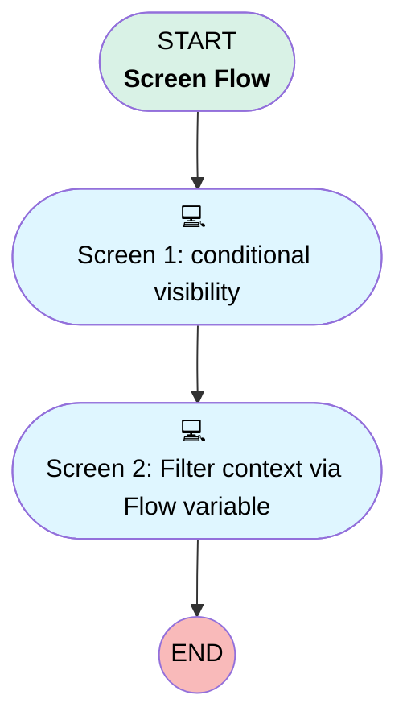

# PROTOTYPE Tabs Filter Context Flow

## Flow Diagram [(_View History_)](Proto_Tabs_Filter_Context_Flow-history.md)

<!-- Flow description -->

## General Information

|<!-- -->|<!-- -->|
|:---|:---|
|Process Type|Flow|
|Label|PROTOTYPE Tabs Filter Context Flow|
|Status|Active|
|Environments|Default|
|Interview Label|PROTOTYPE Tabs Filter Context Flow {!$Flow.CurrentDateTime}|
|BuilderType (PM)|LightningFlowBuilder|
|CanvasMode (PM)|AUTO_LAYOUT_CANVAS|
|Connector|[Screen1](#screen1)|
|Next Node|[Screen1](#screen1)|

## Flow Nodes Details

### Screen1

|<!-- -->|<!-- -->|
|:---|:---|
|Type|Screen|
|Label|Screen 1: conditional visibility|
|Allow Back|⬜|
|Allow Finish|✅|
|Allow Pause|⬜|
|Show Footer|✅|
|Show Header|✅|
|Connector|[Screen2](#screen2)|

#### View

|<!-- -->|<!-- -->|
|:---|:---|
|Data Type|String|
|Choice References|- choicePipeline - choicePerformance |
|Default Selected Choice Reference|choicePipeline|
|Field Text|View (acts as tabs)|
|Field Type|Radio Buttons|
|Is Required|⬜|
|Style Properties|verticalAlignment: &nbsp;&nbsp;stringValue: top width: &nbsp;&nbsp;stringValue: 12 |

#### HideFilter

|<!-- -->|<!-- -->|
|:---|:---|
|Data Type|Boolean|
|Default Value|false|
|Field Text|Hide the Filter widget (tests Filter remount, persistence NONE)|
|Field Type|Input Field|
|Is Required|✅|
|Style Properties|verticalAlignment: &nbsp;&nbsp;stringValue: top width: &nbsp;&nbsp;stringValue: 12 |

#### Filter1

|<!-- -->|<!-- -->|
|:---|:---|
|Extension Name|c:boardFilterWidget|
|Field Type|Component Instance|
|Inputs On Next Nav To Assoc Scrn|Use Stored Values|
|Is Required|✅|
|Store Output Automatically|✅|
|Style Properties|verticalAlignment: &nbsp;&nbsp;stringValue: top width: &nbsp;&nbsp;stringValue: 12 |
|Visibility Rule|conditionLogic: and conditions: &nbsp;&nbsp;leftValueReference: HideFilter &nbsp;&nbsp;operator: EqualTo &nbsp;&nbsp;rightValue: &nbsp;&nbsp;&nbsp;&nbsp;booleanValue: false |
|boardId (input)|flowB|
|title (input)|Filter flowB (screen 1)|
|configJson (input)|{"version":1,"widgetType":"filter","boardId":"flowB","title":"Filter flowB","persistence":"NONE","filters":[{"filterId":"stage","label":"Stage","type":"PICKLIST","selectionMode":"multi","optionsSource":"FIELD_DESCRIBE","sourceObjectApiName":"Opportunity","fieldApiName":"StageName","defaultValue":{"values":["Closed Won"]}}]}|

#### ProbeAlways

|<!-- -->|<!-- -->|
|:---|:---|
|Extension Name|c:protoTabProbe|
|Field Type|Component Instance|
|Inputs On Next Nav To Assoc Scrn|Use Stored Values|
|Is Required|✅|
|Store Output Automatically|✅|
|Style Properties|verticalAlignment: &nbsp;&nbsp;stringValue: top width: &nbsp;&nbsp;stringValue: 12 |
|boardId (input)|flowB|
|label (input)|S1 always visible|

#### ProbePipeline

|<!-- -->|<!-- -->|
|:---|:---|
|Extension Name|c:protoTabProbe|
|Field Type|Component Instance|
|Inputs On Next Nav To Assoc Scrn|Use Stored Values|
|Is Required|✅|
|Store Output Automatically|✅|
|Style Properties|verticalAlignment: &nbsp;&nbsp;stringValue: top width: &nbsp;&nbsp;stringValue: 12 |
|Visibility Rule|conditionLogic: and conditions: &nbsp;&nbsp;leftValueReference: View &nbsp;&nbsp;operator: EqualTo &nbsp;&nbsp;rightValue: &nbsp;&nbsp;&nbsp;&nbsp;stringValue: Pipeline |
|boardId (input)|flowB|
|label (input)|S1 Pipeline view|

#### MetricPipeline

|<!-- -->|<!-- -->|
|:---|:---|
|Extension Name|c:boardMetricWidget|
|Field Type|Component Instance|
|Inputs On Next Nav To Assoc Scrn|Use Stored Values|
|Is Required|✅|
|Store Output Automatically|✅|
|Style Properties|verticalAlignment: &nbsp;&nbsp;stringValue: top width: &nbsp;&nbsp;stringValue: 12 |
|Visibility Rule|conditionLogic: and conditions: &nbsp;&nbsp;leftValueReference: View &nbsp;&nbsp;operator: EqualTo &nbsp;&nbsp;rightValue: &nbsp;&nbsp;&nbsp;&nbsp;stringValue: Pipeline |
|boardId (input)|flowB|
|title (input)|S1 Pipeline count|
|objectApiName (input)|Opportunity|
|configJson (input)|{"version":1,"widgetType":"metric","boardId":"flowB","title":"S1 Pipeline count","objectApiName":"Opportunity","aggregateFunction":"COUNT"}|

#### ProbePerformance

|<!-- -->|<!-- -->|
|:---|:---|
|Extension Name|c:protoTabProbe|
|Field Type|Component Instance|
|Inputs On Next Nav To Assoc Scrn|Use Stored Values|
|Is Required|✅|
|Store Output Automatically|✅|
|Style Properties|verticalAlignment: &nbsp;&nbsp;stringValue: top width: &nbsp;&nbsp;stringValue: 12 |
|Visibility Rule|conditionLogic: and conditions: &nbsp;&nbsp;leftValueReference: View &nbsp;&nbsp;operator: EqualTo &nbsp;&nbsp;rightValue: &nbsp;&nbsp;&nbsp;&nbsp;stringValue: Performance |
|boardId (input)|flowB|
|label (input)|S1 Performance view|

#### MetricPerformance

|<!-- -->|<!-- -->|
|:---|:---|
|Extension Name|c:boardMetricWidget|
|Field Type|Component Instance|
|Inputs On Next Nav To Assoc Scrn|Use Stored Values|
|Is Required|✅|
|Store Output Automatically|✅|
|Style Properties|verticalAlignment: &nbsp;&nbsp;stringValue: top width: &nbsp;&nbsp;stringValue: 12 |
|Visibility Rule|conditionLogic: and conditions: &nbsp;&nbsp;leftValueReference: View &nbsp;&nbsp;operator: EqualTo &nbsp;&nbsp;rightValue: &nbsp;&nbsp;&nbsp;&nbsp;stringValue: Performance |
|boardId (input)|flowB|
|title (input)|S1 Performance count|
|objectApiName (input)|Opportunity|
|configJson (input)|{"version":1,"widgetType":"metric","boardId":"flowB","title":"S1 Performance count","objectApiName":"Opportunity","aggregateFunction":"COUNT"}|

### Screen2

|<!-- -->|<!-- -->|
|:---|:---|
|Type|Screen|
|Label|Screen 2: Filter context via Flow variable|
|Allow Back|✅|
|Allow Finish|✅|
|Allow Pause|⬜|
|Show Footer|✅|
|Show Header|✅|

#### Filter2

|<!-- -->|<!-- -->|
|:---|:---|
|Extension Name|c:boardFilterWidget|
|Field Type|Component Instance|
|Inputs On Next Nav To Assoc Scrn|Use Stored Values|
|Is Required|✅|
|Store Output Automatically|✅|
|Style Properties|verticalAlignment: &nbsp;&nbsp;stringValue: top width: &nbsp;&nbsp;stringValue: 12 |
|boardId (input)|flowB|
|title (input)|Filter flowB (screen 2)|
|configJson (input)|{"version":1,"widgetType":"filter","boardId":"flowB","title":"Filter flowB","persistence":"NONE","filters":[{"filterId":"stage","label":"Stage","type":"PICKLIST","selectionMode":"multi","optionsSource":"FIELD_DESCRIBE","sourceObjectApiName":"Opportunity","fieldApiName":"StageName","defaultValue":{"values":["Closed Won"]}}]}|
|filterContextJson (input)|Filter1.filterContextJson|

#### ProbeScreen2

|<!-- -->|<!-- -->|
|:---|:---|
|Extension Name|c:protoTabProbe|
|Field Type|Component Instance|
|Inputs On Next Nav To Assoc Scrn|Use Stored Values|
|Is Required|✅|
|Store Output Automatically|✅|
|Style Properties|verticalAlignment: &nbsp;&nbsp;stringValue: top width: &nbsp;&nbsp;stringValue: 12 |
|boardId (input)|flowB|
|label (input)|S2 probe|

#### MetricScreen2

|<!-- -->|<!-- -->|
|:---|:---|
|Extension Name|c:boardMetricWidget|
|Field Type|Component Instance|
|Inputs On Next Nav To Assoc Scrn|Use Stored Values|
|Is Required|✅|
|Store Output Automatically|✅|
|Style Properties|verticalAlignment: &nbsp;&nbsp;stringValue: top width: &nbsp;&nbsp;stringValue: 12 |
|boardId (input)|flowB|
|title (input)|S2 count|
|objectApiName (input)|Opportunity|
|configJson (input)|{"version":1,"widgetType":"metric","boardId":"flowB","title":"S2 count","objectApiName":"Opportunity","aggregateFunction":"COUNT"}|

___

_Documentation generated from branch monitoring_orgfarm_42750320ff_dev_ed_develop by [sfdx-hardis](https://sfdx-hardis.cloudity.com), featuring [salesforce-flow-visualiser](https://github.com/toddhalfpenny/salesforce-flow-visualiser)_