# Service Command Board

## Flow Diagram [(_View History_)](Service_Command_Board-history.md)

```mermaid
%% If you read this, your Markdown visualizer does not handle MermaidJS syntax.
%% - If you are in VS Code, install extension `Markdown Preview Mermaid Support` at https://marketplace.visualstudio.com/items?itemName=bierner.markdown-mermaid
%% - If you are using sfdx-hardis, try to define env variable `MERMAID_MODES=cli,docker` ,then run again the command to regenerate markdown with SVG images.
%% - If you are within a Zensical site, define the mermaid custom fence in `mkdocs.yml` as described in https://zensical.org/docs/
%% - As a last resort, you can copy-paste this MermaidJS code into https://mermaid.live/ to see the flow diagram

flowchart TB
START(["START<br/><b>Screen Flow</b>"]):::startClass
click START "#general-information" "27855274"

Board(["💻 <em></em><br/>Board"]):::screens
click Board "#board" "2817854204"

Board --> END_Board
START -->  Board
END_Board(( END )):::endClass


classDef actionCalls fill:#D4E4FC,color:black,text-decoration:none,max-height:100px
classDef assignments fill:#FBEED7,color:black,text-decoration:none,max-height:100px
classDef collectionProcessors fill:#F0E3FA,color:black,text-decoration:none,max-height:100px
classDef customErrors fill:#FFE9E9,color:black,text-decoration:none,max-height:100px
classDef decisions fill:#FDEAF6,color:black,text-decoration:none,max-height:100px
classDef loops fill:#FDEAF6,color:black,text-decoration:none,max-height:100px
classDef recordCreates fill:#FFF8C9,color:black,text-decoration:none,max-height:100px
classDef recordDeletes fill:#FFF8C9,color:black,text-decoration:none,max-height:100px
classDef recordLookups fill:#EDEAFF,color:black,text-decoration:none,max-height:100px
classDef recordRollbacks fill:#FFF8C9,color:black,text-decoration:none,max-height:100px
classDef recordUpdates fill:#FFF8C9,color:black,text-decoration:none,max-height:100px
classDef screens fill:#DFF6FF,color:black,text-decoration:none,max-height:100px
classDef subflows fill:#D4E4FC,color:black,text-decoration:none,max-height:100px
classDef startClass fill:#D9F2E6,color:black,text-decoration:none,max-height:100px
classDef endClass fill:#F9BABA,color:black,text-decoration:none,max-height:100px
classDef transforms fill:#FDEAF6,color:black,text-decoration:none,max-height:100px


```

<!-- Flow description -->

## General Information

|<!-- -->|<!-- -->|
|:---|:---|
|Process Type|Flow|
|Label|Service Command Board|
|Status|Active|
|Description|Reference Screen Flow Board: a footerless screen of 1-, 4-, and 2-column Flow Sections hosting the Board Filter Bar, Metric, Bar Chart, and Table Widgets on Board id serviceCommand. Optional recordId input scopes the Board to a record when the Flow is embedded on a Record Page.|
|Environments|Default|
|Interview Label|Service Command Board {!$Flow.CurrentDateTime}|
|BuilderType (PM)|LightningFlowBuilder|
|CanvasMode (PM)|AUTO_LAYOUT_CANVAS|
|OriginBuilderType (PM)|LightningFlowBuilder|
|Connector|[Board](#board)|
|Next Node|[Board](#board)|

## Variables

|Name|Data Type|Is Collection|Is Input|Is Output|Object Type|Description|
|:-- |:--:|:--:|:--:|:--:|:--:|:--  |
|recordId|String|⬜|✅|⬜|<!-- -->|<!-- -->|

## Flow Nodes Details

### Board

|<!-- -->|<!-- -->|
|:---|:---|
|Type|Screen|
|Label|[Board](#board)|
|Allow Back|⬜|
|Allow Finish|✅|
|Allow Pause|⬜|
|Show Footer|⬜|
|Show Header|⬜|

#### filterBar

|<!-- -->|<!-- -->|
|:---|:---|
|Extension Name|c:boardFilterWidget|
|Field Type|Component Instance|
|Inputs On Next Nav To Assoc Scrn|Use Stored Values|
|Is Required|✅|
|Store Output Automatically|✅|
|Style Properties|verticalAlignment: &nbsp;&nbsp;stringValue: top width: &nbsp;&nbsp;stringValue: 12 |
|Parent Field|[FilterSection_Column1](#filtersection_column1)|
|boardId (input)|serviceCommand|
|title (input)|Service Command Filters|
|configJson (input)|{"version":1,"widgetType":"filter","boardId":"serviceCommand","title":"Service Command Filters","filters":[{"filterId":"status","label":"Case Status","type":"PICKLIST","selectionMode":"multi","optionsSource":"FIELD_DESCRIBE","sourceObjectApiName":"Case","fieldApiName":"Status"},{"filterId":"priority","label":"Priority","type":"PICKLIST","selectionMode":"multi","optionsSource":"CUSTOM","fieldApiName":"Priority","options":[{"label":"High","value":"High"},{"label":"Medium","value":"Medium"},{"label":"Low","value":"Low"}]},{"filterId":"account","label":"Account","type":"LOOKUP","selectionMode":"multi","fieldApiName":"AccountId","targetObjectApiName":"Account"},{"filterId":"owner","label":"Owner","type":"USER","selectionMode":"multi","includeQueues":true},{"filterId":"created","label":"Created","type":"DATE_RANGE","fieldApiName":"CreatedDate"},{"filterId":"search","label":"Search","type":"TEXT","matchMode":"SOSL","minCharacters":2,"placeholder":"Search cases, comments, and posts"}],"persistence":"SESSION"}|
|recordId (input)|recordId|

#### FilterSection_Column1

|<!-- -->|<!-- -->|
|:---|:---|
|Field Type|Region|
|Is Required|⬜|
|Parent Field|[FilterSection](#filtersection)|
|width (input)|12|

#### FilterSection

|<!-- -->|<!-- -->|
|:---|:---|
|Field Type|Region Container|
|Is Required|⬜|
|Region Container Type|Section Without Header|
|Style Properties|verticalAlignment: &nbsp;&nbsp;stringValue: top width: &nbsp;&nbsp;stringValue: 12 |

#### openCases

|<!-- -->|<!-- -->|
|:---|:---|
|Extension Name|c:boardMetricWidget|
|Field Type|Component Instance|
|Inputs On Next Nav To Assoc Scrn|Use Stored Values|
|Is Required|✅|
|Store Output Automatically|✅|
|Style Properties|verticalAlignment: &nbsp;&nbsp;stringValue: top width: &nbsp;&nbsp;stringValue: 12 |
|Parent Field|[MetricSection_Column1](#metricsection_column1)|
|boardId (input)|serviceCommand|
|title (input)|Open Cases|
|objectApiName (input)|Case|
|configJson (input)|{"version":1,"widgetType":"metric","boardId":"serviceCommand","title":"Open Cases","objectApiName":"Case","aggregateFunction":"COUNT","subtitle":"Not closed","baseFilters":[{"id":"bf1","fieldPath":"IsClosed","operator":"EQ","value":false}],"thresholds":[{"operator":"lte","value":1000,"variant":"success"},{"operator":"lte","value":1500,"variant":"warning"},{"operator":"gt","value":1500,"variant":"error"}]}|

#### MetricSection_Column1

|<!-- -->|<!-- -->|
|:---|:---|
|Field Type|Region|
|Is Required|⬜|
|Parent Field|[MetricSection](#metricsection)|
|width (input)|3|

#### escalatedCases

|<!-- -->|<!-- -->|
|:---|:---|
|Extension Name|c:boardMetricWidget|
|Field Type|Component Instance|
|Inputs On Next Nav To Assoc Scrn|Use Stored Values|
|Is Required|✅|
|Store Output Automatically|✅|
|Style Properties|verticalAlignment: &nbsp;&nbsp;stringValue: top width: &nbsp;&nbsp;stringValue: 12 |
|Parent Field|[MetricSection_Column2](#metricsection_column2)|
|boardId (input)|serviceCommand|
|title (input)|Escalated|
|objectApiName (input)|Case|
|configJson (input)|{"version":1,"widgetType":"metric","boardId":"serviceCommand","title":"Escalated","objectApiName":"Case","aggregateFunction":"COUNT","subtitle":"Cases in Escalated status","baseFilters":[{"id":"bf1","fieldPath":"Status","operator":"EQ","value":"Escalated"}],"thresholds":[{"operator":"lt","value":250,"variant":"success"},{"operator":"lt","value":500,"variant":"warning"},{"operator":"gte","value":500,"variant":"error"}]}|

#### MetricSection_Column2

|<!-- -->|<!-- -->|
|:---|:---|
|Field Type|Region|
|Is Required|⬜|
|Parent Field|[MetricSection](#metricsection)|
|width (input)|3|

#### accountsAffected

|<!-- -->|<!-- -->|
|:---|:---|
|Extension Name|c:boardMetricWidget|
|Field Type|Component Instance|
|Inputs On Next Nav To Assoc Scrn|Use Stored Values|
|Is Required|✅|
|Store Output Automatically|✅|
|Style Properties|verticalAlignment: &nbsp;&nbsp;stringValue: top width: &nbsp;&nbsp;stringValue: 12 |
|Parent Field|[MetricSection_Column3](#metricsection_column3)|
|boardId (input)|serviceCommand|
|title (input)|Accounts Affected|
|objectApiName (input)|Account|
|configJson (input)|{"version":1,"widgetType":"metric","boardId":"serviceCommand","title":"Accounts Affected","objectApiName":"Account","aggregateFunction":"COUNT","subtitle":"Accounts with open cases","filterBindings":{"status":"Case(AccountId).Status","priority":"IGNORE","account":"Id","owner":"IGNORE","created":"IGNORE","search":"IGNORE"},"baseFilters":[{"id":"bf1","fieldPath":"Case(AccountId).IsClosed","operator":"EQ","value":false}],"thresholds":[{"operator":"lte","value":10,"variant":"success"},{"operator":"gt","value":10,"variant":"warning"}]}|

#### MetricSection_Column3

|<!-- -->|<!-- -->|
|:---|:---|
|Field Type|Region|
|Is Required|⬜|
|Parent Field|[MetricSection](#metricsection)|
|width (input)|3|

#### openPipeline

|<!-- -->|<!-- -->|
|:---|:---|
|Extension Name|c:boardMetricWidget|
|Field Type|Component Instance|
|Inputs On Next Nav To Assoc Scrn|Use Stored Values|
|Is Required|✅|
|Store Output Automatically|✅|
|Style Properties|verticalAlignment: &nbsp;&nbsp;stringValue: top width: &nbsp;&nbsp;stringValue: 12 |
|Parent Field|[MetricSection_Column4](#metricsection_column4)|
|boardId (input)|serviceCommand|
|title (input)|Open Pipeline|
|objectApiName (input)|Opportunity|
|configJson (input)|{"version":1,"widgetType":"metric","boardId":"serviceCommand","title":"Open Pipeline","objectApiName":"Opportunity","aggregateFunction":"SUM","valueFieldApiName":"Amount","subtitle":"Open opportunity amount","format":{"formatStyle":"currency","currencyCode":"USD"},"filterBindings":{"status":"IGNORE","priority":"IGNORE"},"baseFilters":[{"id":"bf1","fieldPath":"IsClosed","operator":"EQ","value":false}],"thresholds":[{"operator":"gte","value":2000000,"variant":"success"},{"operator":"gte","value":1000000,"variant":"warning"},{"operator":"lt","value":1000000,"variant":"error"}]}|

#### MetricSection_Column4

|<!-- -->|<!-- -->|
|:---|:---|
|Field Type|Region|
|Is Required|⬜|
|Parent Field|[MetricSection](#metricsection)|
|width (input)|3|

#### MetricSection

|<!-- -->|<!-- -->|
|:---|:---|
|Field Type|Region Container|
|Is Required|⬜|
|Region Container Type|Section Without Header|
|Style Properties|verticalAlignment: &nbsp;&nbsp;stringValue: top width: &nbsp;&nbsp;stringValue: 12 |

#### casesByStatus

|<!-- -->|<!-- -->|
|:---|:---|
|Extension Name|c:boardBarWidget|
|Field Type|Component Instance|
|Inputs On Next Nav To Assoc Scrn|Use Stored Values|
|Is Required|✅|
|Store Output Automatically|✅|
|Style Properties|verticalAlignment: &nbsp;&nbsp;stringValue: top width: &nbsp;&nbsp;stringValue: 12 |
|Parent Field|[ChartSection_Column1](#chartsection_column1)|
|boardId (input)|serviceCommand|
|title (input)|Cases by Status and Priority|
|objectApiName (input)|Case|
|orientation (input)|vertical|
|configJson (input)|{"version":1,"widgetType":"bar","boardId":"serviceCommand","title":"Cases by Status and Priority","objectApiName":"Case","orientation":"vertical","groupByField":"Status","stackByField":"Priority","stackMode":"stacked","aggregateFunction":"COUNT","sortBy":"PICKLIST_ORDER","showDataLabels":false}|

#### ChartSection_Column1

|<!-- -->|<!-- -->|
|:---|:---|
|Field Type|Region|
|Is Required|⬜|
|Parent Field|[ChartSection](#chartsection)|
|width (input)|6|

#### pipelineByStage

|<!-- -->|<!-- -->|
|:---|:---|
|Extension Name|c:boardBarWidget|
|Field Type|Component Instance|
|Inputs On Next Nav To Assoc Scrn|Use Stored Values|
|Is Required|✅|
|Store Output Automatically|✅|
|Style Properties|verticalAlignment: &nbsp;&nbsp;stringValue: top width: &nbsp;&nbsp;stringValue: 12 |
|Parent Field|[ChartSection_Column2](#chartsection_column2)|
|boardId (input)|serviceCommand|
|title (input)|Pipeline by Stage and Type|
|objectApiName (input)|Opportunity|
|orientation (input)|horizontal|
|configJson (input)|{"version":1,"widgetType":"bar","boardId":"serviceCommand","title":"Pipeline by Stage and Type","objectApiName":"Opportunity","orientation":"horizontal","groupByField":"StageName","stackByField":"Type","stackMode":"grouped","aggregateFunction":"SUM","valueFieldApiName":"Amount","sortBy":"PICKLIST_ORDER","maxSeries":3,"format":{"formatStyle":"currency","currencyCode":"USD","notation":"compact"},"filterBindings":{"status":"IGNORE","priority":"IGNORE"}}|

#### ChartSection_Column2

|<!-- -->|<!-- -->|
|:---|:---|
|Field Type|Region|
|Is Required|⬜|
|Parent Field|[ChartSection](#chartsection)|
|width (input)|6|

#### ChartSection

|<!-- -->|<!-- -->|
|:---|:---|
|Field Type|Region Container|
|Is Required|⬜|
|Region Container Type|Section Without Header|
|Style Properties|verticalAlignment: &nbsp;&nbsp;stringValue: top width: &nbsp;&nbsp;stringValue: 12 |

#### caseComments

|<!-- -->|<!-- -->|
|:---|:---|
|Extension Name|c:boardTableWidget|
|Field Type|Component Instance|
|Inputs On Next Nav To Assoc Scrn|Use Stored Values|
|Is Required|✅|
|Store Output Automatically|✅|
|Style Properties|verticalAlignment: &nbsp;&nbsp;stringValue: top width: &nbsp;&nbsp;stringValue: 12 |
|Parent Field|[TableSection_Column1](#tablesection_column1)|
|boardId (input)|serviceCommand|
|title (input)|Cases with Comments|
|objectApiName (input)|Case|
|configJson (input)|{"version":1,"widgetType":"table","boardId":"serviceCommand","title":"Cases with Comments","objectApiName":"Case","columns":[{"id":"caseNumber","fieldPath":"CaseNumber","width":"10rem"},{"id":"subject","fieldPath":"Subject","width":"14rem","wrapText":true},{"id":"account","fieldPath":"Account.Name","label":"Account"},{"id":"status","fieldPath":"Status"},{"id":"priority","fieldPath":"Priority","hideOnNarrow":true},{"id":"owner","fieldPath":"Owner.Name","label":"Owner","hideOnNarrow":true},{"id":"created","fieldPath":"CreatedDate","hideOnNarrow":true}],"sortBy":"CreatedDate","sortDirection":"DESC","pageSize":25,"baseFilters":[{"id":"bf1","fieldPath":"CaseComment(ParentId).Id","operator":"IS_NULL","value":false}],"childRelationship":{"relationshipName":"CaseComments","childObjectApiName":"CaseComment","foreignKeyField":"ParentId","columns":[{"id":"body","fieldPath":"CommentBody","wrapText":true},{"id":"author","fieldPath":"CreatedBy.Name","label":"Author"},{"id":"created","fieldPath":"CreatedDate"}],"sortBy":"CreatedDate","sortDirection":"DESC","limit":10}}|

#### TableSection_Column1

|<!-- -->|<!-- -->|
|:---|:---|
|Field Type|Region|
|Is Required|⬜|
|Parent Field|[TableSection](#tablesection)|
|width (input)|6|

#### caseFeed

|<!-- -->|<!-- -->|
|:---|:---|
|Extension Name|c:boardTableWidget|
|Field Type|Component Instance|
|Inputs On Next Nav To Assoc Scrn|Use Stored Values|
|Is Required|✅|
|Store Output Automatically|✅|
|Style Properties|verticalAlignment: &nbsp;&nbsp;stringValue: top width: &nbsp;&nbsp;stringValue: 12 |
|Parent Field|[TableSection_Column2](#tablesection_column2)|
|boardId (input)|serviceCommand|
|title (input)|Cases with Feed Posts|
|objectApiName (input)|Case|
|configJson (input)|{"version":1,"widgetType":"table","boardId":"serviceCommand","title":"Cases with Feed Posts","objectApiName":"Case","columns":[{"id":"caseNumber","fieldPath":"CaseNumber","width":"10rem"},{"id":"subject","fieldPath":"Subject","width":"14rem","wrapText":true},{"id":"account","fieldPath":"Account.Name","label":"Account"},{"id":"status","fieldPath":"Status"},{"id":"priority","fieldPath":"Priority","hideOnNarrow":true},{"id":"owner","fieldPath":"Owner.Name","label":"Owner","hideOnNarrow":true},{"id":"created","fieldPath":"CreatedDate","hideOnNarrow":true}],"sortBy":"CreatedDate","sortDirection":"DESC","pageSize":25,"childRelationship":{"childObjectApiName":"FeedItem","foreignKeyField":"ParentId","columns":[{"id":"body","fieldPath":"Body","wrapText":true},{"id":"type","fieldPath":"Type"},{"id":"author","fieldPath":"CreatedBy.Name","label":"Author"},{"id":"created","fieldPath":"CreatedDate"}],"sortBy":"CreatedDate","sortDirection":"DESC","limit":10}}|

#### TableSection_Column2

|<!-- -->|<!-- -->|
|:---|:---|
|Field Type|Region|
|Is Required|⬜|
|Parent Field|[TableSection](#tablesection)|
|width (input)|6|

#### TableSection

|<!-- -->|<!-- -->|
|:---|:---|
|Field Type|Region Container|
|Is Required|⬜|
|Region Container Type|Section Without Header|
|Style Properties|verticalAlignment: &nbsp;&nbsp;stringValue: top width: &nbsp;&nbsp;stringValue: 12 |

___

_Documentation generated from branch monitoring_orgfarm_42750320ff_dev_ed_develop by [sfdx-hardis](https://sfdx-hardis.cloudity.com), featuring [salesforce-flow-visualiser](https://github.com/toddhalfpenny/salesforce-flow-visualiser)_